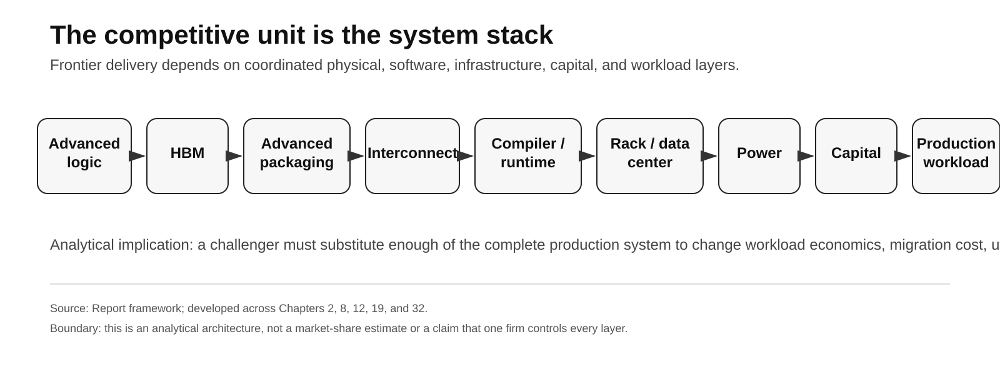
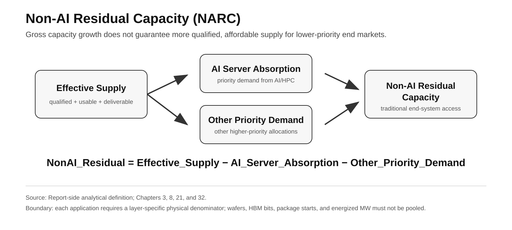
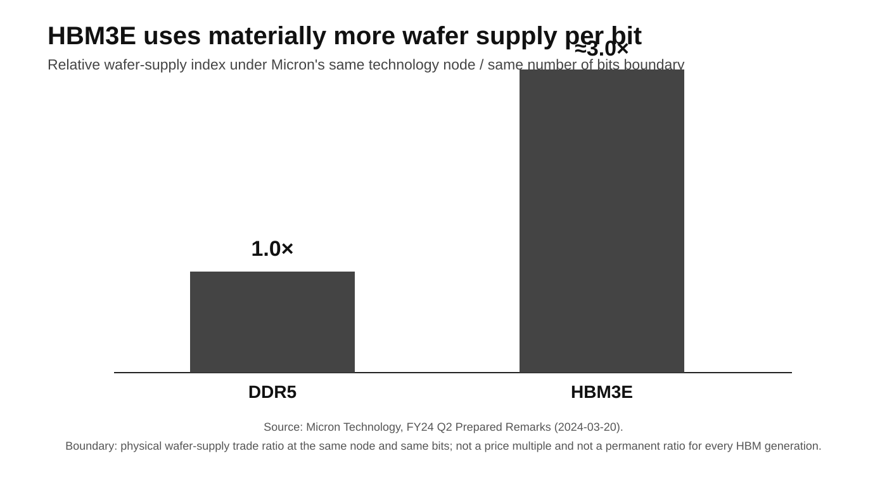
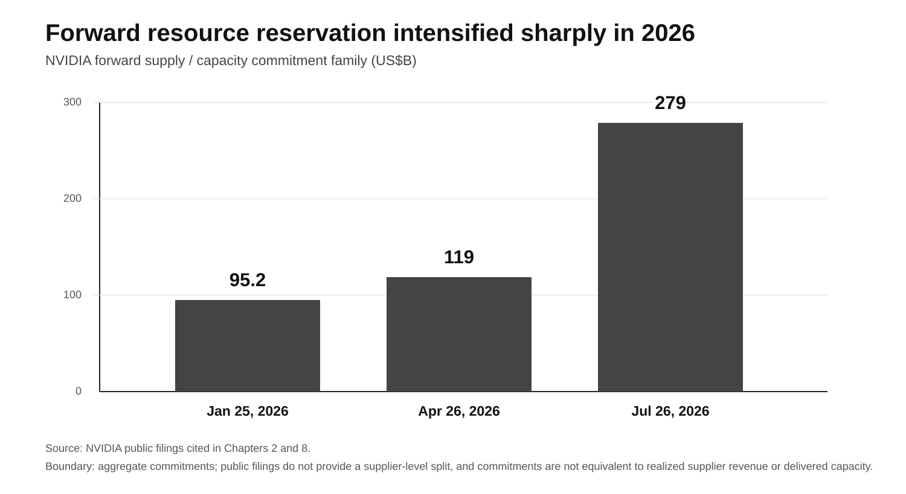
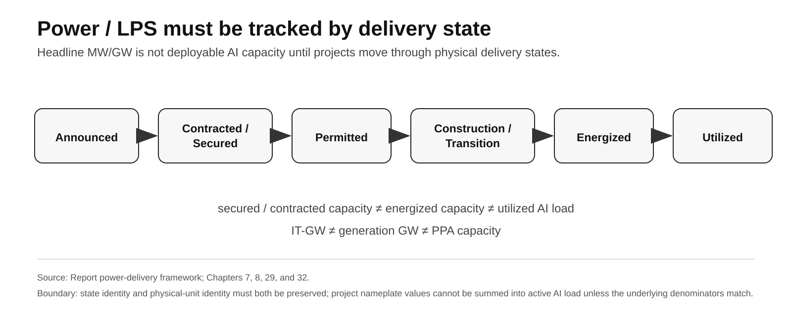
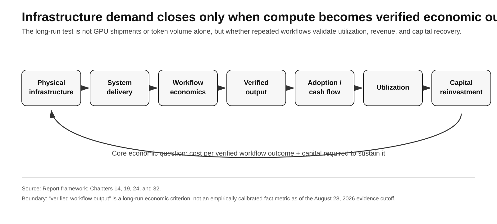
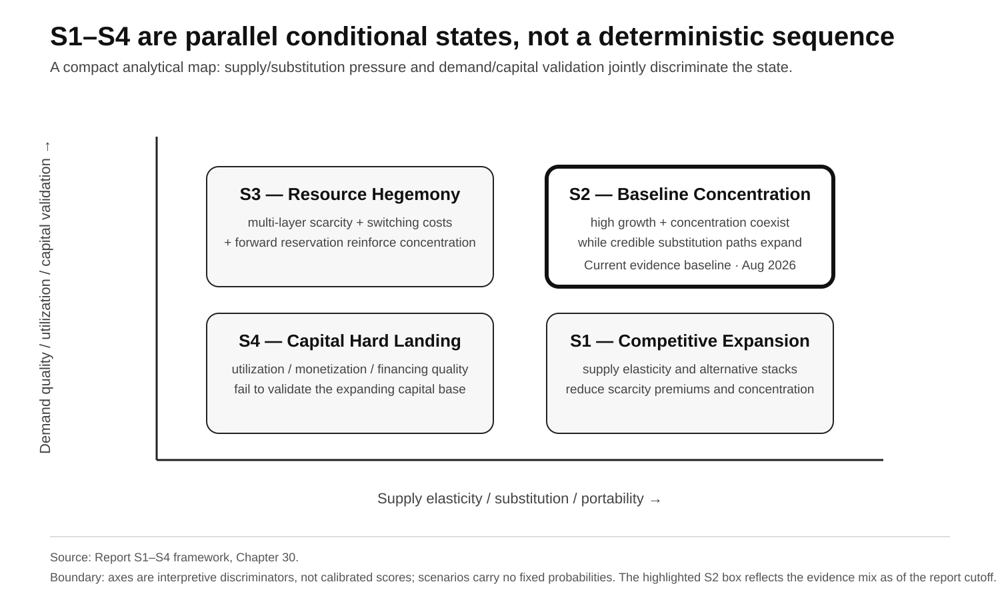

# Research Brief

## AI Infrastructure Reordering, 2026–2036

**Structural industry outlook on system-stack competition, semiconductor allocation, HBM, advanced packaging, power, capital formation, and end-market transmission**

**Evidence cutoff:** August 28, 2026  
**Edition revision:** September 14, 2026  
**Status:** publication-layer brief derived from the frozen 32-chapter canonical English report. It does not introduce a second analytical edition or new factual claims.

---

## Executive thesis

The AI infrastructure cycle is no longer best understood as a contest over the fastest accelerator.

The relevant competitive unit has shifted toward the complete production system:

> **advanced logic + HBM + advanced packaging + interconnect + compiler/runtime + rack/data center + power/LPS + capital + production workload**

That shift changes the industrial question. The central issue is not whether aggregate semiconductor or infrastructure supply grows. It is **which demand pools obtain the next unit of qualified capacity, how quickly bottlenecks move across layers, and whether installed compute ultimately converts into utilization, workflow output, revenue, and capital recovery.**

As of the report cutoff, the evidence mix is closest to **S2 — Baseline Concentration**:

> **high growth, strong leading platforms, scarce-layer concentration, and credible but incomplete substitution paths coexist.**

This is not a deterministic 2036 forecast. It is the current state that best fits the observed evidence under the report's scenario framework. The repository name and the historical "hegemony" label appear in the title lineage as the research question, not as a current finding; S3 — Resource Hegemony remains a conditional hypothesis with explicit reverse signals.



---

## 1. What is structurally different in 2026

Three changes matter most.

### 1.1 Platform competition has expanded into system competition

NVIDIA's current advantage is not adequately described by standalone GPU performance. Rack-scale systems combine accelerator compute, HBM, scale-up fabric, software, rack architecture, cooling, deployment tooling, and production migration cost.

Hyperscaler alternatives matter for the same reason. Google, AWS, Microsoft, Meta, and other system builders are not merely introducing alternative chips; they are trying to close enough of the surrounding stack that meaningful production workloads can move.

The relevant competitive test is therefore:

> **Can an alternative stack deliver production workloads with acceptable migration cost, utilization, reliability, supply assurance, and total economics?**

Neither a cheaper die nor a stronger isolated benchmark is sufficient by itself.

### 1.2 AI/HPC is changing the marginal destination of capital

TSMC reported that HPC represented **66% of 2Q26 revenue**, while 7 nm and below represented **77% of wafer revenue**.[^rb1] These measures do not prove customer-level wafer allocation, but they show the economic weight of advanced-compute demand in the foundry mix.

The report describes the resulting structure as a **Two-Speed Semiconductor Economy**:

- AI infrastructure demand can carry high willingness to pay, long commitments, prepayment capacity, and strong capital formation;
- traditional end systems remain important but may operate with lower bidding power, longer qualification clocks, and tighter BOM constraints.

The key variable is therefore not current capacity alone, but **which demand pool is increasingly able to induce the next increment of capacity.**

### 1.3 Gross supply and residual access are different variables

A market can add wafer, DRAM, packaging, or power capacity while traditional buyers still face weaker allocation, higher prices, or slower configuration upgrades.

The report therefore uses **Non-AI Residual Capacity (NARC)**:

```text
NonAI_Residual
= Effective_Supply
- AI_Server_Absorption
- Other_Priority_Demand
```



NARC is not a single universal percentage. It must be evaluated separately for each physical pool and qualification boundary.

---

## 2. The physical bottleneck is a moving system, not one permanent scarce component

The report rejects the idea that one layer—GPU, HBM, CoWoS, or power—must remain the dominant bottleneck for the entire decade.

Instead, the system can experience a **Rolling Bottleneck Cascade**:

> memory / packaging tightness → hardware delivery constraint → supply expansion → more systems reach sites → power / interconnection becomes binding → deployment slows → utilization and next-cycle commitments respond

The bottleneck can also move in the opposite direction if capacity is overbuilt relative to demand.

This matters because capital, procurement, and industrial strategy can be wrong even when the diagnosis of one layer is correct. A company can solve yesterday's bottleneck and still fail to deliver a usable system.

### HBM illustrates why denominator discipline matters

Micron disclosed that under a **same technology node / same number of bits** comparison, HBM3E requires approximately **3× the wafer supply of DDR5**.[^rb2]



This is a physical manufacturing trade ratio.

It is **not**:

- a price multiple;
- a claim that every HBM generation will require exactly 3×;
- a license to infer HBM economics from bit share alone.

The report keeps HBM bits, DRAM wafer input, packaging capacity, and rack deployment as separate denominators unless public evidence closes them on the same scope.

---

## 3. Forward commitments have become an industrial signal

When direct customer-level HBM, packaging, or rack allocation is unavailable, forward commitments provide a more defensible indicator of resource-reservation intensity than assumption-driven fleet arithmetic.

NVIDIA's disclosed **forward supply / capacity commitment family** rose across reporting dates from:[^rb3]

- **US$95.2B** on January 25, 2026;
- **US$119B** on April 26, 2026;
- **US$279B** on July 26, 2026.

The reporting label, mix, and duration are not identical across dates: the FY26 Form 10-K uses **manufacturing, supply, and capacity commitments**, while the FY27 Q2 Form 10-Q reports **supply and capacity commitments**. The sequence is therefore a forward-reservation indicator, not a homogeneous accounting time series.



The July figure is an aggregate company commitment. Public filings do not provide a supplier-level split.

The analytical implication is narrower but important:

> **high system economics can translate into stronger forward reservation power, which can improve delivery certainty across future system generations.**

This mechanism is self-reinforcing only while utilization, customer demand, financing quality, and supplier economics remain supportive.

---

## 4. Power has become part of compute delivery

Power should not be analyzed merely as an electricity-price input.

At modern rack densities, the limiting variable becomes **Time-to-Power**: how long it takes to move from project intent to energized, usable capacity for a real workload.

The report separates six project states:



The boundary is critical:

> **secured / contracted capacity ≠ energized capacity ≠ utilized AI load**

and:

> **IT-GW ≠ generation GW ≠ PPA capacity**

The PORTS-Pike structure is analytically important because it shows land, power, shell, credit support, and model-company demand being coordinated earlier in the infrastructure cycle. But its initial **4.25 IT-GW design capacity** remains planned future capacity, not current utilized AI load.[^rb4]

The industrial advantage is therefore not simply “having power.” It is being able to move qualified projects through permitting, interconnection, equipment procurement, construction, energization, and utilization inside the relevant hardware-generation window.

---

## 5. Model companies and capital markets are moving upstream

Leading model companies increasingly influence infrastructure formation rather than consuming only pre-existing cloud capacity.

The report calls this the **Anchor Compute Buyer Effect**:

> **long-duration workload demand → revenue visibility → financing certainty → earlier infrastructure buildout → earlier resource reservation**

This can strengthen the buildout when demand is durable and utilization follows.

It can also increase concentration, duration mismatch, and financing correlation.

The 2026 infrastructure-finance layer adds a second mechanism: **Financing Reflexivity**. Seller equity, credit enhancement, infrastructure support, and third-party capital can accelerate deployment, but they also make demand quality more dependent on financing structure.

PORTS-Pike makes the scale and boundary concrete: NVIDIA's FY27 Q2 Form 10-Q caps aggregate guarantee obligations at **US$105B** for leases covering approximately **4.25 GW of IT load**, with phased activation as data centers enter service. This is maximum conditional credit exposure, **not funded CapEx or current cash outflow**.[^rb5]

AMD provides an independent cross-vendor check: its Q2 2026 Form 10-Q reports **US$4.1B of maximum gross exposure** from guarantees tied to certain commercial-partner data-center lease obligations with terms up to 15 years. This is also maximum guarantee exposure rather than funded CapEx or realized loss.[^rb7] The financing mechanism is therefore broader than one supplier, while the instruments' denominators remain non-additive.

The report therefore distinguishes among:

1. independently financed end demand;
2. long-duration Anchor Buyer commitments;
3. third-party infrastructure capital;
4. supplier equity / credit support.

Large CapEx alone does not by itself establish either durable demand or a bubble.

The relevant question is whether the capital base is validated by **utilization, revenue, market clearing, customer cash generation, financing quality, and verified workflow output.**

---

## 6. Infrastructure demand must close through verified workflow output

A report that stops at GPUs, HBM, CapEx, or data-center capacity is incomplete. Those are the supply side. The ten-year industrial cycle ultimately depends on whether installed compute moves through software, enterprise workflows, and the physical world into verifiable economic output.

The relevant unit is:

> **cost per verified workflow outcome**

**AI inheritance.** Decades of information technology have already created software, databases, cloud systems, APIs, source code, identity/access systems, and traceable workflows. In highly digitized organizations AI can act as an intelligence / automation layer on that installed base:

> **Digital Installed Base → AI Overlay → Workflow Penetration → Automation Depth → Workload Volume**

**Agent-native software.** Traditional SaaS scales largely around accounts and seats; agent-native software continuously consumes inference, retrieval, tools/APIs, retries, observability, and human review. Cheaper models and better routing can cut resource intensity per attempt, but if lower prices unlock more users, longer agent loops, more tool calls, and previously uneconomic workflows, total compute demand can still expand.

**Physical AI** must clear a capital-payback test: the commercial threshold is not one completed task, but whether **Useful Tasks × Uptime × Deployment Scale** can cover **Energy + Maintenance + Human Supervision + Depreciation + Financing**.

**Labor.** Occupational exposure cannot be converted directly into job-loss forecasts; the chain runs through task suitability, workflow redesign, adoption economics, and responsibility.

Lower unit compute cost therefore does not by itself establish either lower total infrastructure demand or a Jevons-style increase in demand. Both depend on whether cheaper compute unlocks more verified workflows. If the supply, capital, and financing layers expand persistently faster than verified output, cash flow, and utilization, the risk of **S4 — Capital Hard Landing** rises structurally.

The demand-side loop is:

> **Physical Infrastructure → System Delivery → Workflow Economics → Verified Output → Adoption / Cash Flow → Utilization → Capital Reinvestment**



---

## 7. Traditional end systems remain important but may lose upstream priority

The report does not argue that smartphones, PCs, game consoles, vehicles, industrial equipment, robotics, aerospace, or other long-lifecycle systems become irrelevant.

The industrial risk lies elsewhere:

> **importance to end users does not automatically guarantee priority in upstream capital allocation.**

Exposure also differs by end market.

- Smartphones, PCs, and selected edge / ADAS systems can share advanced logic, memory, or selected packaging more directly with AI.
- Automotive and industrial systems are often affected through product mix, qualification rigidity, long lifecycle, and supplier allocation.
- Aerospace, defense, and other high-reliability low-volume systems can face continuity risk through mature-node economics, trusted supply, equipment, engineering talent, and special-process availability rather than direct HBM competition.

The relevant transmission channels are therefore:

- quantity assurance;
- lead time;
- configuration / memory-content decisions;
- component pricing;
- qualification flexibility;
- supplier product-mix incentives;
- lifecycle support.

This is why the report tracks **residual qualified supply**, not only global capacity growth.

---

## 8. China requires two separate closure tests

The report separates two questions that are often collapsed.

### Production-Grade Parallel Stack

Can an alternative system run real production workloads across:

- accelerator / compute;
- HBM-class or equivalent memory subsystem;
- advanced packaging;
- high-speed interconnect;
- compiler/runtime;
- production workload;
- utilization, reliability, and economics?

### Autonomous Frontier Closure

Can that stack continue scaling across generations when critical external inputs are constrained?

This additionally requires durable continuity across:

- advanced manufacturing;
- equipment, materials, software, and service;
- HBM / packaging;
- cross-generation process upgrades;
- power / LPS;
- capital formation.

A real production-grade parallel stack can exist without proving autonomous frontier closure.

At the August 28, 2026 evidence cutoff, China has a real frontier parallel stack with partial production deployment, but public evidence remains insufficient to confirm closure across all seven Production-Grade Gates. Autonomous Frontier Closure remains a still higher and unproven threshold.

Conversely, import dependence does not mean no production substitution exists.

---

## 9. The 2026–2036 outlook is conditional

The report uses four parallel states rather than one point forecast.



### S1 — Competitive Expansion

Supply elasticity rises, alternative stacks mature, portability improves, and scarcity premiums decline.

The S1 evidence strengthened within the August 28, 2026 evidence cutoff: AMD described Helios rackscale solutions as in production, while Meta committed to **up to 6 GW**, Anthropic to **up to 2 GW**, and Microsoft announced Azure deployment.[^rb6] These are deployment / shipment commitments rather than measured utilization or production-workload share, so they strengthen the competitive branch without displacing the current S2 baseline by themselves.

### S2 — Baseline Concentration

High growth and concentration coexist. Leading platforms and scarce-layer suppliers retain strong economics while substitution paths continue to expand.

**This is the current evidence baseline as of August 2026.**

### S3 — Resource Hegemony

Multiple scarce layers, quantity assurance / delivery access, switching costs, and financing coordination reinforce one another while workload monetization remains sufficient to support the associated commitments, increasing the cost of replicating a competitive system.

### S4 — Capital Hard Landing

Utilization, monetization, clearing prices, commitments, or financing quality fail to validate the expanding capital base across multiple actors and layers.

The scenarios are not sequential and do not carry fixed probabilities.

---

## 10. What would change the current view

The current S2 interpretation should not be defended against contrary evidence.

The highest-value reverse signals include:

- durable loosening in HBM and advanced packaging;
- large-scale alternative-stack production substitution with low migration cost;
- materially broader quantity assurance / delivery access across multiple qualified scarce layers;
- Time-to-Power shortening enough to stop differentiating high-value projects;
- major forward commitments being cancelled, rescheduled, or materially reduced;
- sustained deterioration in utilization, AI revenue, clearing prices, and customer cash generation;
- supplier-assisted financing increasing while independent financing and utilization weaken;
- new first-party evidence materially changing China's Production-Grade Gates or autonomous frontier closure;
- regulatory remedies materially changing interface access, tying, or entry conditions.

The framework is designed so that new evidence can change the conclusion.

---

## 11. Research discipline

The report uses:

> **F → H → M → S → X**

- **F — Fact:** observed and publicly verifiable;
- **H — Hypothesis:** a future input condition;
- **M — Mechanism:** the causal transmission;
- **S — Scenario:** a conditional future state;
- **X — Falsification:** evidence strong enough to force the judgment to change.

Evidence is also separated into:

- **A:** first-party / formal evidence;
- **B:** institutional / academic research;
- **C:** sell-side / supply-chain / media estimate;
- **D:** report-side calculation / sensitivity / scenario input.

The core rule is simple:

> **Future analysis can be strong, but the fact layer, denominator, evidence identity, and time identity must remain conservative.**

---

## Bottom line

The AI infrastructure buildout is best understood as a reordering of industrial priority across a complete delivery system.

The decisive variables are not GPU shipments alone.

They are:

- who can assemble and operate the system stack;
- who can secure the next unit of qualified scarce capacity;
- how quickly HBM, packaging, networking, and power constraints move;
- whether alternative stacks reduce migration cost and concentration;
- whether traditional end systems retain sufficient residual access;
- whether long-duration commitments and financing structures convert into utilization;
- whether installed compute produces verified workflow output and durable cash flow.

The current evidence supports **S2 — Baseline Concentration**; it does not support a conclusion of permanent monopoly, automatic competitive diffusion, or a confirmed capital hard landing.

For the complete evidence, denominators, counterarguments, and falsification boundaries, read the [32-chapter canonical English report](README.md), the [List of Figures](01-list-of-figures.md), and the [Core Evidence Ledger](../核心证据台账.en.md).


## Source anchors

[^rb1]: TSMC, 2Q26 Management Report, HPC 66%, smartphone 22%, and 7 nm-and-below technology mix, https://investor.tsmc.com/english/encrypt/files/encrypt_file/reports/2026-07/6f49632674bd2d0fd48cb65aaf89ec6ab510b559/2Q26%20ManagementReport.pdf
[^rb2]: Micron Technology, FY24 Q2 Prepared Remarks, HBM3E wafer-supply intensity versus DDR5 at the same node / same bits, https://s25.q4cdn.com/621799436/files/doc_financials/2024/q2/FY24-Q2-Prepared-Remarks.pdf
[^rb3]: NVIDIA Corporation, FY26 Form 10-K and FY27 Q2 Form 10-Q, forward supply / capacity commitment family across non-identical reporting labels and durations, https://www.sec.gov/Archives/edgar/data/1045810/000104581026000021/nvda-20260125.htm ; https://www.sec.gov/Archives/edgar/data/1045810/000104581026000075/nvda-20260726.htm
[^rb4]: NVIDIA / SB Energy, PORTS-Pike Exhibit 99.1 filed 2026-08-17, initial 4.25 IT-GW design capacity and phased buildout, https://www.sec.gov/Archives/edgar/data/1045810/000104581026000069/sbeoainvidia-portsrelease.htm

[^rb5]: NVIDIA Corporation, FY27 Q2 Form 10-Q, PORTS-Pike guarantees covering approximately 4.25 GW of IT load with aggregate obligations capped at US$105B and phased service expected to begin in FY2029, https://www.sec.gov/Archives/edgar/data/1045810/000104581026000075/nvda-20260726.htm

[^rb6]: AMD, Advancing AI 2026 / Helios official materials and customer deployment announcements: Helios described as in production; Meta up to 6 GW with first-gigawatt shipments from 2H26; Anthropic up to 2 GW with first-gigawatt deployment from 1H27; Microsoft Helios deployment on Azure, https://ir.amd.com/news-events/press-releases/detail/1294/aai-2026-amd-delivers-full-stack-compute-for-the-agentic-ai-era ; https://newsroom.amd.com/news/amd-and-meta-announce-expanded-strategic-partnersh/ ; https://newsroom.amd.com/news/amd-anthropic-strategic-partnership/ ; https://ir.amd.com/news-events/press-releases/detail/1291/microsoft-to-deploy-next-gen-amd-instinct-and-amd-epyc-processors-as-the-companies-expand-their-long-term-strategic-partnership

[^rb7]: Advanced Micro Devices, Inc., Q2 2026 Form 10-Q, US$4.1B maximum gross exposure from guarantees tied to certain commercial-partner data-center lease obligations with terms up to 15 years; exposure declines as contractual lease payments are made, https://www.sec.gov/Archives/edgar/data/2488/000000248826000123/amd-20260627.htm
