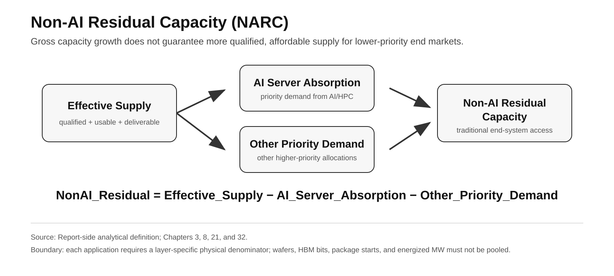

# Part I · Chapter 3: AI Resource Reallocation and Non-AI Residual Capacity

## 1. The claim: priority can change before absolute shortage appears

AI does not need to “take all capacity” to change semiconductor and infrastructure economics. Reallocation starts at the margin.

The report screens the following resource families for exposure when they are both **shared with AI/HPC demand and slow to expand**:

- advanced logic;
- HBM / selected DRAM;
- advanced packaging;
- high-end substrates / networking;
- selected power-management components;
- data-center power.

This list is a **report-side exposure taxonomy**, not a claim that one external source ranks all six as the industry's empirically "most exposed" resources.

The report uses **resource reallocation pressure** as shorthand for this mechanism; it is not treated as a separate empirical law:

> **When AI/server workloads offer higher risk-adjusted returns, longer order duration, stronger payment certainty, and better expected utilization, constrained supply and the next unit of capital tend to move toward that demand.**

The analytical object is therefore the **opportunity cost of the next qualified unit of scarce capacity**, not a claim that AI physically consumes every semiconductor category.

---

## 2. Mechanism: the opportunity cost of the next scarce unit

Resource reallocation can be described as:

> **high-value AI/server demand → higher expected return → product-mix / capacity-allocation shift → lower residual capacity for lower-priority demand**

The mechanism requires several conditions:

- capacity cannot expand quickly in the short run;
- different end markets share a physical or capital pool;
- AI/server customers can offer longer orders, prepayments, or greater purchasing certainty;
- suppliers expect higher risk-adjusted returns from the higher-value demand.

The mechanism is therefore not simply “a higher price.” It is a repricing of the **opportunity cost of the next unit of scarce resource**.

---

## 3. Markets clear through allocation as well as price

During severe shortages, markets do not clear through spot price alone.

Long-term agreements, customer credit, prepayments, purchasing scale, and allocation fulfillment affect how much volume a buyer actually receives.

TrendForce stated in January 2026 that after U.S. CSPs locked in part of available capacity, other buyers had to accept higher prices to secure supply allocation. In March 2026, it also reported that PC OEMs and module makers with lower allocation-fulfillment rates had to obtain incremental supply at higher prices.[^1][^2]

Therefore:

> **willingness-to-pay ≠ guaranteed quantity**

Resource pressure must be separated into two variables:

1. **Price Pressure:** how much a buyer must pay for the same quantity;
2. **Quantity Assurance:** whether the buyer can obtain enough volume on schedule even if it accepts the price.

For traditional end markets, the second variable can matter more than short-term spot pricing.

---

## 4. Residual capacity is the downstream denominator

Effective supply available to traditional markets can be represented as:

```text
NonAI_Residual(t)
= Effective_Supply(t)
- AI_Server_Absorption(t)
- Other_Priority_Demand(t)
```

This resolves a common analytical error:

> **Growth in total supply does not imply equal growth in supply available to traditional end markets.**

If total effective supply expands but AI/server absorption expands faster, Non-AI Residual Capacity can still decline.



**Figure 2 note:** Report-side analytical definition. Each application still requires a layer-specific physical denominator; wafers, HBM bits, package starts, and energized MW must not be pooled.

Evaluating whether smartphones, PCs, general servers, automotive, or industrial markets are returning to looser conditions therefore requires more than tracking:

- global wafer capacity;
- global DRAM bit growth;
- global packaging capacity;
- global power-project pipelines.

The relevant question is **how much effective residual supply those end markets can obtain within the same quality, qualification, generation, and delivery window**.

---

## 5. Reallocation changes capital formation, not just current supply

The long-run effect of resource reallocation extends beyond current allocation into the next round of capital formation.

The AI Infrastructure Economy and Traditional Device Economy share parts of the same advanced-logic, memory, packaging, and power-management resource base, but they differ in:

- willingness to pay;
- contract duration;
- prepayment structure;
- utilization visibility;
- BOM sensitivity;
- end-market price elasticity.

Suppliers are therefore deciding not only “who receives more capacity today,” but also:

> **which product class offers the higher risk-adjusted return on the next dollar of CapEx.**

The report uses **two-speed semiconductor economics** as shorthand for that divergence.

It is not a claim that consumer electronics are permanently sacrificed. The report treats the current evidence as **consistent with AI/HPC gaining greater influence over marginal semiconductor capital formation**, but public disclosures do not provide one complete time series that allocates semiconductor CapEx by end-demand pool.

---

## 6. Memory is the cleanest observed transmission path

Micron disclosed that, under **same technology node / same number of bits** conditions, HBM3E requires approximately **3× the wafer supply of DDR5**.[^3]

TrendForce forecasts HBM + RDIMM at approximately **51% of 2026 DRAM bit supply**.[^4]

These two anchors describe **different denominators** and should not be combined into one ratio. Micron's disclosure establishes a same-node / same-bits HBM3E wafer-input trade ratio, while TrendForce's 51% forecast combines HBM and RDIMM at the DRAM-bit-supply level.

Read together, they are directionally consistent with the report's view that server-memory demand can absorb manufacturing resources more intensively than a simple aggregate bit-share headline suggests, but they do **not** quantify one unified manufacturing-intensity multiplier.

The memory-layer transmission mechanism is therefore:

> HBM / server-memory demand rises → wafer / cleanroom / capital tilts toward higher-value products → conventional DDR/LPDDR residual supply changes → price / configuration / quantity-assurance pressure reaches traditional end markets

The boundaries remain important:

- 3× is a same-node / same-bits wafer-supply trade ratio;
- 51% (2026E) includes HBM + RDIMM;
- 51% is a 2026E forecast;
- neither figure can be rewritten as HBM wafer share.

---

## 7. Logic and packaging must remain separate denominators

TSMC's 2025 smartphone platform represented **29%** of annual net revenue, while HPC represented **58%**.[^5]

That establishes HPC as the largest revenue platform, but these are revenue-mix measures—not customer-level wafer allocation.

Leading-edge logic and advanced packaging must also remain separate:

- logic wafer availability does not guarantee a complete system can be delivered;
- packaging tightness does not imply equal customer allocation;
- customer revenue share cannot be converted into wafer share or CoWoS share.

Resource reallocation therefore cannot be summarized by one synthetic “AI share of global capacity.” It is a set of allocation shifts across different layers with different physical units.

---

## 8. Transmission depends on overlap, supply elasticity, and buyer power

Transmission into traditional markets depends on three conditions.

### Shared-resource overlap

The more an end market shares physical inputs with AI, the higher its exposure.

### Supply elasticity

The harder the resource is to expand quickly, the stronger the short-run pressure.

### Buyer bargaining power

Buyers with LTAs, purchasing scale, inventory, strong balance sheets, and end-market pricing power can absorb or delay the shock more effectively.

These end systems should not be placed into a universal “AI took the chips” funnel.

**Table 3.1 — Layered exposure of non-AI / Physical-AI end systems**

| End system | Main shared or adjacent upstream layers | Main transmission path | What can be inferred | What must not be inferred |
|---|---|---|---|---|
| Smartphone / PC | selected leading-edge SoC/GPU, LPDDR/DRAM, NAND, selected packaging | BOM, configuration, upgrade tax, replacement cycle, quantity assurance | observed memory / system-price pressure can raise the opportunity cost of shared resources[^11] | industry disappearance; a named customer losing a known wafer quantity |
| Game console | custom SoC/APU, GDDR/DRAM, NAND/SSD, selected packaging/test | BOM, promotion, hardware margin, long-generation cost-down, quantity assurance | Sony links memory procurement to hardware volume / promotion / profitability; TrendForce separately forecasts console-margin pressure[^12] | direct HBM competition; known wafers taken by AI; next generation must be delayed or repriced |
| Router / broadband | consumer DRAM/NAND, low bargaining power | higher price + weaker allocation | Counterpoint documents severe router / gateway memory-price and BOM pressure; quantity pressure remains buyer-specific[^13] | all end markets rise by the same multiple |
| Automotive / industrial / production lines | mature memory, MCU/analog, power, selected ADAS compute, packaging/test | lead time, qualification, EOL/part number, supply continuity | long qualification and long lifecycles reduce rapid substitution; adjacent product-mix shifts can matter | automotive electronics are directly “consumed” by GPU/HBM demand |
| Robotics / Physical AI | industrial control + sensors/actuation + edge accelerator + cloud retraining | industrial-electronics and edge-AI constraints can stack | **report-side system-exposure classification**; see Chapter 15 for the separate physical-AI evidence base | every robot needs frontier HBM; factories stop because AI took GPUs |
| Avionics / radar / space electronics | trusted/qualified logic, RF/power, rad-hard/rad-tolerant parts, special packaging/test | small-volume line economics, qualification, trusted access, long-lifecycle support | commercial high-volume markets can weaken small-volume special-demand bargaining power | aircraft, radar, or satellites are directly stopped by HBM shortage |
| Naval / other long-life defense systems | long-life qualified electronics, power/communications, trusted supply, maintenance spares | EOL, supplier longevity, small-volume economics | long-lived systems need sustained part-number and trusted-supply continuity | naval platforms “need NVIDIA capacity” |

**Source:** Chapter 21 smartphone / PC / game-console / consumer / industrial transmission evidence; NXP / ST automotive-longevity disclosures; U.S. GAO / DMEA trusted-microelectronics evidence; NASA/JPL space-radiation assurance materials.[^6][^7][^8][^9][^10]  
**Note:** The AI-era transmission strength differs substantially across the later rows. For defense / aerospace / space, the public evidence primarily establishes the structural weakness of low-volume, special, long-life, trusted supply in a commercial market; it does **not** establish AI/HPC as the direct cause of a specific program's cost or delay.

The key boundary is:

> **Resource Gravity is selective. The closer an end system is to shared advanced logic / memory / packaging, the more direct the transmission. The more it depends on trusted, long-life, RF/power, rad-hard, or special-process capacity, the more likely the channel runs through capital, equipment, engineering capacity, and supplier economics.**

Detailed transmission into pricing, configuration, replacement cycles, and observed examples belongs in [Chapter 21](part-III-ch21-consumer-transmission.md).

---

## 9. Reallocation is conditional, not a one-way law

Resource reallocation contains a self-correcting mechanism.

If AI/HBM demand absorbs enough supply to drive up conventional DRAM, other logic-product, or traditional-component pricing, the per-unit resource economics of non-AI products improve.

That can produce:

> **AI allocation rises → non-AI residual supply tightens → non-AI price / margin rises → supplier rebalancing incentive strengthens**

Likewise, if AI workload monetization weakens, utilization falls, or supply elasticity improves rapidly, resource reallocation pressure can weaken.

It is therefore not a permanent law that “AI always drains every resource.” It is a **dynamic capital-allocation mechanism**.

---

## 10. Observable signs of strengthening or weakening

Signals of **strengthening** include:

- larger AI/server forward commitments;
- HBM / advanced-packaging tightness persisting across generations;
- supplier product mix continuing to tilt toward high-value AI/server products;
- declining Non-AI Residual Capacity;
- widening gaps in quantity assurance;
- incremental CapEx becoming more explicitly centered on AI/HPC.

Signals of **weakening** include:

- materially higher supply elasticity;
- stronger traditional-product economics inducing supplier rebalancing;
- sustained reductions in HBM / packaging lead times;
- improved allocation fulfillment;
- weaker AI utilization / monetization;
- forward commitments being reduced or delayed.

---

## 11. Current read

As of August 2026, the report's synthesis of the cited allocation, memory, and platform-mix evidence is more consistent with:

> **resource reallocation pressure affecting selected shared scarce layers and changing the resource environment for traditional end markets through Non-AI Residual Capacity and quantity assurance.**

This is a **cross-source analytical judgment**, not a directly measured layer-by-layer Non-AI Residual Capacity series.

The process remains selective and dynamic, and it is subject to price feedback, supply expansion, and substitution.

The most accurate formulation is therefore not “AI is taking every chip.” It is:

> **AI is raising the opportunity cost of selected critical resources and changing how suppliers rank incremental capacity, product mix, and priority customers.**

## References

[^1]: TrendForce, 2026-01-05, CSP capacity locking and allocation pricing, https://www.trendforce.com/presscenter/news/20260105-12860.html
[^2]: TrendForce, 2026-03-31, allocation fulfillment and higher-price procurement by OEMs/module makers, https://www.trendforce.com/presscenter/news/20260331-12995.html
[^3]: Micron Technology, FY24 Q2 Prepared Remarks, 2024-03-20, HBM3E wafer-supply trade ratio versus DDR5, https://s25.q4cdn.com/621799436/files/doc_financials/2024/q2/FY24-Q2-Prepared-Remarks.pdf
[^4]: TrendForce, 2026-08-25, 2026E HBM + RDIMM share of DRAM bit supply, https://www.trendforce.com/presscenter/news/20260825-13198.html
[^5]: TSMC, 4Q25 Presentation / 2025 full-year platform mix, https://investor.tsmc.com/english/encrypt/files/encrypt_file/qr/phase4_reports/2026-01/2506fec872e6b99dc5391618ff38e3cd51ade2dd/4Q25%20Presentation%20%28E%29_WoG.pdf


[^6]: NXP Semiconductors, S32G Vehicle Network Processors, minimum 15-year product support under the Product Longevity program, https://www.nxp.com/products/processors-and-microcontrollers/s32-automotive-platform/s32g-vehicle-network-processors%3AS32G-PROCESSORS
[^7]: STMicroelectronics, 2025-09-08, selected SPC58 automotive MCUs extended to 20-year availability, https://newsroom.st.com/media-center/press-item.html/n4718.html
[^8]: U.S. GAO, 2015, Trusted Defense Microelectronics: Future Access and Capabilities Are Uncertain, low-volume unique defense needs and limited influence on commercial markets, https://www.gao.gov/products/gao-16-185t
[^9]: U.S. DMEA Trusted Access Program Office, Trusted Foundry / Trusted Supplier Program, guaranteed access for typically low-volume U.S. Government needs, https://www.acq.osd.mil/asds/dmea/tapo/trusted-supplier-programs.html
[^10]: NASA/JPL, Space Radiation Effects on Integrated Circuits, special design/fabrication and radiation-hardening requirements, https://parts.jpl.nasa.gov/asic/Appendix.3.html
[^11]: IDC, 2026-06-02, PC shipment / ASP / memory-shortage outlook, https://www.idc.com/resource-center/blog/pc-market-enters-volatile-territory-as-memory-shortage-persists-through-2027/ ; IDC, 2026-08-26, smartphone shipment / ASP / low-end viability outlook, https://www.idc.com/resource-center/blog/smartphone-shipments-set-for-record-16-7-drop-in-2026-as-the-memory-crisis-hits-full-force/
[^12]: Sony Group, FY2025 Q4 earnings speech / FY2026 outlook, memory procurement linked to PS5 hardware sales, promotion, and profitability, https://www.sony.com/en/SonyInfo/IR/library/presen/er/pdf/25q4_sonyspeech.pdf ; TrendForce, 2025-12-02, game-console memory-cost / margin outlook, https://www.trendforce.com/presscenter/news/20251202-12811.html
[^13]: Counterpoint Research, 2026-02-11, broadband memory-price surge and router BOM impact, https://counterpointresearch.com/en/insights/7times-memory-price-surge-threatens-telcos-broadband-router-set-topbox-supply
