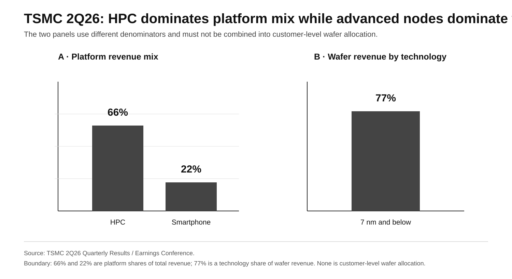

# Part I · Chapter 4: Advanced Logic Allocation — TSMC, N2, and the Next Unit of Qualified Capacity

## 1. The unit of analysis is qualified incremental capacity

Leading-edge logic is necessary but not sufficient for frontier AI. The relevant variable is not “who has access to an advanced node?” but **who can secure qualified incremental capacity at the required volume and timing while HBM, packaging, interconnect, power, and software are ready to convert that wafer output into a production system**.

The advanced-manufacturing question is therefore:

> **Who can repeatedly secure enough qualified N2/N2P/A16-class capacity, on schedule, without another layer becoming the binding constraint?**

A rumored wafer price does not answer that question. Volume, qualification, delivery timing, roadmap continuity, and cross-layer readiness do.

## 2. TSMC baseline: capacity, node mix, platform mix

**Table 4.1 — TSMC 2025 capacity, technology, and platform-revenue structure**

| Metric | 2025 |
|---|---:|
| 12-inch-equivalent wafer shipments | ~15.0M |
| annual capacity | >17M |
| 3 nm wafer-revenue share | 24% |
| 5 nm | 36% |
| 7 nm | 14% |
| ≤7 nm | 74% |
| HPC platform | 58% of net revenue; +48% YoY platform growth |
| Smartphone platform | 29%; +11% YoY platform growth |
| largest / second-largest customer | 19% / 17% of annual revenue |

**Source:** TSMC 2025 Annual Report, 2025 Form 20-F, and 4Q25 Presentation.[^1][^2][^3]  
**Note:** Platform share and node share are revenue-based metrics. Customer revenue share cannot be converted into wafer, node, or CoWoS allocation.

These figures show that HPC became TSMC's largest platform while TSMC continued to serve a broad customer base. They do not support the claim that TSMC has become a dedicated fab for any one customer.

## 2A. 2Q26: HPC remains a major marginal driver of advanced-manufacturing capital

TSMC's official 2Q26 results provide a current cross-section:[^8]

- HPC platform revenue mix: **66%**;
- smartphone: **22%**;
- advanced technologies at 7 nm and below: **77% of wafer revenue**;
- 2026 capital budget: **US$60B–64B**.

These remain revenue-mix and company-CapEx measures, not AI wafer allocation.

They support a narrower conclusion:

> **HPC has become one of the central marginal demand drivers of TSMC's advanced-manufacturing capital formation, while the company continues to raise investment in advanced processes and advanced packaging.**

**Figure 7 note:** TSMC first-party actuals with separate denominators. HPC 66% and smartphone 22% are platform shares of total revenue; 7 nm and below 77% is a technology share of wafer revenue. None is customer-level wafer allocation.

This strengthens the report's focus on the destination of the next marginal capital dollar, but it does not support claims that:

- 66% of wafers are AI;
- 77% of advanced-technology revenue belongs to NVIDIA;
- all US$60–64B of CapEx is AI-specific;
- smartphones have lost leading-edge access.

## 3. Revenue share is not an allocation denominator

The 2025 largest-customer share of 19% and second-largest-customer share of 17% are **annual-revenue ranking disclosures**.[^2]

They cannot be converted into N2 wafer share, 3 nm wafer share, CoWoS share, HPC wafer share, or physical wafer counts.

A different anonymized customer table supports year-over-year comparison: Customer A **12%→19%** and Customer B **22%→17%** from 2024 to 2025.[^4] The annual largest/second-largest ranking and the anonymized A/B series answer different questions and cannot be combined into a fictional longitudinal trajectory for one customer.

Likewise, HPC at 58% is a platform revenue share, not a wafer-shipment share.

## 4. N2 matters through launch access, scale, and continuity

N2 matters for more than transistor density. Competitors care about:

- timing of volume production;
- available scale;
- yield / delivery stability;
- HBM and packaging support;
- system-level performance conversion;
- roadmap continuity.

Access to a node does not by itself confer a system-level advantage. If memory, packaging, interconnect, or power are missing, complete-system delivery remains constrained.

## 5. Scarce-capacity access remains layer-specific

The report does not use a single cross-layer percentage to summarize access to advanced logic, HBM, packaging, networking, and power.

Those are different physical pools and must be evaluated separately.

The relevant questions are:

- how many qualified suppliers exist;
- whether buyers receive planned quantities on time;
- lead time and allocation fulfillment;
- long-term agreements / prepayments;
- delivery schedules;
- buyer credit quality;
- supply elasticity.

If reliable customer-level allocation data becomes available for one physical layer, a percentage can be used for that layer. It cannot be extended into a full-stack "resource capture share."

## 6. Allocation is multi-variable, not rank-deterministic

Advanced-capacity allocation is more likely to reflect a combination of price, committed volume, contract duration, prepayment, credit quality, utilization certainty, roadmap stability, customer diversification, and geopolitical risk.

The claim that "the number-one customer gets all the best resources" is therefore not supportable.

A more defensible mechanism is that order scale, credit, prepayment, and roadmap certainty increase a buyer's bargaining power over incremental resources, while suppliers retain incentives to diversify customers, protect long-run bargaining power, and manage geopolitical risk.

## 7. Packaging is a separate physical pool

TSMC first-party material confirms advanced-packaging tightness, but customer-level CoWoS allocation is not disclosed.[^5] TrendForce's estimate that NVIDIA represented more than 60% of 2025 CoWoS demand is B-grade institutional evidence.[^6]

No report-side packaging-geometry ratio is used in the formal analysis to infer rack output or customer allocation. Front-end logic wafers and back-end advanced-packaging capacity are different physical pools and cannot be divided into one another.

This is why "leading-edge logic available" and "complete AI system deliverable" are different questions.

## 8. Foundry share is not frontier-system substitution

TrendForce estimates 1Q26 foundry revenue shares at roughly **72% for TSMC**, **6.5% for Samsung Foundry (excluding System LSI)**, and **5.1% for SMIC**.[^7]

These are revenue shares, not frontier-AI capacity shares. A second supply system capable of substitution must also prove node performance, yield, advanced packaging, the HBM ecosystem, customer qualification, and software/system integration.

"Another foundry exists" and "a complete second frontier-AI supply stack exists" are therefore different propositions.

## 9. Current read

TSMC's strategic position rests on three conditions that currently coexist: strong leading-edge logic, HPC as its largest platform, and advanced packaging as a publicly confirmed growth constraint.

The key forward variables are not one quarter's customer revenue shares, but who can secure incremental N2/N2P/A16-class capacity, how HBM and packaging supply evolve, how cloud custom silicon competes for new capacity, and whether a second manufacturing system can deliver a credible logic + packaging + memory alternative.

## 10. What would change the view

Signals that should reduce TSMC's leading-edge strategic leverage include:

- a second foundry achieving independently verifiable, large-scale external production at the same-generation node;
- customer qualification, yield, delivery, and advanced packaging combining into a real substitute;
- N2/N2P/A16 supply elasticity improving materially faster than demand growth;
- advanced-packaging constraints disappearing on a sustained basis;
- leading-edge workloads migrating materially toward another manufacturing system.

A higher foundry revenue share alone, a single technology demonstration, or policy subsidies are not sufficient to establish an equivalent frontier-manufacturing second source.

## References

[^1]: TSMC, 2025 Annual Report, https://investor.tsmc.com/static/annualReports/2025/english/index.html
[^2]: Taiwan Semiconductor Manufacturing Company Limited, 2025 Form 20-F, U.S. SEC, https://www.sec.gov/Archives/edgar/data/1046179/000162828026025362/tsm-20251231.htm
[^3]: TSMC, 4Q25 Presentation / 2025 full-year platform and technology mix, https://investor.tsmc.com/english/encrypt/files/encrypt_file/qr/phase4_reports/2026-01/2506fec872e6b99dc5391618ff38e3cd51ade2dd/4Q25%20Presentation%20%28E%29_WoG.pdf
[^4]: TSMC, 2025 Consolidated Report, anonymized Customer A/B revenue series, https://www.sec.gov/Archives/edgar/data/1046179/000104617926000024/a2025q4consolidatedreport-.htm
[^5]: TSMC, 2Q26 Earnings Conference Transcript, advanced-packaging tightness, https://investor.tsmc.com/english/quarterly-results/2026/q2
[^6]: TrendForce, 2025 CoWoS demand structure, NVIDIA estimated >60%, B-grade institutional estimate, https://www.trendforce.com/research/download/RP250314ZJ
[^7]: TrendForce, 2026-06-12, 1Q26 foundry revenue shares, https://www.trendforce.com/presscenter/news/20260612-13095.html
[^8]: TSMC, 2Q26 Quarterly Results / Earnings Conference, platform mix, advanced-technology revenue mix, and 2026 capital budget, https://investor.tsmc.com/english/quarterly-results/2026/q2
