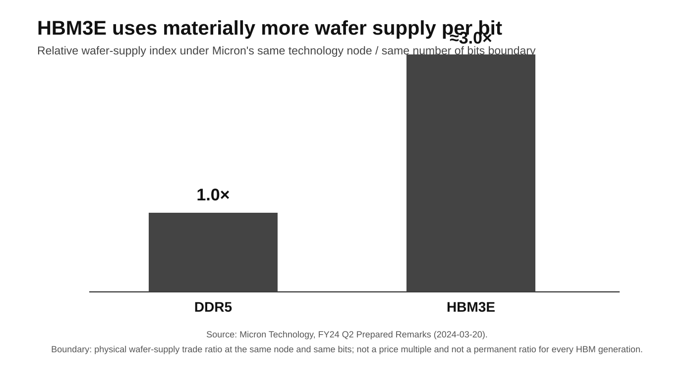

# Part I · Chapter 5: HBM Economics — Manufacturing Intensity, Residual Capacity, and Memory Scarcity

## 1. The memory question is manufacturing intensity, not bit demand alone

HBM should not be treated as just another GPU BOM line. In frontier systems it affects model capacity, batching, context length, concurrency, communication, and accelerator utilization; at rack scale, its manufacturing intensity becomes a system-level capacity constraint.

The industrial question is broader than "how many HBM bits are demanded?" It is:

> **How much wafer input, cleanroom space, packaging capacity, qualification effort, and capital does each unit of high-value memory absorb, and what residual supply remains for conventional DRAM?**

That is why HBM can reprice the broader memory system **even if** aggregate DRAM bit capacity continues to grow.

## 2. Micron's ~3× disclosure is the first-party manufacturing anchor

Micron's FY24 Q2 prepared remarks provide a clear boundary: at the **same technology node and for the same number of bits**, HBM3E requires approximately **3× the wafer supply of DDR5**.[^2] Micron's FY25 10-K further confirms that producing the same number of HBM bits requires more wafers and cleanroom space.[^3]

This evidence supports the following conclusions:

- HBM3E consumes more manufacturing input per bit than DDR5;
- HBM expansion places greater pressure on DRAM wafer / cleanroom input;
- effective residual capacity for conventional DRAM can face stronger pressure.

It does **not** mean that HBM is priced at 3× DDR5, nor can it be treated as an immutable "3:1 law" for every fab and every HBM generation. Micron's FY25 Q2 prepared remarks add a forward-looking generation boundary: the company expects the trade ratio to rise with HBM4 and to rise again with HBM4E, where it expects the ratio to **exceed 4:1**.[^7] That is a vendor expectation, not a realized industrywide production ratio.

**Figure 3 note:** Micron first-party physical trade ratio under the same-node / same-bits boundary. The relative index is not a price multiple and must not be extrapolated mechanically to later HBM generations.

## 3. The 51% forecast uses a different denominator

TrendForce **forecasts** that **HBM + RDIMM together will account for roughly 51% of 2026 DRAM bit supply**.[^4] This B-grade institutional forecast must retain three boundaries:

1. the 51% includes **HBM and RDIMM** and cannot be rewritten as "51% of DRAM is HBM";
2. it is a **bit-supply** share, not a wafer share;
3. it is a **2026E forecast**, not completed full-year actuals.

Combined with Micron's same-bit wafer trade ratio, this creates a more important mechanism: **bit share does not fully capture manufacturing-input pressure.** When a high-value bit requires more wafer and cleanroom input, its impact on manufacturing resources can exceed its share of bits.

## 4. Residual capacity is the downstream denominator

Memory reallocation can be expressed as a clear transmission chain:

**AI/server memory demand rises → HBM/RDIMM mix rises → wafer / cleanroom / packaging input shifts toward high-value products → conventional DDR/LPDDR residual capacity tightens → non-AI end markets face greater price and configuration pressure.**

The key variable is not total global DRAM capacity. It is the effective supply actually left for consumer electronics and other traditional workloads after AI/server demand has absorbed the priority resources.

This is why the report uses **Non-AI Residual Capacity** as the central memory metric rather than treating gross DRAM-capacity growth as proof that traditional markets have returned to abundance.

## 5. HBM has changed memory-vendor economics

SK hynix reported FY25 revenue of **KRW97.1467T**, operating profit of **KRW47.2063T**, operating margin of **49%**, and net income of **KRW42.9479T**, while stating that HBM revenue more than doubled year over year.[^5]

These figures do not prove that HBM alone generated all profit, but they are sufficient to show that high-value memory product mix has materially improved memory-vendor economics. Conventional server memory remains important as well, reinforcing the point that HBM and DDR5/RDIMM are not fully isolated capital and manufacturing systems.

## 6. Supply is concentrated; the public denominator is incomplete

High-end HBM supply is concentrated primarily among SK hynix, Samsung, and Micron. The barriers are not just DRAM-fab CapEx. They also include:

- TSV / stacking;
- yield learning;
- advanced-packaging integration;
- customer qualification;
- generation timing;
- high-volume manufacturing stability.

Public first-party material is insufficient to construct a fully comparable and auditable three-vendor HBM market-share table. Media or sell-side estimates are therefore not upgraded into company-official share data.

### 6.1 Price feedback limits one-way scarcity narratives

Resource reallocation contains a price-feedback mechanism. TrendForce's June 2, 2026 model estimate found that after conventional DRAM prices rose sharply from the second half of 2025, **DDR5 64GB RDIMM per-wafer revenue exceeded HBM in 1Q26**; the same research estimated HBM profitability below that of DDR5 64GB RDIMM.[^6]

This is B-grade institutional estimation, not product-level realized gross-margin disclosure from Samsung, SK hynix, or Micron. Its analytical value is the self-correcting mechanism it reveals:

> HBM/AI demand rises → conventional-DRAM residual supply tightens → DDR5/RDIMM prices rise → conventional-DRAM per-wafer economics improve → the relative incentive for further HBM conversion declines → memory vendors rebalance product mix.

Resource reallocation is not an infinitely one-way process. Long-run allocation depends on risk-adjusted return per scarce manufacturing input, qualification, yield, generation transitions, and customer-contract structure.

## 7. Rack specs show intensity, not industry demand

GB200 NVL72's **13.4 TB of HBM3E per rack** is a useful system-level material identity.[^1]

It shows that once procurement moves from an accelerator card to a rack-scale system, memory intensity must also be evaluated at the system level.

But without a public rack shipment or deployment count, the specification cannot be scaled into an industry PB-demand estimate.

The boundary is:

> **Per-system HBM specifications can describe memory intensity; industry demand still requires observed shipments, customer demand, or memory-vendor supply data.**

## 8. HBM4 raises cross-layer capital density; later-generation ratios must retain forecast identity

The complexity of next-generation HBM comes not only from higher stack counts. It can also involve logic base dies, advanced foundry processes, packaging, testing, and qualification.

If logic base dies use more advanced processes, the memory bottleneck extends further into foundry and packaging:

**HBM vendor → logic base die → advanced foundry → advanced packaging → accelerator qualification**

HBM can evolve from a "memory bottleneck" into a system bottleneck spanning memory, foundry, and packaging. Micron has already disclosed that it expects the trade ratio to rise with HBM4 and for HBM4E to **exceed 4:1**.[^7] That forward-looking disclosure still cannot be rewritten as "HBM4 is already 4×" or as a realized industrywide ratio, and one 12-Hi or 16-Hi configuration cannot be treated as the universal HBM4 production standard.

## 9. HBM does not clear like a standard commodity-memory cycle

One important difference between HBM and standard commodity memory is generation-specific qualification. Product generations move quickly, they are closely tied to accelerator generations, qualification cycles are long, and obsolescence risk is higher.

This can produce:

> **looser supply in an older HBM generation while the next frontier generation remains constrained.**

Oversupply in one generation does not by itself solve qualification, yield, and packaging constraints in the next.

## 10. Inference can shift the bottleneck without eliminating memory economics

Some inference workloads can trade bandwidth for lower-cost DDR/LPDDR, but frontier inference still faces KV-cache, long-context, large-batch, MoE-routing, low-latency serving, and multi-accelerator communication constraints.

More importantly, RDIMM is already included in TrendForce's forward AI/server memory structure. Shifting some workloads from HBM toward DDR5 changes the cost/bandwidth tradeoff inside a broader shared memory-resource pool instead of creating an independent supply base.

## 11. Current read and falsification

HBM scarcity is not inevitable. The current mechanism would weaken materially if:

- memory architecture sharply reduces dependence on high-bandwidth stacked memory;
- algorithmic efficiency persistently lowers memory bandwidth / capacity demand;
- the HBM wafer/cleanroom trade ratio improves materially;
- stacking, yield, logic-base, and advanced-packaging supply elasticity rises sharply;
- conventional DRAM and HBM manufacturing resources become much more decoupled.

The long-run claim is not that "HBM will always be scarce." It is:

> **As long as frontier-system bandwidth demand grows faster than HBM supply elasticity and manufacturing input per bit remains materially above conventional DRAM, HBM is likely to remain a core scarce layer of AI infrastructure.**

## References

[^1]: NVIDIA, “GB200 NVL72,” official product page, https://www.nvidia.com/en-us/data-center/gb200-nvl72/
[^2]: Micron Technology, FY24 Q2 Prepared Remarks, 2024-03-20, HBM3E ≈3× DDR5 wafer supply at same node / same bits, https://s25.q4cdn.com/621799436/files/doc_financials/2024/q2/FY24-Q2-Prepared-Remarks.pdf
[^3]: Micron Technology, FY25 Form 10-K, HBM wafer and cleanroom requirements, U.S. SEC, https://www.sec.gov/Archives/edgar/data/723125/000072312525000028/mu-20250828.htm
[^4]: TrendForce, 2026-08-25, 2026E HBM + RDIMM share of DRAM bit supply, https://www.trendforce.com/presscenter/news/20260825-13198.html
[^5]: SK hynix, FY25 Financial Results, https://news.skhynix.com/en/sk-hynix-announces-fy25-financial-results/
[^6]: TrendForce, 2026-06-02, per-wafer revenue comparison for HBM and DDR5 64GB RDIMM, https://www.trendforce.com/presscenter/news/20260602-13074.html

[^7]: Micron Technology, FY25 Q2 Prepared Remarks, 2025-03-20, HBM trade ratio expected to rise with HBM4 and to exceed 4:1 with HBM4E; forward-looking vendor expectation, https://investors.micron.com/static-files/52ce0c07-49dc-4eab-b1d2-a67bde373bca
