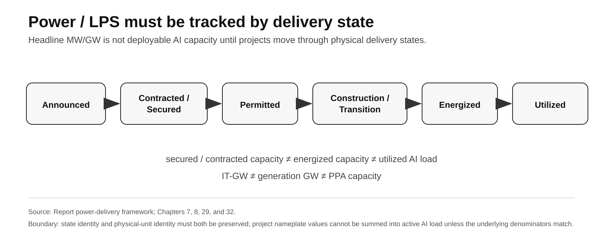
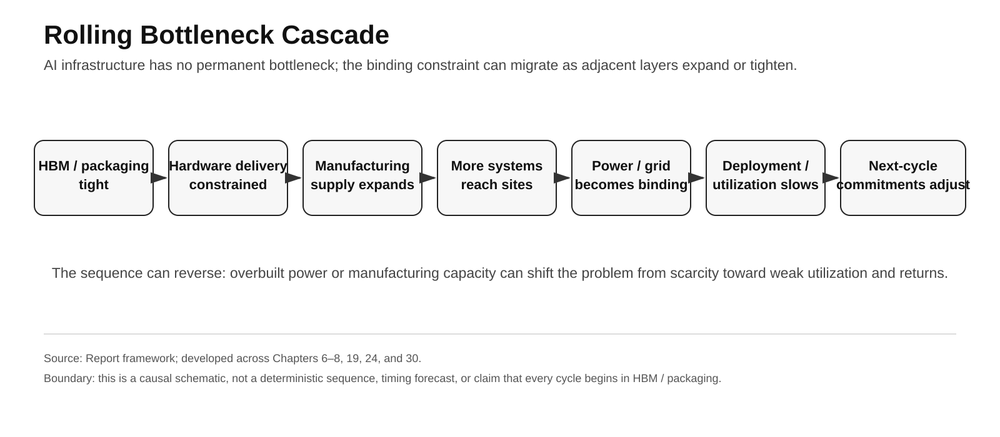

# Part I · Chapter 7: Time-to-Power — From Rack Density to Deployable AI Capacity

## 1. The power question is deployable capacity, not electricity price

At roughly **120 kW/rack**, power is no longer just an operating-cost input. It becomes a deployment gate.[^1]

A D-grade stress conversion makes the scale visible:

> 500 racks × 120 kW/rack = **60 MW of rack-level full-load power**

This does not describe any specific campus and excludes facility overhead. It shows why hundreds of dense racks quickly pull **powered land, interconnection, substations, transformers, cooling, firm generation, and permitting** into the same delivery chain as chips and HBM.

The relevant industrial variable is therefore:

> **Time-to-Power: how long it takes to move from project intent to energized, usable capacity for a real AI workload.**

## 2. Power requires a delivery-state model

Power / LPS projects should be separated into six states:

> **Announced → Contracted / Secured → Permitted → Construction / Transition → Energized → Utilized**

A 1 GW PPA cannot be rewritten as "1 GW of AI compute online." A secured LPS position or future IT-GW design capacity cannot be treated as energized load, and a 500 MW development target cannot be converted directly into an active rack count. The real economic value of a project depends on how far it has advanced from announcement toward high-utilization delivery—not on the maximum MW/GW in a headline.

Generation MW/GW, PPA capacity, IT-GW, energized facility load, and utilized AI load must retain their distinct physical identities.

**Figure 5 note:** Report framework. State identity and physical-unit identity must both be preserved; project nameplate values cannot be summed into active AI load unless the underlying denominators match.

## 3. Representative projects sit on different delivery clocks

### 3.1 Microsoft / Constellation: restarting an existing ~835 MW nuclear asset

Microsoft and Constellation entered a **20-year PPA** supporting the restart of the former Three Mile Island Unit 1 as the Crane Clean Energy Center, with an approximately **835 MW** public capacity anchor.[^2]

The case shows how hyperscaler demand can support a large existing power asset returning to service.

But 835 MW is a project / unit-capacity anchor, not evidence that 835 MW is already being delivered in real time to AI data centers. The project still sits on regulatory, repair, restart, interconnection, and commercial-operation clocks.

Constellation's official release states that the restart requires significant investment but does **not** disclose a US$1.6B restart CapEx figure. That number therefore does not enter this chapter's fact layer.

### 3.2 Talen / AWS: a revised PPA of up to 1,920 MW

The Talen/AWS revised PPA has a full contract quantity of **up to 1,920 MW** and runs through 2042.[^3]

Talen's 2026 Q2 10-Q states that the transition to the revised AWS PPA **occurred in April 2026**. An earlier 2025 10-K had stated that **full transition was expected in spring 2027**.[^3][^4]

April 2026 can therefore be used as the current disclosed status of the revised-PPA transition. It **cannot** be interpreted as proof that every physical conversion, transmission modification, and full-delivery step had already been completed.

The relevant forward indicators are the capacity ramp, energized MW, AWS load, and utilization.

This case shows that regulation and commercial structure can change the delivery path for power without making large-scale AI electricity demand disappear.

### 3.3 Google / Kairos: 50 MWe in 2030 and up to 500 MWe by 2035

The Google/Kairos public timeline is much longer: **Hermes 2 up to 50 MWe in 2030**, followed by a fleet of **up to 500 MWe by 2035**.[^5]

This is better understood as a long-duration supply option, an industrial-learning path, and a capacity hedge—not as near-term power available to AI campuses in 2026–2028.

The near-term value of SMRs therefore lies mainly in future optionality; they should not be used to erase today's interconnection, transformer, and powered-site constraints.

### 3.4 PORTS-Pike / NVIDIA / SB Energy / OpenAI: secured LPS with initial 4.25 IT-GW design capacity

On **August 17, 2026**, NVIDIA disclosed a different infrastructure structure at the PORTS-Pike Technology Campus: NVIDIA is providing credit support for land, power, and shell buildout with SB Energy; the initial deployment is designed to support **4.25 IT-GW**; OpenAI will use the site; and SB Energy will build, own, and operate the data center.[^7]

Planned capacity is expected to come online in phases beginning in **2028**.

This makes secured LPS a more direct precursor to deployable compute than a generic headline PPA. But **4.25 IT-GW is still design / planned capacity, not 2026 energized or utilized AI load**.

## 4. Project capacities cannot be summed into active AI load

The project numbers above do not share one physical identity. Generation MW/MWe, PPA capacity, and IT-GW design capacity sit at different layers and cannot be added into one active AI-load figure.

**Table 7.1 — Representative AI power / LPS pathways**

| Project | Nominal scale | Primary status |
|---|---:|---|
| Crane / Microsoft | ~835 MW | restart + regulatory process |
| Talen / AWS | up to 1,920 MW | revised-PPA transition / ramp |
| Kairos / Google | 50 MWe in 2030; up to 500 MWe by 2035 | long-duration development |
| PORTS-Pike / NVIDIA / SB Energy / OpenAI | initial 4.25 IT-GW design capacity | LPS secured / future phased buildout from 2028 |

**Source:** Constellation, Talen Energy, Kairos Power / Google, and NVIDIA.[^2][^3][^4][^5][^7]  
**Note:** Generation MW/MWe, PPA capacity, and IT-GW design capacity are different physical quantities. Their contract, permitting, construction, energization, and utilization states must remain separate.

These pathways represent different infrastructure mechanisms: restarting an existing large generator, restructuring a large-load PPA, developing next-generation nuclear supply, and securing land + power + shell for future AI-factory buildout. Their maturity, units, clocks, and utilization dates are not directly comparable.

## 5. Grid queues measure friction, not AI demand

Berkeley Lab's Queued Up data show that active U.S. generation/storage interconnection requests peaked near **2,600 GW at the end of 2023** and stood at approximately **2,061 GW at the end of 2025**.[^6]

These numbers cannot be converted into "the United States lacks 2,061 GW of data-center power." The queue is primarily generation/storage projects and includes projects that may withdraw, duplicate one another, or experience long delays.

The narrower supported conclusion is that **interconnection and transmission buildout can take years, making Time-to-Power a real constraint.**

What matters for AI system delivery is how many MW a specific region can actually deliver inside a specific hardware-generation window—not the total GW sitting in a national queue.

### 5A. Grid delivery has an equipment-procurement clock

Time-to-Power is also constrained by the supply chain of the grid itself. The IEA reports that new transmission lines can take **four to eight years** in advanced economies, while procurement wait times for critical grid components have lengthened materially.[^8] A separate IEA transmission-supply-chain review reports typical procurement of **two to three years for cables** and **up to four years for large power transformers**, with average lead times for both almost doubling since 2021.[^9]

### Table 7.2 — Grid delivery frictions relevant to Time-to-Power

| Constraint | Public institutional anchor | Correct interpretation |
|---|---|---|
| New transmission | 4–8 years in advanced economies | broad grid-build clock; not a project-specific AI-data-center lead time |
| Cables | 2–3 years procurement | component-supply constraint inside transmission / interconnection delivery |
| Large power transformers | up to 4 years procurement | equipment bottleneck that can delay substation / grid delivery |
| Interconnection queue | multi-year studies and high withdrawal rates | friction indicator; not a direct measure of unmet AI demand |

**Source:** IEA and Lawrence Berkeley National Laboratory.[^6][^8][^9]  
**Note:** These are grid-system and equipment-supply anchors, not a claim that every AI campus faces the same lead time. They strengthen the narrower conclusion that energized capacity is constrained by **permitting + interconnection + equipment procurement + construction**, not by generation nameplate alone.

This also sharpens the delivery-state boundary: a project can have land, a PPA, and a financing plan while still lacking a timely transformer, cable, substation, or grid-connection path.

## 6. Time-to-Power is a system-competition variable

Advanced chips can advance on monthly and quarterly product clocks. Power infrastructure often advances on multi-year clocks.

That creates a variable comparable in importance to the chip roadmap:

> **Time-to-Power**

Projects with existing grid interconnection, powered land, substation / transformer capacity, firm generation, and executable permitting paths gain a timing advantage.

Hyperscaler competition is therefore not only about who acquires more accelerators. It is also about a **deployment-timing question at scale**:

> **who can energize the next 50 MW / 100 MW / 500 MW of systems sooner.**

The 50 / 100 / 500 MW values are scenario-scale markers used to illustrate Time-to-Power; they are not disclosed project capacities.

## 7. Power can become binding after semiconductor supply eases

AI infrastructure does not have a single permanent bottleneck.

One possible **Rolling Bottleneck Cascade** is:

> HBM / advanced packaging tight → hardware delivery constrained → manufacturing supply expands → more racks reach sites → power / interconnection becomes binding → deployment and utilization slow → next-cycle hardware orders / commitments decelerate

**Figure 8 note:** Report causal framework. The sequence is schematic rather than deterministic; a cycle can begin in another layer, and overbuild can reverse the mechanism from scarcity toward weak utilization and returns.

The reverse is also possible. If power infrastructure is built far ahead of workload demand, the problem can shift from scarcity to low utilization and weak capital returns.

"Power is now a core constraint" and "power is not yet the sole dominant bottleneck" can therefore both be true.

## 8. Power contracts and compute assets run on different clocks

AI servers have shorter technological and economic lives than major power assets and long-duration PPAs.

Crane involves a **20-year PPA**, while compute hardware will turn over much faster.[^2] This creates a classic duration mismatch:

> **shorter-cycle compute asset vs. longer-cycle power / infrastructure asset**

In high-demand scenarios, long-duration power access can be a moat. In S4 Capital Hard Landing, the same long-duration obligation can become a burden.

Power contracts therefore need to be evaluated through duration, ramp, take-or-pay / cancellation terms, project execution, utilization, and residual value.

## 9. When does power become the binding constraint?

Power should be upgraded from "one of the core constraints" to "the dominant constraint" only if several signals appear together:

- major buyers repeatedly disclose power/interconnection as the binding growth ceiling;
- delivered hardware sits idle waiting to be energized;
- energized capacity persistently lags deployment plans;
- next-generation orders are delayed by power constraints;
- Time-to-Power remains a decisive differentiator for high-value powered sites;
- utilization and capital returns deteriorate systematically because of power-delivery timing.

As of August 2026, public evidence supports a narrower conclusion:

> **Power has joined HBM and advanced packaging as a core physical constraint, but the evidence is not yet sufficient to show that power alone dominates the entire AI-infrastructure expansion rate.**

## 10. What would change the view

The judgment that power / LPS is a core AI-infrastructure constraint should be downgraded if the following conditions persist:

- Time-to-Power shortens materially;
- secured / contracted projects convert into energized capacity at high and predictable rates;
- transformers, substations, grid interconnection, and cooling stop causing major deployment delays;
- energized capacity grows persistently faster than deployable compute demand;
- regional power price / availability stops materially affecting site selection.

Headline GW growth alone is not sufficient evidence that the power bottleneck has disappeared. The relevant test is the speed of state transition into energized capacity and actual utilization.

## References

[^1]: NVIDIA, DGX GB200 Hardware Guide, rack power approximately 120 kW, https://docs.nvidia.com/dgx/dgxgb200-user-guide/hardware.html
[^2]: Constellation, Crane Clean Energy Center / Microsoft 20-year PPA and approximately 835 MW unit, https://investors.constellationenergy.com/news-releases/news-release-details/constellation-launch-crane-clean-energy-center-restoring-jobs
[^3]: Talen Energy, 2026 Q2 Form 10-Q, revised AWS PPA transition and up to 1,920 MW, U.S. SEC, https://www.sec.gov/Archives/edgar/data/1622536/000162253626000066/tln-20260630.htm
[^4]: Talen Energy, 2025 Form 10-K, expected full transition timing, U.S. SEC, https://www.sec.gov/Archives/edgar/data/1622536/000162253626000017/tln-20251231.htm
[^5]: Kairos Power / Google partnership, Hermes 2 up to 50 MWe in 2030 and fleet up to 500 MWe by 2035, https://www.kairospower.com/google
[^6]: Lawrence Berkeley National Laboratory, “Queued Up” 2026 update, active interconnection queue, https://emp.lbl.gov/news/backlog-power-plants-seeking-transmission-grid-connection-eased-somewhat-2025-amidst
[^7]: NVIDIA, “NVIDIA Guarantees SB Energy's PORTS-Pike Technology Campus in Ohio to Exclusively Host NVIDIA AI Compute,” 2026-08-17, https://investor.nvidia.com/news/press-release-details/2026/NVIDIA-Guarantees-SB-Energys-PORTS-Pike-Technology-Campus-in-Ohio-to-Exclusively-Host-NVIDIA-AI-Compute/default.aspx

[^8]: International Energy Agency, “Energy and AI — Executive summary,” grid-connection queues, transmission lead times, and critical-component delays, https://www.iea.org/reports/energy-and-ai/executive-summary
[^9]: International Energy Agency, “Building the Future Transmission Grid — Executive summary,” cable and large-transformer procurement lead times, https://www.iea.org/reports/building-the-future-transmission-grid/executive-summary
