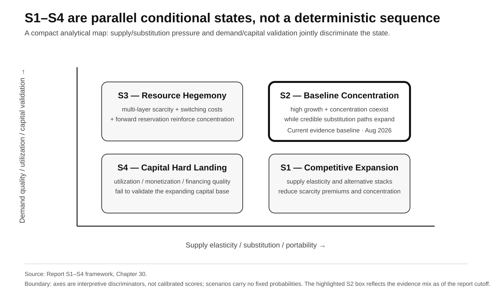

# Part IV · Chapter 30: Scenario Framework — Distinguishing S1–S4

## 1. Scenarios are conditional states, not narratives

The framework does not prescribe a single deterministic 2030 or 2036 outcome, nor does it attach fixed probabilities to S1–S4.

Its purpose is operational: **given the current evidence, which structural state best fits the system, which variables discriminate among the alternatives, and what observations would force a reweighting?**

The scenario map below summarizes the framework qualitatively.



**Figure 6 note:** Qualitative report framework. Positions are schematic rather than calibrated scores; S1–S4 are parallel conditional states with no fixed probabilities.

Scenario weighting depends on state variables that can be monitored:

- layer-specific scarce-capacity access;
- HBM / advanced-packaging supply;
- second-stack substitution;
- Anchor Buyer commitments;
- power delivery / Time-to-Power;
- software migration;
- China closure tests;
- utilization / monetization;
- financing quality;
- regulation / geopolitics.

## 2. S1 — Competitive Expansion: supply and substitution outrun concentration

### Structural condition

AI demand continues to grow, but supply expansion and alternative systems mature fast enough to reduce concentration.

Typical conditions include:

- leading-edge capacity expands with more qualified supply;
- HBM supply elasticity improves;
- advanced-packaging tightness eases materially;
- cloud custom systems carry large production workloads;
- open software / interfaces reduce migration cost;
- energized power keeps pace with buildout;
- multiple system stacks coexist in production over long periods.

### Economic result

The dominant platform can remain very large while buyer optionality and bargaining power improve.

Scarcity premiums decline and value capture becomes more distributed.

This is:

> **market expands + concentration declines**

not "AI infrastructure disappears."

### 2A. Supply-response overshoot can accelerate S1

The Rolling Bottleneck Cascade does not imply that the same scarce layer remains short for a decade. Fabs, memory, and packaging all have long construction and qualification cycles. **High prices and high margins can induce several suppliers to expand at the same time; if effective output arrives in a similar window while demand growth decelerates, a layer can move rapidly from shortage to headroom or even oversupply.**

Public forward evidence at the **August 28, 2026 evidence cutoff** already shows this response can be **layer-specific rather than uniform**. TrendForce on July 30, 2026 expected DRAM to remain tight in 2027 while NAND Flash could move toward a looser supply-demand structure in **2H27** as new capacity and bit-output growth arrive; it also expected meaningful output contribution from some new DRAM capacity to emerge only in **2028**.[^10]

Accordingly, 2024–2026 HBM / packaging tightness should not be extrapolated into permanent ten-year scarcity. The variables to monitor by layer are:

- effective capacity ramp;
- qualification / yield;
- demand-growth deceleration;
- lead time / clearing price;
- utilization;
- product-mix reversal.

If supply growth persistently exceeds demand growth across several scarce layers while lead times and scarcity premiums decline, S1 weight should rise materially. If that easing is accompanied by weakening utilization and clearing prices, S4 weight can rise as well.

## 3. S2 — Baseline Concentration: growth and concentration coexist

### Definition

The current core trends persist:

- AI demand remains high;
- leading system-platform seller economics remain strong;
- HBM / advanced packaging remain periodically tight;
- cloud custom systems continue expanding without fully replacing frontier workloads;
- power becomes an independent deployment constraint;
- China's frontier parallel stack keeps iterating with partial production deployment, while a complete production-grade frontier closure remains unconfirmed by public evidence;
- CapEx / forward commitments remain high.

### Economic result

The market continues expanding rapidly while value capture remains concentrated in a small number of system platforms and scarce-layer suppliers.

For traditional end systems, S2 is not merely background: **high growth and high concentration can coexist with tighter Non-AI Residual Capacity, differentiated quantity assurance, slower configuration upgrades, or an upgrade tax.** This does not mean every end market is shrinking; it means the benefits of growth and the burden of resource pressure can sit at different points in the value chain.

As of August 2026, this is the **baseline state** that best matches the current evidence mix.

It is not a fixed ten-year forecast.

## 4. S3 — Resource Hegemony: multi-layer concentration becomes self-reinforcing

### Definition

Demand growth continues to outrun substitution and supply expansion while multiple scarce layers remain concentrated at the same time.

Typical conditions include:

- advanced packaging stays structurally tight;
- HBM manufacturing intensity / generation constraints persist;
- quantity assurance / delivery access across advanced logic, HBM, packaging, and LPS/power remain concentrated among a small set of buyers;
- proprietary software / interconnect migration costs stay high;
- cloud custom systems divert only part of the workload;
- powered land / firm MW are locked for long periods by a small set of buyers;
- Anchor Buyer and seller forward commitments continue expanding;
- infrastructure finance continues to absorb long-duration capital while workload monetization remains sufficient to support the associated commitments.

### Reinforcement mechanism

> high profit → stronger commitments / prepayment → greater future resource reservation → higher delivery certainty → stronger installed base / workload retention

This describes stronger system-level resource coordination.

It is not a legal finding of monopoly.

## 5. S4 — Capital Hard Landing: capital formation outruns productive demand

### Definition

AI workload demand, utilization, and monetization fail to cover a rapidly expanding capital base.

Typical synchronized signals include:

- utilization and effective AI revenue fall behind the installed capital base;
- instance / lease prices and secondary-market values weaken;
- enterprise AI monetization remains weak;
- hyperscaler CapEx guidance falls;
- seller / Anchor Buyer commitments shrink, reschedule, or cancel;
- impairments / write-downs rise;
- customer cash generation weakens while supplier equity / credit support or refinancing dependency rises;
- independent third-party risk capital becomes less willing to absorb exposure;
- consumer-linked, labor-income-dependent enterprise revenue weakens while AI budgets keep growing.

These are **typical signal families, not a mandatory five-of-five gate**. S4 confirmation depends on cross-signal confirmation plus cross-actor / cross-layer causal breadth. Accounting impairment is confirmatory / severity evidence, not a prerequisite; financing-led or real-economy clearing can be confirmed before qualifying write-down evidence appears.

S4 can also arrive from the **demand leg** rather than the funding leg. If AI-driven substitution compresses labor income faster than new demand is created, weakness can reach enterprise AI monetization and capital clearing through consumption and household credit rather than through a financing accident. This is a transmission path within S4, not a fifth scenario; its gates and clocks are specified in [Chapter 24](part-III-ch24-capital-clearing.md) §7B and [Chapter 29](part-IV-ch29-monitoring-framework.md) §10.

### Clearing order

The first pressure usually appears in:

- next-generation hardware orders;
- inventory;
- short-lived system residual value;
- speculative / highly concentrated financing.

If weakness persists, the pressure can move into semiconductor CapEx, data-center expansion, and power buildout.

S4 does not mean AI usage disappears.

After capital clearing, cheaper compute can still stimulate new applications.

## 5.1 Comparative scenario matrix

**Table 30.1 — Core drivers, primary outcomes, and reverse signals for S1–S4**

| Scenario | Core drivers | Primary industry outcome | Key reverse signal |
|---|---|---|---|
| S1 — Competitive Expansion | higher supply elasticity, multi-sourcing, and portability | more distributed value capture and greater buyer optionality | scarce-layer tightness strengthens again or migration costs rise |
| S2 — Baseline Concentration | strong demand, strong leading platforms, substitution develops but remains incomplete | high growth and concentration coexist | supply/substitution improve materially or ROI/commitments deteriorate together |
| S3 — Resource Hegemony | multi-layer scarcity + concentrated quantity assurance / delivery access + switching costs + financing coordination strengthen while monetization supports long-duration commitments | scarce-capacity access becomes more concentrated and replication costs rise | capacity access broadens, financing dependence falls, and open interfaces materially lower migration costs |
| S4 — Capital Hard Landing | utilization / monetization and demand-financing quality fall short of the capital base | clearing prices, orders, CapEx, asset values, and financing quality weaken | utilization, clearing prices, independent financing, and forward commitments recover |

**Source:** Report S1–S4 scenario framework.  
**Note:** The four scenarios are parallel conditional states. They do not carry fixed probabilities and are not inevitable sequential stages.

## 5A. Capacity Gap is a diagnostic axis, not a fifth scenario

S1–S4 remain parallel conditional states; no second scenario taxonomy is introduced. To separate “is the layer short today?” from “is the pressure widening or converging?”, the framework uses two complementary metrics.

### Absolute gap

```text
AI_Capacity_Gap_i(t)
= AI_Effective_Demand_i(t)
- AI_Effective_Capacity_i(t)
```

Demand and capacity must be measured within the same physical layer, delivery window, and qualification/quality boundary. Units can include wafers/month, qualified package starts/month, bits/year, or MW.

- **Absolute Gap > 0:** current deliverable supply is insufficient;
- **Absolute Gap ≈ 0:** current supply and demand are near balance;
- **Absolute Gap < 0:** current effective headroom exists.

### Growth gap

```text
AI_Capacity_Growth_Gap_i(t)
= Growth(AI_Effective_Demand_i(t))
- Growth(AI_Effective_Capacity_i(t))
```

The Growth Gap is a same-period growth-rate difference and describes whether the absolute gap is more likely to widen or converge:

- **Growth Gap > 0:** scarcity may widen, or existing headroom may be eroded;
- **Growth Gap < 0:** scarcity may converge, or effective headroom may expand;
- **Growth Gap = 0:** supply and demand are changing at the same rate; it does not mean no shortage exists.

Therefore:

- **Absolute Gap > 0 and Growth Gap > 0 across several critical layers:** scarcity is strengthening and relative weight shifts toward S2 / S3;
- **Absolute Gap > 0 but Growth Gap < 0:** the layer remains short, but supply is catching up and S1 weight can rise;
- **Absolute Gap < 0 with healthy utilization:** supply has headroom, but this is not S4 by itself;
- **Absolute Gap < 0 + falling utilization + weaker clearing prices + shrinking commitments:** S4 weight rises materially.

AI Capacity Gap / Growth Gap must be read together with Non-AI Residual Capacity. The first two ask how much AI currently lacks and how that gap is changing; NARC asks how much effective supply remains for non-AI demand after priority allocation.

## 6. Six variable classes discriminate the scenarios

### Supply

Leading-edge wafers, HBM, advanced packaging, power.

### Substitution

Cloud custom systems, open compiler/runtime, alternative interconnect, China's parallel stack.

### Demand

Token/workflow volume, enterprise adoption, Anchor Buyer commitments, sovereign demand.

### Capital / Monetization

Seller cash generation, hyperscaler CapEx, depreciation, utilization, workload revenue, residual value.

### Financing Quality

Anchor Buyer credit quality, third-party risk capital, supplier equity / credit support, refinancing dependency, asset transferability.

### Regulation / Geopolitics

Export controls, antitrust remedies, interface openness, industrial policy, regional fragmentation.

## 7. Anchor Buyers and financing quality can amplify expansion or clearing

Multi-year compute commitments from large model companies can influence infrastructure financing, custom silicon, power, and data-center buildout.

The 2026 financing layer is now observable in first-party disclosures: NVIDIA has announced compute-financing platforms targeting **more than US$500B of third-party capital mobilization over time**, while PORTS-Pike pairs seller credit support with initial **4.25 IT-GW** design capacity.[^7][^8] NVIDIA's FY27 Q2 Form 10-Q separately caps aggregate obligations under the associated SB Energy lease guarantees at **US$105B**. The guarantees generally become effective as the applicable leases commence across phased data-center delivery, are triggered by specified tenant defaults, and decline as lease payments are made.[^11] **US$105B is maximum conditional guarantee exposure, not funded CapEx, not current cash outflow, and not an additive copy of the underlying lease demand.**

Financing Reflexivity is also no longer NVIDIA-specific. AMD's Q2 2026 Form 10-Q reports **US$4.1B maximum gross exposure** from guarantees tied to certain commercial-partner data-center lease obligations with terms up to 15 years; AMD states that the guarantees typically become payable upon partner default and that exposure declines as contractual lease payments are made.[^12] **US$4.1B is likewise maximum guarantee exposure, not funded CapEx or a realized loss.**

This cross-vendor evidence shifts the mechanism from a single-company case toward an industry financing structure, while keeping each instrument's denominator and risk transfer separate.

If Anchor Buyer demand expands and converts into real utilization, S2/S3 weighting rises.

If long-duration commitments are delayed, renegotiated, or underutilized at scale, S4 weighting rises.

Model-company contracts therefore should not be treated as ordinary cloud-customer spending.

Seller-assisted financing can strengthen infrastructure formation when it is supported by real utilization, monetization, and independent capital.

It becomes an S4 risk amplifier when customer cash generation weakens while supplier equity / credit support and refinancing dependency continue to increase.

Anchor Buyer demand must therefore be distinguished from **Financing Reflexivity**, rather than treating every financing-supported order as either fully organic or automatically artificial.

## 8. Signals that move S2 toward S1

- alternative system stacks scale in frontier / high-value production workloads;
- HBM / packaging lead times decline sustainably;
- access to advanced capacity becomes more distributed;
- open software / interfaces reduce migration cost materially;
- power expansion shortens Time-to-Power;
- buyer multi-sourcing becomes standard production practice.

## 9. Signals that move S2 toward S3

- seller forward commitments keep expanding rapidly;
- HBM / packaging tightness persists across generations;
- proprietary-system switching cost rises;
- quantity assurance / delivery access across multiple critical scarce layers remain concentrated among a small set of buyers;
- scarce power / powered land is locked by a small set of Anchor Buyers;
- alternative stacks fail to create enough production-scale optionality.

## 10. Signals that move S2 toward S4

- CapEx guidance declines repeatedly;
- utilization falls;
- seller / Anchor Buyer commitments cancel or shrink materially;
- second-hand system clearing prices fall quickly;
- cloud discounts / lease rates deteriorate;
- impairment rises;
- enterprise AI monetization remains persistently below depreciation / operating cost;
- supplier equity / credit support rises while independent customer financing / third-party risk-taking weakens;
- labor-income compression reaches consumption, household credit, or consumer-linked enterprise revenue while independent financing also weakens.

## 11. These are states, not stages

They are parallel conditional states.

One region can experience S3-style power scarcity while selected workloads already operate in S1-style multi-stack competition.

Memory can temporarily loosen while packaging remains tight.

Capital markets can clear locally while productive workloads continue to grow.

Scenario weighting therefore describes **relative structure**, not one compulsory industry path.

## 12. Current baseline: S2

As of August 2026, the baseline is:

> **S2 — Baseline Concentration**

because:

- NVIDIA / leading-platform seller economics remain strong;[^1]
- HBM remains structurally resource-intensive, while advanced packaging remains an evidenced current bottleneck;[^2][^3]
- cloud custom systems are real alternative systems, while public product evidence alone does not establish comprehensive frontier-workload substitution;[^4]
- seller forward supply / capacity commitments remain high;[^5]
- power is a separate deployment constraint that must be monitored through rack density, grid/interconnection, and delivery-state evidence;[^6]
- China has real frontier parallel alternatives and partial production deployment, but under [Chapter 17](part-II-ch17-china-parallel-stack.md)'s seven Production-Grade Gates a complete production-grade frontier closure remains unconfirmed by public evidence;
- within this report's monitoring framework, a cross-signal case for an industry-wide Capital Hard Landing has not yet been established.

The baseline remains valid only while this evidence mix remains valid; the discrimination rules are in Section 12A.

## 12A. Discrimination rules

Scenarios are distinguished along the following axes rather than by any single aggregate metric:

- **S1 ↔ S2:** the degree to which alternative systems scale in frontier / high-value production workloads, and whether HBM / packaging lead times keep falling;
- **S2 ↔ S3:** the direction of allocation concentration at scarce layers, the growth rate of seller forward commitments, proprietary switching costs, and the degree of powered-land lockup;
- **S3 ↔ S4:** the relationship between utilization / monetization and the capital base. Because no comparable industry-wide ratio is publicly disclosed, public proxies are used: clearing prices (used-system prices, lease rates, cloud discounts), commitment growth, seller equity / credit support, third-party capital risk premia, and refinancing dependency.

The same capital evidence now spans third-party mobilization and seller-assisted support across more than one supplier: the **>US$500B** third-party-capital mobilization target, **US$105B** PORTS-Pike maximum conditional guarantee exposure, **US$4.1B** AMD commercial-partner data-center lease-guarantee maximum gross exposure, **nearly US$50B** invested in frontier AI labs, and selective credit enhancement for **nearly 2 GW of compute**.[^7][^11][^12][^9] These figures have different denominators and are not additive capital totals. They support S2/S3 infrastructure coordination while the proxy signals are healthy, and shift weight toward S4 when the proxies deteriorate broadly and persistently; the judgment never rests on a single data point.

Boundary case: if demand growth slows materially without producing sufficient cross-signal confirmation and causal breadth across multiple S4 signal families, assignment follows substitution strength — expanding substitution raises S1 weight, while persistent scarce-layer tightness places the state in S2 (reading "high demand" as "demand growth still above effective-supply growth").

## 12B. Calibration status

As of the **August 28, 2026 evidence cutoff**, the S1–S4 discrimination axes are explicit, but there is **no statistically validated universal threshold, fixed observation window, or automatic state-switch rule**.

Therefore:

- one CapEx cut cannot independently trigger S4;
- one packaging / HBM tightness signal cannot independently trigger S3;
- one alternative-chip launch cannot independently trigger S1;
- S2 cannot become a permanent default merely because most observations can still be narrated inside it.

Changes in scenario weight require **several independent public proxies to move in the same direction across repeated observations**, while counterevidence and segment breadth remain explicit. Because disclosure frequencies differ across quarterly, semiannual, and annual data, the framework does not force them into a false single observation window.

**Mechanism-break override:** breadth requirements govern **system-level scenario classification**, not whether an underlying mechanism is allowed to survive direct falsification. If a high-quality observation, on the same denominator and time identity, directly breaks a necessary premise of a mechanism, that mechanism must be downgraded, rewritten, or retired immediately even when cross-signal breadth is not yet present. Breadth determines whether the whole S1–S4 state changes; it cannot be used to ignore a broken premise.

In other words:

> **The framework already specifies what to observe, but it does not pretend that “how much” and “for how long” have already been statistically calibrated.**

Historical backtesting, lead/lag analysis, and threshold calibration belong to later empirical validation. Until then, S1–S4 should be read as an updateable structural discrimination framework, not a mechanical classifier.

---

## 13. How to use the framework

Future updates should not ask:

> "Which ten-year prediction was proven correct?"

They should ask:

> **Which observable variables changed, and how should S1–S4 relative weighting adjust?**

That keeps long-run judgment responsive to industrial evidence rather than tied to a one-time endpoint forecast.

## References

[^1]: NVIDIA, FY27 Q2 official results, https://nvidianews.nvidia.com/news/nvidia-announces-financial-results-for-second-quarter-fiscal-2027
[^2]: Micron Technology, FY24 Q2 Prepared Remarks, HBM3E wafer-supply trade ratio, https://s25.q4cdn.com/621799436/files/doc_financials/2024/q2/FY24-Q2-Prepared-Remarks.pdf
[^3]: TSMC, 2Q26 Earnings Conference Transcript, advanced-packaging tightness limiting customer growth, https://investor.tsmc.com/english/encrypt/files/encrypt_file/reports/2026-08/3e494f0c14dd0890f897aa044415e21d93486cc4/TSMC%202Q26%20Transcript.pdf
[^4]: Google Ironwood TPU, https://blog.google/innovation-and-ai/infrastructure-and-cloud/google-cloud/ironwood-tpu-age-of-inference/ ; AWS Trainium3 UltraServers, https://aws.amazon.com/about-aws/whats-new/2025/12/amazon-ec2-trn3-ultraservers/ ; Microsoft Maia 200, https://blogs.microsoft.com/blog/2026/01/26/maia-200-the-ai-accelerator-built-for-inference/ ; Meta MTIA 300, https://engineering.fb.com/2026/08/24/networking-traffic/mtia-300-meta-training-chip-built-in-nics/
[^5]: NVIDIA Corporation, FY27 Q2 Form 10-Q, US$279B aggregate supply and capacity commitments, https://www.sec.gov/Archives/edgar/data/1045810/000104581026000075/nvda-20260726.htm
[^6]: NVIDIA, DGX GB200 Hardware Guide, rack power density, https://docs.nvidia.com/dgx/dgxgb200-user-guide/hardware.html ; Talen Energy, 2026 Q2 Form 10-Q, large-load / PPA transition context, https://www.sec.gov/Archives/edgar/data/1622536/000162253626000066/tln-20260630.htm ; International Energy Agency, Energy and AI — Executive summary, grid-connection and transmission constraints, https://www.iea.org/reports/energy-and-ai/executive-summary
[^7]: NVIDIA, 2026-08-10, AI compute infrastructure financing platforms and >US$500B third-party-capital mobilization target, https://investor.nvidia.com/news/press-release-details/2026/NVIDIA-Partners-With-Apollo-BlackRock-Blackstone-Brookfield-Goldman-Sachs-and-KKR-to-Establish-AI-Compute-Infrastructure-Financing-Platforms-to-Mobilize-Over-500-Billion-of-Third-Party-Capital/default.aspx
[^8]: NVIDIA, 2026-08-17, PORTS-Pike / SB Energy / OpenAI, LPS credit support and initial 4.25 IT-GW design capacity, https://investor.nvidia.com/news/press-release-details/2026/NVIDIA-Guarantees-SB-Energys-PORTS-Pike-Technology-Campus-in-Ohio-to-Exclusively-Host-NVIDIA-AI-Compute/default.aspx
[^9]: NVIDIA, FY27 Q2 Earnings Call transcript, 2026-08-26, frontier-lab investment close to US$50B and selective credit enhancement for close to 2 GW of compute, https://investor.nvidia.com/files/content_files/TRANSCRIPT_-NVIDIA-Corp-NVDA-US-Q2-2027-Earnings-Call-26-August-2026-5_00-PM-ET.pdf

[^10]: TrendForce, 2026-07-30, “Diverging Memory Market Outlook in 2027 as DRAM Supply Remains Tight While NAND Flash Supply Conditions Ease,” https://www.trendforce.com/presscenter/news/20260730-13158.html

[^11]: NVIDIA Corporation, FY27 Q2 Form 10-Q, SB Energy / PORTS-Pike guarantees covering approximately 4.25 GW of IT load, aggregate obligations capped at US$105B, phased effectiveness as nine data centers enter service, and exposure declining as lease payments are made, https://www.sec.gov/Archives/edgar/data/1045810/000104581026000075/nvda-20260726.htm

[^12]: Advanced Micro Devices, Inc., Q2 2026 Form 10-Q, US$4.1B maximum gross exposure from guarantees tied to certain commercial-partner data-center lease obligations with terms up to 15 years; guarantees typically become payable upon partner default and exposure declines as lease payments are made, https://www.sec.gov/Archives/edgar/data/2488/000000248826000123/amd-20260627.htm

## Cross-references

- [Chapter 29: Core Metrics and Evidence-Monitoring Framework](part-IV-ch29-monitoring-framework.md)
- [Chapter 32: Master Judgment](part-IV-ch32-master-judgment.md)
- [Core Hypothesis Matrix](../核心假设矩阵.en.md)
