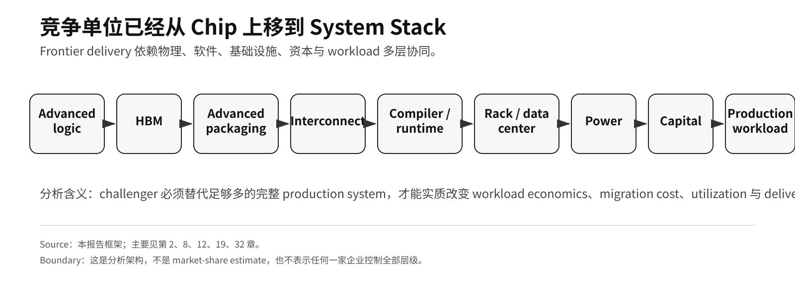
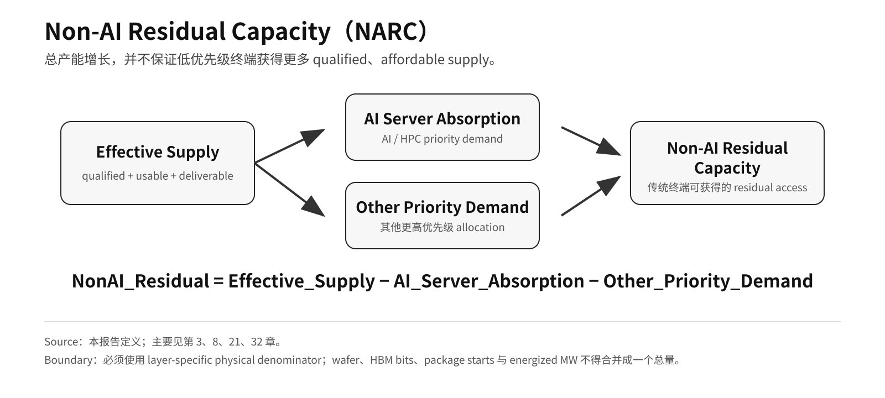
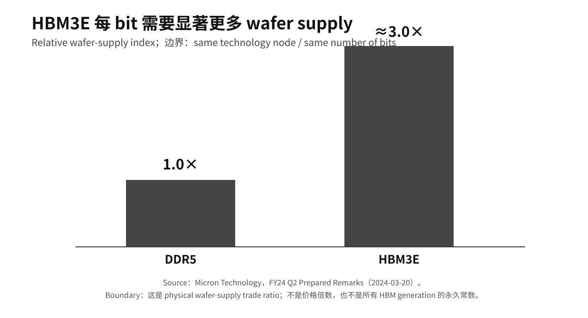
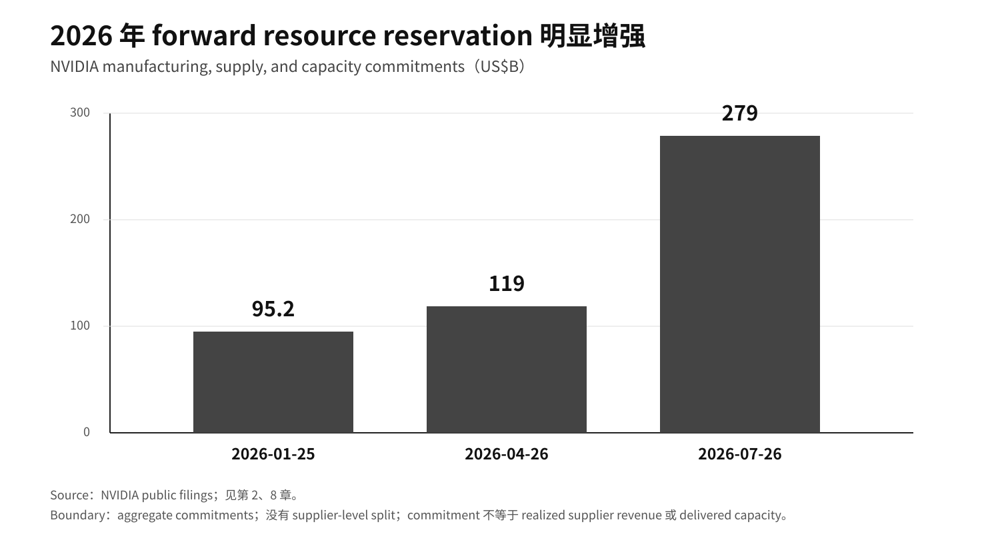
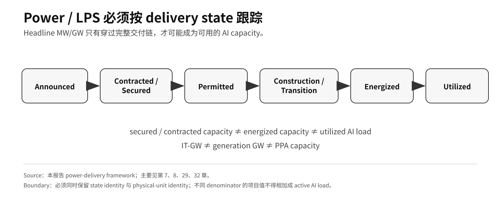
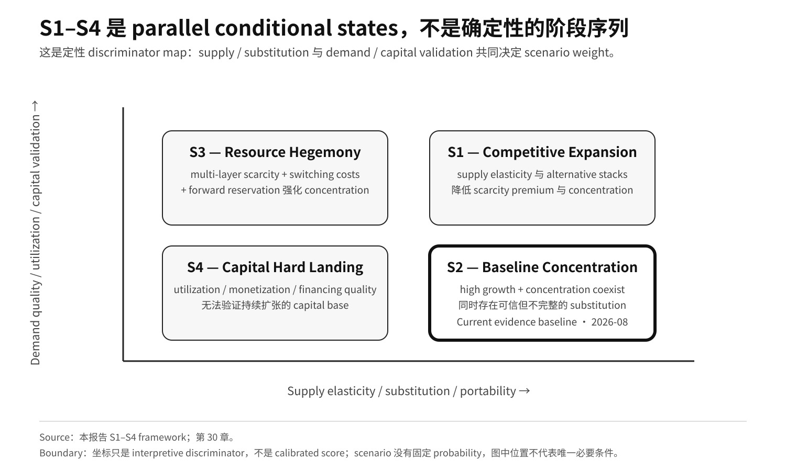

# Research Brief

## AI基础设施格局重塑：2026–2036结构性产业展望

**System Stack 竞争、半导体资源配置、HBM、Advanced Packaging、Power、资本形成与终端传导的行业研究简报**

**Evidence cutoff：** 2026-08-28  
**Edition revision：** 2026-09-03  
**Status：** 本简报属于 publication layer，由已冻结的 32 章英文 canonical report 派生，不构成第二套研究版本，也不新增 factual claim。

---

## Executive thesis

这一轮 AI infrastructure cycle 已经不能只理解为“谁拥有更快的 accelerator”。

真正的竞争单位正在上移到完整 production system：

> **advanced logic + HBM + advanced packaging + interconnect + compiler/runtime + rack/data center + power/LPS + capital + production workload**

因此，产业问题也发生了变化。关键不再只是 semiconductor 或 infrastructure 的总供给是否增长，而是：

> **谁获得下一单位 qualified capacity，瓶颈如何在不同物理层之间迁移，以及已经安装的 compute 最终能否转化为 utilization、workflow output、revenue 与 capital recovery。**

截至本报告 cutoff，公开 evidence mix 最接近：

> **S2 — Baseline Concentration：high growth、强势 leading platform、scarce-layer concentration，与可信但尚不完整的 substitution path 同时存在。**

这不是一个确定性的 2036 forecast，而是当前证据最支持的结构状态。



---

## 1. 2026 年真正发生结构变化的是什么

最重要的是三件事。

### 1.1 Platform competition 已经扩展成 system competition

NVIDIA 的当前优势已经不能只用单颗 GPU performance 描述。

Rack-scale system 把 accelerator compute、HBM、scale-up fabric、software、rack architecture、cooling、deployment tooling 与 production migration cost 放进了同一个交付单元。

Hyperscaler alternative 的战略意义也在这里。Google、AWS、Microsoft、Meta 等并不只是推出另一颗 chip，而是在尝试闭合足够多的 surrounding stack，使真正有价值的 production workload 能够迁移。

因此，真正的 competitive test 是：

> **alternative stack 能否以可接受的 migration cost、utilization、reliability、supply assurance 与 total economics 交付 production workload？**

更便宜的 die 或更强的一项 benchmark，本身都不足以证明 system-level substitution。

### 1.2 AI/HPC 正在改变“下一单位资本投向哪里”

TSMC 披露，2026 Q2 HPC 占 revenue **66%**，7 nm 及以下占 wafer revenue **77%**。[^rb1]

这些指标不能推出 customer-level wafer allocation，但足以说明 advanced-compute demand 在 foundry economic mix 中的权重。

本报告把这种结构定义为 **Two-Speed Semiconductor Economy**：

- AI infrastructure demand 往往拥有更高 willingness to pay、更长 commitment、更强 prepayment capacity 与 capital formation；
- traditional end system 仍然重要，但通常面对更严格的 BOM、qualification clock 与产品生命周期约束。

所以真正需要观察的，不只是现有 capacity，而是：

> **哪一类 demand pool 正越来越有能力决定新增 capacity 被建设在哪里、为谁建设。**

### 1.3 Gross supply 与 residual access 是两个不同变量

全球 wafer、DRAM、packaging 或 power capacity 可以增长，同时传统终端依然面对 weaker allocation、更高价格或更慢 configuration upgrade。

因此，本报告使用 **Non-AI Residual Capacity（NARC）**：

```text
NonAI_Residual
= Effective_Supply
- AI_Server_Absorption
- Other_Priority_Demand
```



NARC 不是一个 universal percentage。它必须在每一个独立 physical pool 和 qualification boundary 内单独计算或判断。

---

## 2. 物理瓶颈不是一颗芯片，而是不断迁移的系统约束

本报告不认为 GPU、HBM、CoWoS 或 power 中的某一层会永久成为未来十年的唯一 dominant bottleneck。

更合理的结构是 **Rolling Bottleneck Cascade**：

> memory / packaging tightness → hardware delivery 受限 → supply expansion → 更多 rack 到达 site → power / interconnection 成为瓶颈 → deployment 放缓 → utilization 与 next-cycle commitment 调整

如果 capacity 过度提前建设，瓶颈也可以反向迁移，甚至从 scarcity 转向 under-utilization。

这意味着：即使对某一个 layer 的判断正确，如果企业仍然按静态 bottleneck 做十年规划，也可能犯错。

### HBM 正好说明 denominator discipline 为什么重要

Micron 披露，在 **same technology node / same number of bits** 条件下，HBM3E 大约需要 DDR5 **3× wafer supply**。[^rb2]



这个数字是 physical manufacturing trade ratio。

它不是：

- price multiple；
- 所有 HBM generation 的永久常数；
- 用 bit share 直接推导 HBM economics 的依据。

因此，本报告始终把 HBM bits、DRAM wafer input、advanced-packaging capacity 与 rack deployment 视为不同 denominator，除非公开证据能够把它们真正闭合到同一 scope。

---

## 3. Forward commitments 已经成为产业级信号

当 customer-level HBM、packaging 或 rack allocation 无法从公开资料直接观察时，forward commitment 比“假设一个 fleet size 再机械相乘”更有证据价值。

NVIDIA 披露的 **forward supply / capacity commitment family** 在多个报告时点上升：[^rb3]

- 2026-01-25：**US$95.2B**
- 2026-04-26：**US$119B**
- 2026-07-26：**US$279B**

各报告时点的 disclosure label、底层 mix 与 duration 并不完全相同：FY26 Form 10-K 使用 **manufacturing, supply, and capacity commitments**，FY27 Q2 Form 10-Q 使用 **supply and capacity commitments**。因此，这一序列只能作为 forward-reservation indicator，不能当作完全同质的 accounting time series。



US$279B 是 company-level aggregate commitment。公开 filing 并没有给出 supplier-level split。

因此，这一数据支持的结论应保持窄口径：

> **强 system economics 可以进一步转化为更强的 forward reservation power，并提高下一代 system delivery certainty。**

但这一 reinforcing mechanism 只有在 utilization、customer demand、financing quality 与 supplier economics 同时成立时才可持续。

---

## 4. Power 已经成为 compute delivery 的组成部分

Power 不能只作为 electricity-price input 分析。

在现代 rack density 下，更关键的变量是 **Time-to-Power**：

> 一个项目从 intent 到 energized、usable capacity，并真正承载 real workload，需要多久。

本报告使用六状态 delivery model：



两个边界必须严格保留：

> **secured / contracted capacity ≠ energized capacity ≠ utilized AI load**

以及：

> **IT-GW ≠ generation GW ≠ PPA capacity**

PORTS-Pike 的分析意义在于：land、power、shell、credit support 与 model-company demand 正在 infrastructure cycle 更早阶段被联合协调；但其 initial **4.25 IT-GW design capacity** 仍然是 planned future capacity，不是当前 utilized AI load。[^rb4]

因此，真正的 industrial advantage 不是“谁买了更多 power”，而是：

> **谁能在 hardware-generation window 内，把 permitting、interconnection、equipment procurement、construction、energization 与 utilization 连续推进完成。**

---

## 5. Model company 与 capital market 正在向 infrastructure 上游移动

领先 model company 越来越不只是消费既有 cloud capacity，而是在影响 infrastructure formation 本身。

本报告把这一机制定义为 **Anchor Compute Buyer Effect**：

> **long-duration workload demand → revenue visibility → financing certainty → earlier infrastructure buildout → earlier resource reservation**

如果 demand 真实并最终转化为 utilization，这会强化 infrastructure buildout。

如果 utilization 与 monetization 不跟上，它也会增加 concentration、duration mismatch 与 financing correlation。

2026 年出现的 infrastructure-finance structure 又增加了第二个机制：**Financing Reflexivity**。

Seller equity、credit enhancement、infrastructure support 与 third-party capital 可以加速建设，但也会使 demand quality 更依赖 financing structure。

PORTS-Pike 把这个规模与边界具体化：NVIDIA FY27 Q2 Form 10-Q 对 initial 约 **4.25 GW IT-load** lease structure 的 aggregate guarantee obligations 设定 **US$105B** 上限，并随 data centers 进入 service 分阶段生效。它是 maximum conditional credit exposure，**不是 funded CapEx，也不是当前 cash outflow**。[^rb5]

因此，本报告区分：

1. independently financed end demand；
2. long-duration Anchor Buyer commitments；
3. third-party infrastructure capital；
4. supplier equity / credit support。

仅仅看到大规模 CapEx，既不能证明 durable demand，也不能证明 bubble。

真正需要验证的是：

> **utilization、revenue、market clearing、customer cash generation、financing quality，以及 verified workflow output 是否足以支撑 capital base。**

---

## 6. 传统终端仍然重要，但“重要”不等于拥有 upstream priority

本报告并不认为 smartphone、PC、game console、vehicle、industrial equipment、robotics、aerospace 或其他 long-lifecycle system 会变得不重要。

真正的风险是：

> **end-market importance 并不会自动转化为 upstream capital allocation priority。**

不同终端受到的传导机制也不同：

- smartphone、PC 与部分 edge / ADAS system 更可能直接共享 advanced logic、memory 或 selected packaging；
- automotive 与 industrial system 更常受到 product mix、qualification rigidity、long lifecycle 与 supplier allocation 的影响；
- aerospace、defense 与其他 high-reliability low-volume system 更可能面临 mature-node economics、trusted supply、equipment、engineering talent 与 special-process continuity，而不是直接竞争 HBM。

因此，需要监控的不是“所有 component price 都被 AI 推高”，而是：

- quantity assurance；
- lead time；
- configuration / memory-content decision；
- component pricing；
- qualification flexibility；
- supplier product-mix incentive；
- lifecycle support。

核心仍然是 **residual qualified supply**。

---

## 7. 中国必须通过两个独立 closure test 判断

本报告明确分开两个问题。

### Production-Grade Parallel Stack

一个 alternative system 是否已经能够在真实 production workload 中闭合：

- accelerator / compute；
- HBM-class 或 equivalent memory subsystem；
- advanced packaging；
- high-speed interconnect；
- compiler/runtime；
- production workload；
- utilization、reliability 与 economics。

### Autonomous Frontier Closure

当 critical external input 受到限制时，这套 stack 是否能够持续跨 generation scaling。

这进一步要求：

- advanced-manufacturing continuity；
- equipment、materials、software 与 service；
- HBM / packaging；
- cross-generation process upgrade；
- power / LPS；
- capital formation。

因此：

> **存在真实 production-grade parallel stack，不等于已经证明 autonomous frontier closure。**

反过来，仍然存在 import dependence，也不等于不存在 production substitution。

---

## 8. 2026–2036 必须使用 conditional scenario，而不是单点预测

本报告使用四个 parallel states：



### S1 — Competitive Expansion

Supply elasticity 上升，alternative stack 成熟，portability 改善，scarcity premium 下降。

截至 2026 年 8 月 cutoff，S1 的证据已经明显增强：AMD 表示 Helios rackscale solutions 已进入 production；Meta commitment 为 **up to 6 GW**，Anthropic 为 **up to 2 GW**，Microsoft 也已宣布 Azure deployment。[^rb6] 这些仍是 deployment / shipment commitments，不是 measured utilization 或 production-workload share，因此会提高 competitive branch 的权重，但单独不足以推翻当前 S2 baseline。

### S2 — Baseline Concentration

High growth 与 concentration 共存。Leading platform 与 scarce-layer supplier 保持强 economics，同时 substitution path 持续扩张。

**截至 2026 年 8 月，这是 current evidence baseline。**

### S3 — Resource Hegemony

多个 scarce layer、switching cost、forward reservation 与 delivery advantage 相互强化，使复制完整 competitive system 的成本持续升高。

### S4 — Capital Hard Landing

Utilization、monetization、clearing price、commitment 或 financing quality 在多个 actor / layer 上无法继续验证扩张中的 capital base。

这四个 scenario 不是阶段序列，也没有固定 probability。

---

## 9. 什么事实会改变当前判断

S2 不应该被当作“必须维护的结论”。

真正有价值的 reverse signal 包括：

- HBM 与 advanced packaging 出现持续性宽松；
- alternative stack 以低 migration cost 实现大规模 production substitution；
- qualified advanced capacity access 明显扩散；
- Time-to-Power 大幅缩短，不再成为高价值项目的差异化变量；
- 大型 forward commitments 被明显取消、延期或下调；
- utilization、AI revenue、clearing price 与 customer cash generation 同步恶化；
- supplier-assisted financing 上升，而 independent financing 与 utilization 下降；
- 新的一手证据实质改变中国 Production-Grade Gates 或 autonomous frontier closure；
- formal regulatory remedy 实质改变 interface access、tying 或 market-entry condition。

这个 framework 的价值就在于：

> **未来 evidence 可以迫使结论改变。**

---

## 10. Research discipline

本报告采用：

> **F → H → M → S → X**

- **F — Fact：** 已发生且公开可验证；
- **H — Hypothesis：** 未来输入条件；
- **M — Mechanism：** 变量之间的 causal transmission；
- **S — Scenario：** 条件组合形成的未来 state；
- **X — Falsification：** 足以迫使判断降级、重写或失效的反向证据。

Evidence 同时分为：

- **A：** first-party / formal evidence；
- **B：** institutional / academic research；
- **C：** sell-side / supply-chain / media estimate；
- **D：** report-side calculation / sensitivity / scenario input。

核心规则只有一条：

> **未来分析可以大胆，但 fact layer、denominator、evidence identity 与 time identity 必须保守。**

---

## Bottom line

这一轮 AI infrastructure buildout 的本质，不只是 GPU shipment expansion，而是完整 industrial priority system 的重排。

真正决定未来结构的变量包括：

- 谁能 assemble 并 operate 完整 system stack；
- 谁能获得下一单位 qualified scarce capacity；
- HBM、packaging、networking 与 power bottleneck 如何迁移；
- alternative stack 是否真正降低 migration cost 与 concentration；
- traditional end system 是否保有足够 residual access；
- long-duration commitment 与 financing structure 是否最终转化为 utilization；
- installed compute 是否真正产生 verified workflow output 与 durable cash flow。

当前 evidence 支持的是 **S2 — Baseline Concentration**。

它不是 permanent monopoly，不是自动 competitive diffusion，也不是已经被证实的 Capital Hard Landing。

完整 evidence、denominator、counterargument 与 falsification boundary，见[32 章中文版](README.md)、[图表目录](01-list-of-figures.md)与[核心证据台账](../核心证据台账.md)。


## Source anchors

[^rb1]: TSMC，2Q26 Management Report，HPC 66%、smartphone 22% 与 7 nm 及以下 technology mix，https://investor.tsmc.com/english/encrypt/files/encrypt_file/reports/2026-07/6f49632674bd2d0fd48cb65aaf89ec6ab510b559/2Q26%20ManagementReport.pdf
[^rb2]: Micron Technology，FY24 Q2 Prepared Remarks，same node / same bits 条件下 HBM3E 相对 DDR5 的 wafer-supply intensity，https://s25.q4cdn.com/621799436/files/doc_financials/2024/q2/FY24-Q2-Prepared-Remarks.pdf
[^rb3]: NVIDIA Corporation，FY26 Form 10-K 与 FY27 Q2 Form 10-Q，aggregate manufacturing / supply / capacity commitments，https://www.sec.gov/Archives/edgar/data/1045810/000104581026000021/nvda-20260125.htm ; https://www.sec.gov/Archives/edgar/data/1045810/000104581026000075/nvda-20260726.htm
[^rb4]: NVIDIA / SB Energy，PORTS-Pike Exhibit 99.1，2026-08-17，initial 4.25 IT-GW design capacity 与 phased buildout，https://www.sec.gov/Archives/edgar/data/1045810/000104581026000069/sbeoainvidia-portsrelease.htm

[^rb5]: NVIDIA Corporation, FY27 Q2 Form 10-Q, PORTS-Pike guarantees covering approximately 4.25 GW of IT load with aggregate obligations capped at US$105B and phased service expected to begin in FY2029, https://www.sec.gov/Archives/edgar/data/1045810/000104581026000075/nvda-20260726.htm

[^rb6]: AMD, Advancing AI 2026 / Helios official materials and customer deployment announcements: Helios described as in production; Meta up to 6 GW with first-gigawatt shipments from 2H26; Anthropic up to 2 GW with first-gigawatt deployment from 1H27; Microsoft Helios deployment on Azure, https://ir.amd.com/news-events/press-releases/detail/1294/aai-2026-amd-delivers-full-stack-compute-for-the-agentic-ai-era ; https://newsroom.amd.com/news/amd-and-meta-announce-expanded-strategic-partnersh/ ; https://newsroom.amd.com/news/amd-anthropic-strategic-partnership/ ; https://ir.amd.com/news-events/press-releases/detail/1291/microsoft-to-deploy-next-gen-amd-instinct-and-amd-epyc-processors-as-the-companies-expand-their-long-term-strategic-partnership
