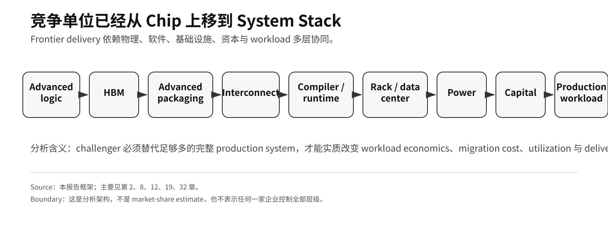
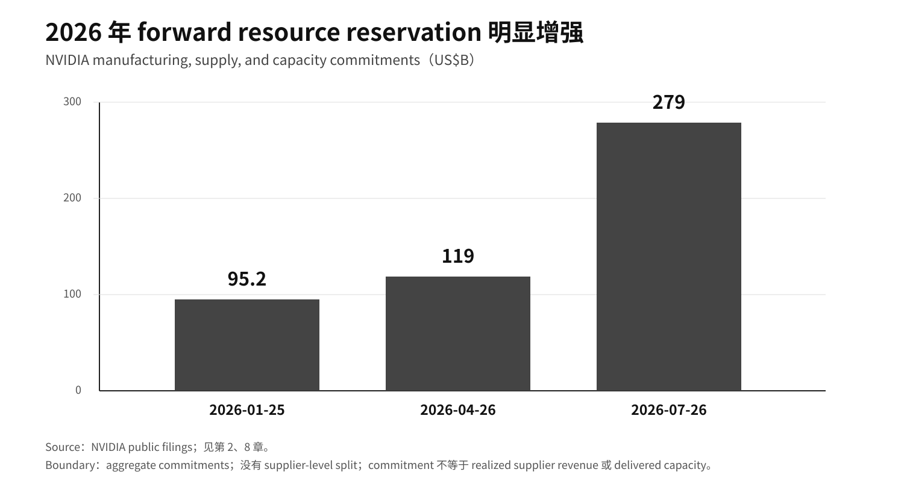

# Part I · 第2章：NVIDIA 系统栈与平台权力

## 1. NVIDIA 的 Moat 是 System-Stack Moat

NVIDIA 当前最重要的竞争优势，不是某一代 GPU 的单点性能，而是把 accelerator、HBM、scale-up fabric、compiler/runtime、libraries、rack architecture 与 deployment tooling 组织成**低平台内迁移摩擦、可重复交付的 production system**。GB200 NVL72 的官方产品规格已经清楚显示这种销售单元上移：[^1]

**Table 2.1 — GB200 NVL72 的 rack-scale 系统结构**

| 层 | 官方规格 / 结构 |
|---|---|
| GPU | 72 Blackwell GPU |
| CPU | 36 Grace CPU |
| GPU memory | 13.4 TB HBM3E |
| CPU memory | 17 TB LPDDR5X |
| Scale-up domain | 72-GPU NVLink domain |
| Rack | liquid-cooled rack-scale system |

**Source:** NVIDIA GB200 NVL72 official product page.[^1]  
**Note:** 该表描述官方系统规格，不代表实际出货量、利用率或客户部署规模。

这改变了竞争的比较方式。单卡时代可以主要比较 FLOPS、显存和卡价；rack-scale 时代必须同时比较 memory hierarchy、scale-up/scale-out interconnect、compiler/runtime、distributed training stack、power/cooling、部署工具和 workload migration cost。

因此，“更便宜的一颗 ASIC”并不自动等于“更便宜的一套生产级 AI system”。

**图 1 Note：** 本报告 framework；用于概括本章与第 8、12、19、32 章形成的分析单元，不是 market-share estimate，也不表示任何一家企业控制全部层级。

## 2. NVLink / NVSwitch 把 Scale-Up Communication 内部化

frontier model training 的瓶颈并不只在单卡计算。tensor parallel、pipeline parallel、expert parallel 和 collective communication 会把性能越来越多地交给 bandwidth、topology、synchronization 与 collective implementation。

NVLink/NVSwitch 的战略价值，是把 scale-up communication 设计为平台内部能力。GB200 NVL72 把 72 颗 GPU 组织在一个 NVLink domain 中；NVIDIA 当前产品页给出整柜 **130 TB/s aggregate NVLink bandwidth**。[^1]这并不能证明任何以太网方案天然无法替代，但它改变了替代问题：

> 竞争者必须替代的不是一颗 GPU，而是“计算 + 内存 + 域内互联 + 软件执行模型”这一整组生产能力。

因此，未经公开仪器验证的 ns 级延迟对比不进入正式证据层，宣传性 benchmark 也不被当作 independent measurement。真正需要观察的是可复核的 production workload：迁移后吞吐、利用率、工程成本与可靠性是否仍有显著差距。

## 3. CUDA / PTX 是 Cross-Generation Software Asset

CUDA 的战略价值不能被简化成一个不存在于财报中的固定“软件溢价”。NVIDIA FY26 Form 10-K 将 CUDA 明确列为 parallel-computing platform，为把 software layer 视为平台组成部分、而不是独立披露的 margin line 提供一手锚点。[^8] 它更接近长期积累的软件资产：

- compiler 与 kernel ecosystem；
- libraries；
- profiling / debugging；
- framework integration；
- distributed communication；
- inference / training runtime；
- deployment tooling；
- developer knowledge。

PTX 的作用尤其重要：NVIDIA 官方将 PTX 描述为跨多代 GPU 的 **stable ISA**。[^9] 因此，上层软件不必在每一代 GPU 变化时完全重写；硬件路线可以从 Hopper 进入 Blackwell、再进入 Rubin，而相当一部分上层软件资产可以继续复用。

这形成一种跨代机制：

**更大的 installed base → 更多 production software assets → 更低的平台内升级成本 → 更高的平台外迁移成本。**

它解释了为什么 NVIDIA 的优势不能只用一次 benchmark 测量，也不能用一个未经披露的“CUDA 毛利率”证明。

## 4. Rack-Scale Architecture 把 Switching Cost 延伸到 Physical Infrastructure

当采购单位上移到 rack，迁移成本也从 software 延伸到 physical infrastructure。客户围绕特定系统建设的，不只是代码，还包括：

- rack / pod topology；
- power distribution；
- liquid cooling；
- networking；
- firmware；
- cluster management；
- scheduling 与 performance validation。

因此，换一颗 accelerator 可能只是一个采购动作；换一套 rack-scale system，往往意味着重新验证软硬件协同和数据中心工程。

这一点是 NVIDIA 系统权力最容易被“芯片 benchmark”低估的地方。系统越往 rack/pod 和园区层延伸，竞争者越需要在部署时间、可靠性和总拥有成本上证明替代，而不是只在峰值算力上接近。

## 5. Platform Profit 可以转化为 Next-Generation Reservation Power

系统级优势如果能够产生高利润和高自由现金流，就会进一步影响供应链。当前最重要的公司层锚点不需要在多个章节反复铺开，只保留一组：

**Table 2.2 — NVIDIA 当前 seller-side economics 与前置供应承诺**

| 指标 | 当前公开值 |
|---|---:|
| FY26 Data Center revenue | US$193.737B |
| FY26 NVIDIA-defined non-GAAP free cash flow | US$96.575B |
| FY27 Q2 revenue | US$96.221B |
| FY27 Q2 Data Center revenue | US$89.0B |
| FY27 Q2 GAAP gross margin | 75.0% |
| FY27 Q2 GAAP operating income | US$63.734B |
| 2026-07-26 manufacturing, supply, and capacity commitments | US$279B |

**Source:** NVIDIA FY26 results / FY26 Form 10-K、FY27 Q2 results 与 FY27 Q2 Form 10-Q.[^2][^3][^4][^8]  
**Note:** US$279B 为 aggregate manufacturing, supply and capacity commitments；公开文件未提供 supplier-level split。

FY27 Q2 10-Q 说明，最新 commitments 主要与 data-center infrastructure systems 所需的 memory 和 manufacturing facilities 有关。[^4]公开文件没有把 US$279B 拆分到 TSMC、CoWoS、SK hynix、Micron 或 Samsung，因此它只能证明整体前置供应承诺规模，不能写成任何单一供应商的确定收入。

**图 4 Note：** first-party filing data。图中保留 company-level aggregate commitment 边界，不把承诺拆分为任何单一 supplier allocation，也不把 commitment 改写成 realized supplier revenue 或 delivered capacity。

这构成一个可检验的跨代强化机制：

**高系统利润 → 更强供应承诺与资源预订能力 → 更高交付确定性 → 更强客户留存 → 下一轮系统收入。**

它不是自动垄断公式。供应商仍会考虑客户多元化、信用、利用率、地缘政治和长期议价平衡。

## 6. System Power 也有明确 Physical Boundary

NVIDIA 并不直接制造所有关键稀缺层。FY26 Form 10-K 明确描述其采用 **fabless / contracting manufacturing strategy**，这为以下外部物理供应依赖提供一手边界。[^8] 它仍依赖：

- leading-edge foundry；
- HBM vendors；
- advanced packaging ecosystem；
- data-center operators；
- grid / power suppliers。

因此，平台权力强并不意味着物理供给完全内生。TSMC、HBM、advanced packaging 和 power 中任一层失配，都可能成为下一代交付约束。

这一区分把 **scarce-layer value capture** 与“市场份额垄断”分开。系统平台可以拥有很强的组织和出价能力，但仍然受到外部物理供应弹性约束。

## 7. 真正的竞争挑战是第二套 System Stack

Google TPU / Ironwood、AWS Trainium、Microsoft Maia 与 Meta MTIA 的战略意义，不只是“又出现了一颗芯片”。[^5] Hyperscaler 同时拥有：

- captive large-scale workloads；
- cloud distribution；
- 对 data-center infrastructure 的控制；
- internal compiler/runtime software；
- 自研 interconnect 与 rack/pod design；
- 在 system level 围绕更窄 workload 做优化的能力。

因此，真正的竞争框架不是：

> NVIDIA GPU vs. custom ASIC

而是：

> **NVIDIA system stack vs. cloud system stack**

这种变化可以同时产生两个方向相反、却并不矛盾的结果：

1. **Platform-profit diversion：** 云厂商自研系统降低对 NVIDIA 部分 platform profit pool 的依赖；
2. **Upstream resource competition：** 这些系统仍然需要 advanced logic、HBM、advanced packaging 与 power。

因此，cloud custom silicon 成功，并不自动意味着上游 physical scarcity 被解除。

## 7A. 报道中的 Hugging Face 交易：平台权力可能从 Runtime 延伸到 Developer Distribution

2026-08-27，Reuters 转述 The Information 报道，NVIDIA 已同意以约 **US$12.9B** 收购 Hugging Face。[^6]截至 **2026-08-28** evidence cutoff，尚无 NVIDIA 或 Hugging Face 的正式公告确认 closing、最终交易条件或监管批准，因此该事项仍记为 **reported transaction**，而不是已经完成的 consolidation fact。

Hugging Face 的战略意义不只是“模型下载网站”。其官方产品覆盖 Hub、models、datasets、Spaces、Transformers 以及 inference/deployment products，把 model discovery、asset distribution、tooling、evaluation 与 deployment 连接在同一开发者入口中。[^7]

如果报道中的交易最终完成，NVIDIA 的平台边界可能从：

> **accelerator → CUDA/runtime → networking → rack/system**

进一步延伸到：

> **accelerator → CUDA/runtime → model discovery/distribution → deployment path**

这可能形成一条强化链：

**hardware installed base → CUDA/software assets → model/runtime optimization → developer default path → workload deployment → accelerator demand。**

因此，它只作为 **developer-distribution / vertical-foreclosure risk** 的监测项，不被升级成新的承重理论，也不被预先写成已经完成的软件 foreclosure。

真正需要观察的，不是 Hugging Face 上是否仍然技术性地存在 non-NVIDIA hardware，而是 ownership 变化之后，平台默认路径是否出现持续、可测量的 NVIDIA 倾斜：

- model page / benchmark 是否默认更强调 NVIDIA runtime；
- inference / endpoint 是否优先推荐特定 backend；
- NVIDIA-optimized artifact、quantization path、container 或 deployment flow 的排序 / 可见度是否上升；
- ROCm、XLA、CPU 或其他 accelerator 的 first-class support 是否弱化；
- 离开 NVIDIA 的 migration friction 是否上升；
- model creator 是否因商业激励而更优先发布 NVIDIA-optimized variant。

这类风险与传统 CUDA lock-in 不完全相同。CUDA lock-in 主要发生在 workload 已经选择 NVIDIA execution environment 之后；distribution-layer foreclosure risk 可以更早发生：

> **model discovery → tool selection → runtime selection → deployment → accelerator。**

因此，它可能把 platform lock-in 前移到 developer funnel。

### 7A.1 Counter-boundaries

即使交易最终完成，也不能自动推出完整 software foreclosure：

- open-weight models 可以 mirror、自托管或分发到多个 registry；
- Hugging Face 历来是 multi-framework / multi-vendor ecosystem；
- model weights、open libraries 与 alternative hubs 保留一定 portability；
- 竞争者可以通过 independent registries、runtimes、cloud distribution 与 neutral-foundation governance 降低单点依赖。

只有当 **ranking、interoperability、deployment friction 与真实 workload distribution** 持续发生变化时，才应提高这一机制的权重。

## 8. Moat Erosion 的 Evidence Standard

不能用产品发布数量、单颗芯片 benchmark 或单季 market share 判断 system moat 是否失效。

更有意义的是观察多个变量是否同时变化：

- cloud system stack 在 frontier training / high-value inference 上达到 production scale；
- open software 显著降低 CUDA migration cost；
- alternative scale-up fabric 达到 production-grade scale；
- multi-stack migration 的 engineering cost 与 performance loss 持续下降；
- scarce upstream resources 不再明显偏向 NVIDIA roadmap；
- major customers 把真实 workload 分散到多套系统，而不只是运行 benchmark 或窄场景 internal test。

如果这些变化持续成立，NVIDIA 的平台权力可能从“system-level pricing power”下移为更可议价的“integration advantage”。

如果跨平台迁移仍昂贵，而平台内部跨代升级继续保持低摩擦，system moat 仍然成立。

---

## 9. Current Read

截至 2026 年 8 月，最准确的描述不是“GPU 竞争已经结束”，也不是“云 ASIC 已经替代 NVIDIA”。

更准确的是：

> **NVIDIA 当前拥有最成熟的商业化通用 AI system stack；hyperscaler 已经形成真实的第二条 system-stack 路线，但其替代程度必须用生产级 workload、迁移成本、利用率和上游资源依赖来验证。**

这也是后续分析 TSMC、HBM、advanced packaging、power 与 capital cycle 的起点：真正的竞争单位已经从裸片上移到系统，而系统仍然受多个外部 scarce layer 共同约束。

## 10. 什么事实会改变当前判断

如果以下信号持续出现，应下调 NVIDIA system-stack power 判断：

- frontier / high-value production workload 大规模迁移到其他 stack；
- CUDA/runtime migration cost 显著下降并在 production 中得到验证；
- alternative interconnect / rack systems 获得广泛外部 adoption；
- NVIDIA supply commitments 明显收缩，而竞争者 quantity assurance 改善；
- seller-side margin / cash generation 与 installed-base retention 同步恶化。

反过来，单一 custom-chip announcement、单季 market share 变化或理论 benchmark 优势，都不足以单独证明 system-stack moat 已经失效。

## References

[^1]: NVIDIA, “GB200 NVL72,” official product page, https://www.nvidia.com/en-us/data-center/gb200-nvl72/
[^2]: NVIDIA, “NVIDIA Announces Financial Results for Fourth Quarter and Fiscal 2026,” https://nvidianews.nvidia.com/news/nvidia-announces-financial-results-for-fourth-quarter-and-fiscal-2026
[^3]: NVIDIA, “NVIDIA Announces Financial Results for Second Quarter Fiscal 2027,” https://nvidianews.nvidia.com/news/nvidia-announces-financial-results-for-second-quarter-fiscal-2027
[^4]: NVIDIA Corporation, Form 10-Q for quarter ended 2026-07-26, U.S. SEC, https://www.sec.gov/Archives/edgar/data/1045810/000104581026000075/nvda-20260726.htm
[^5]: Google, “Ironwood TPU,” https://blog.google/innovation-and-ai/infrastructure-and-cloud/google-cloud/ironwood-tpu-age-of-inference/ ; AWS, “Amazon EC2 Trn3 UltraServers,” https://aws.amazon.com/about-aws/whats-new/2025/12/amazon-ec2-trn3-ultraservers/ ; Microsoft, “Maia 200,” https://blogs.microsoft.com/blog/2026/01/26/maia-200-the-ai-accelerator-built-for-inference/ ; Meta, “MTIA 300,” https://engineering.fb.com/2026/08/24/networking-traffic/mtia-300-meta-training-chip-built-in-nics/
[^6]: Reuters, “Nvidia agrees to buy Hugging Face for $12.9 billion, The Information reports,” 2026-08-27, https://www.reuters.com/technology/nvidia-talks-acquire-hugging-face-13-billion-deal-business-insider-reports-2026-08-27/
[^7]: Hugging Face official documentation for Hub, models, datasets, Spaces, Transformers, and inference/deployment products, https://huggingface.co/docs

[^8]: NVIDIA Corporation, FY26 Form 10-K, CUDA platform, fabless / contracting manufacturing strategy, and FY26 segment disclosures, https://www.sec.gov/Archives/edgar/data/1045810/000104581026000021/nvda-20260125.htm
[^9]: NVIDIA, PTX ISA documentation, PTX described as a stable ISA spanning multiple GPU generations, https://docs.nvidia.com/cuda/parallel-thread-execution/index.html
