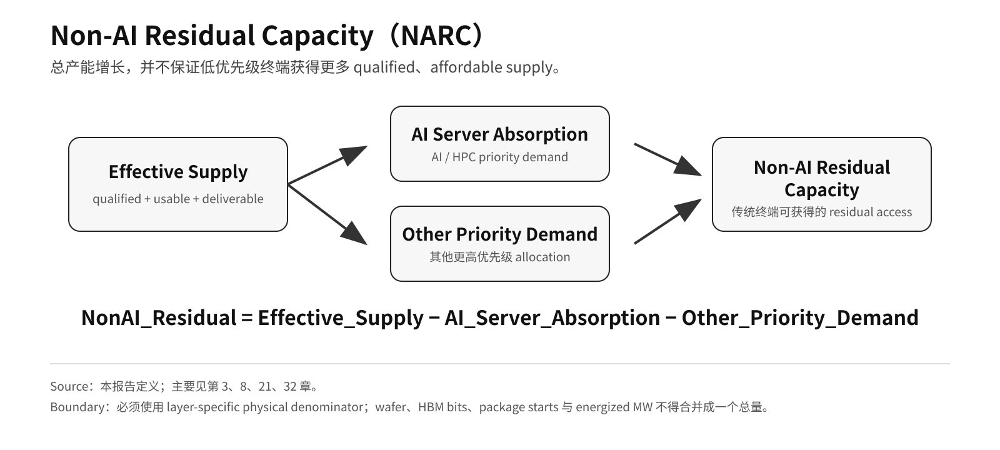

# Part I · 第3章：AI 资源重配与 Non-AI Residual Capacity

## 1. 核心判断：绝对短缺出现之前，资源优先级就可能改变

AI 不需要“拿走全部产能”，也足以改变半导体与基础设施 economics。资源重配首先发生在边际。

最暴露的是同时满足两个条件的资源：**与 AI/HPC demand 共享，而且短期内难以快速扩张**。

- advanced logic；
- HBM / selected DRAM；
- advanced packaging；
- high-end substrates / networking；
- selected power-management components；
- data-center power。

本报告用 **resource reallocation pressure** 作为这一机制的简写，而不是把它定义成独立的经验定律：

> **当 AI/server workload 提供更高 risk-adjusted return、更长 order duration、更强 payment certainty 与更好的 expected utilization 时，有限供给与下一单位资本会更倾向于流向这一需求池。**

因此，真正的分析对象是**下一单位 qualified scarce capacity 的 opportunity cost**，而不是声称 AI 在物理上消耗所有 semiconductor category。

## 2. 机制：下一单位稀缺资源的 Opportunity Cost

资源重配可以写成：

> **high-value AI/server demand → higher expected return → product-mix / capacity-allocation shift → lower residual capacity for lower-priority demand**

这条机制成立需要几个条件：

- capacity 在短期内不能快速扩张；
- 不同终端共享某个 physical pool 或 capital pool；
- AI/server customer 能提供更长订单、prepayment 或更高 purchasing certainty；
- supplier 预期高价值 demand 能提供更高 risk-adjusted return。

因此，这一机制不只是“价格更高”，而是**下一单位稀缺资源的 opportunity cost 被重新定价**。

## 3. 价格不是唯一清算机制：Quantity Assurance 同样重要

在 severe shortage 中，市场不会只靠 spot price 清算。

长期协议、客户信用、预付款、采购规模和 allocation fulfillment 都会决定买方最终能拿到多少货。

TrendForce 2026-01 指出，美国 CSP 锁定部分 capacity 后，其他买家为了确保 supply allocation 被迫接受更高价格；2026-03 又指出，PC OEM / module maker 在 allocation fulfillment 较低时，需要从供应商或模组厂以更高价格补货。[^1][^2]

因此：

> **willingness-to-pay ≠ guaranteed quantity**

这意味着资源压力必须拆成两个变量：

1. **Price Pressure**：拿到同样数量要付多少钱；
2. **Quantity Assurance**：即使愿意付钱，能否按计划获得足够数量。

对传统终端而言，第二个变量往往比短期 spot price 更重要。

---

## 4. Non-AI Residual Capacity：传统终端真正面对的不是全球总供给

传统市场能够获得的有效供给可以抽象为：

```text
NonAI_Residual(t)
= Effective_Supply(t)
- AI_Server_Absorption(t)
- Other_Priority_Demand(t)
```

这个概念解决了一个经常被误判的问题：

> **总供给增长，并不等于传统终端可获得的供给同步增长。**

如果 total effective supply 增长，但 AI/server absorption 增长得更快，Non-AI Residual Capacity 仍然可能下降。



**图 2 Note：** 本报告 analytical definition。任何实际应用都必须保留 layer-specific physical denominator；wafer、HBM bits、package starts 与 energized MW 不能合并成一个总量。

因此，判断 smartphone、PC、general server、automotive 或 industrial 是否恢复宽松，不能只看：

- 全球 wafer capacity；
- 全球 DRAM bit growth；
- 全球 packaging capacity；
- 全球 power project pipeline。

必须看**在同一质量、认证、代际与交付窗口内，传统终端实际能获得多少有效残量**。

---

## 5. 资源重配会改变 Capital Formation，而不只是当期供给

资源重配的长期影响会从当前 allocation 延伸到下一轮 capital formation。

AI Infrastructure Economy 与 Traditional Device Economy 共享部分 advanced logic、memory、packaging 与 power-management resource base，但两类需求在以下方面不同：

- willingness to pay；
- contract duration；
- prepayment structure；
- utilization visibility；
- BOM sensitivity；
- end-market price elasticity。

因此，supplier 决定的不只是“今天谁拿到更多产能”，还包括：

> **下一美元 CapEx 投向哪类产品，能够获得更高 risk-adjusted return。**

本报告用 **two-speed semiconductor economics** 作为这一分化的简写。

它不是“消费电子会被永久牺牲”的判断。更准确地说，**当前证据与 AI/HPC 对 semiconductor marginal capital formation 的边际影响力上升这一机制方向一致**；但公开披露并不存在一条能够按 end-demand pool 完整分配 semiconductor CapEx 的 time series。

## 6. Memory 是目前最清晰的实证路径

Micron 一手披露，在 same node / same bits 条件下，HBM3E 约需要 DDR5 **3× wafer supply**。[^3]

TrendForce 预计 2026 年 HBM + RDIMM 合计约占 DRAM bit supply **51%**。[^4]

这两条不同 denominator 的证据放在一起，只能说明它们**方向上与 server-memory demand 更高制造资源占用这一机制一致**；不能据此构造统一 manufacturing-intensity multiplier：

> **高价值 AI/server memory 对制造资源的吸收强度，可能高于单纯 bit share 所显示的程度。**

因此，memory 层存在一条清晰的资源重排机制：

> HBM / server-memory demand 上升 → wafer / cleanroom / capital 向高价值产品倾斜 → conventional DDR/LPDDR residual supply 改变 → traditional end markets 的 price / configuration / quantity assurance 承压

但必须保留边界：

- 3× 是 same node / same bits 的 wafer-supply trade ratio；
- 51%（2026E）包含 HBM + RDIMM；
- 51% 是 2026E forecast；
- 两者都不能直接改写为 HBM wafer share。

---

## 7. Advanced Logic 与 Packaging：共享资源，但不是同一个物理池

TSMC 2025 smartphone platform 占全年 net revenue **29%**，HPC 为 **58%**。[^5]

这说明 HPC 已成为最大的 revenue platform，但这些是收入结构，不是 customer-level wafer allocation。

更重要的是，leading-edge logic 与 advanced packaging 必须分开看：

- logic wafer available，不代表完整 system deliverable；
- packaging tight，也不等于所有客户 allocation 相同；
- customer revenue share 不能换算成 wafer share 或 CoWoS share。

因此，resource reallocation 不能被压缩成一个 synthetic “AI share of global capacity”；它是一组发生在不同 physical layer、使用不同物理单位的 allocation shift。

---

## 8. 为什么不同传统行业承受的压力不同

AI 对传统市场的传导强度取决于三个条件：

### Shared-resource overlap

与 AI 共用的物理资源越多，暴露越高。

### Supply elasticity

资源越难快速扩产，短期压力越强。

### Buyer bargaining power

拥有 LTA、规模采购、库存、强资产负债表和终端定价权的客户，更容易缓冲冲击。

因此，不能把所有整机放进同一个“被 AI 抢产能”漏斗。更准确的分层如下。

**Table 3.1 — Non-AI / Physical-AI 整机的上游暴露类型**

| 整机 / 系统 | 主要共享或相邻上游 | 主要传导形态 | 公开证据允许推出 | 禁止推出 |
|---|---|---|---|---|
| Smartphone / PC | selected leading-edge SoC/GPU、LPDDR/DRAM、NAND、selected packaging | BOM、配置、升级税、换机周期、quantity assurance | IDC forecast 显示 memory shortage 下 units 下降、ASP 上升与低端 viability pressure；这支持下游压力，不证明 customer-level allocation[^11] | 行业消亡；某品牌被挤掉确定 wafer 数量 |
| Game console | custom SoC/APU、GDDR/DRAM、NAND/SSD、selected packaging/test | BOM、promotion、hardware margin、长世代 cost-down、quantity assurance | Sony 把 memory procurement 与硬件销量、促销、盈利联系起来，但同时披露 FY26 必需 memory volume 已 secured；TrendForce 另行预测 console-margin pressure[^12] | 主机直接抢 HBM；FY26 PS5 仍存在未解决的 quantity shortage；AI 抢走某厂确定 wafer 数量；下一代必然涨价/延期 |
| Router / broadband | consumer DRAM/NAND、低议价采购 | higher price + weaker allocation | Counterpoint 记录了严重的 router / gateway memory-price 与 BOM pressure；quantity pressure 仍需按 buyer 单独验证[^13] | 所有终端都按同一倍数涨价 |
| Automotive / industrial / production line | mature memory、MCU/analog、power、selected ADAS compute、packaging/test | 交期、认证、EOL/料号、供应连续性 | 长认证和长寿命降低快速换料能力；相邻 product-mix 可形成压力 | 汽车电子被 GPU/HBM 直接“吃掉” |
| Robotics / Physical AI | industrial control + sensors/actuation + edge accelerator + cloud retraining | 工业电子与 edge-AI 两类约束叠加 | 机器人可能同时暴露于工业电子与 AI compute 两侧 | 每台机器人都需要 frontier HBM；工厂因 AI 自动停产 |
| Avionics / radar / space electronics | trusted/qualified logic、RF/power、rad-hard/rad-tolerant parts、special packaging/test | 小批量产线经济性、资格认证、可信 access、长寿命支持 | 商业高量市场可削弱小批量特殊需求的 bargaining power | 飞机、雷达、卫星因 HBM shortage 直接停摆 |
| Naval / other long-life defense systems | long-life qualified electronics、power/communications、trusted supply、maintenance spares | EOL、供应商 longevity、small-volume economics | 长周期系统需要长期料号与可信供应保障 | 舰船/航母“缺 NVIDIA” |

**Source:** 本报告第21章的 smartphone / PC / game-console / consumer / industrial transmission evidence；NXP / ST automotive longevity disclosures；U.S. GAO / DMEA trusted-microelectronics evidence；NASA/JPL space-radiation assurance materials。[^6][^7][^8][^9][^10]  
**Note:** 表中后四类的 AI-era transmission 强度并不相同。尤其 defense / aerospace / space 的公开证据主要支持“低量、特殊、长寿命、可信供应在商业市场中的结构性弱势”，**不等于已经证明 AI/HPC 是某一具体项目成本或延期的直接原因**。

这张表的核心不是扩大“受害者名单”，而是固定一条边界：

> **Resource Gravity 是选择性的。越接近共享 advanced logic / memory / packaging，传导越直接；越依赖 trusted、long-life、RF/power、rad-hard 或 special-process capacity，传导越可能通过资本、设备、工程能力与供应商经济性间接发生。**

具体终端价格、配置、换机周期与已观测案例详见第21章。

---

## 9. 资源重配是条件机制，不是单向定律

资源重排存在自我修复机制。

如果 AI/HBM 大量吸收供给，导致 conventional DRAM、其他 logic products 或传统终端 component price 大幅上涨，那么非 AI 产品的单位资源 economics 会改善。

于是可能形成：

> **AI allocation 上升 → non-AI residual supply 收紧 → non-AI price / margin 上升 → supplier rebalancing incentive 增强**

同样，如果 AI workload monetization 下降、utilization 下滑或 supply elasticity 快速改善，resource reallocation pressure 也会减弱。

因此，它不是“AI 永远抽走所有资源”的永久定律，而是一个**动态资本配置机制**。

---

## 10. 如何判断资源重配压力正在强化还是减弱

应同时观察以下信号：

**强化信号**

- AI/server forward commitments 扩大；
- HBM / advanced packaging tightness 跨代持续；
- supplier product mix 继续向高价值 AI/server 倾斜；
- Non-AI Residual Capacity 下降；
- quantity assurance 差距扩大；
- 新增 CapEx 更明显地围绕 AI/HPC 建设。

**减弱信号**

- supply elasticity 明显提高；
- traditional-product economics 回升并推动资本重新平衡；
- HBM / packaging lead time 持续缩短；
- allocation fulfillment 改善；
- AI utilization / monetization 下降；
- forward commitments 缩减或改期。

---

## 11. Current Read

截至 2026 年 8 月，公开证据更支持：

> **resource reallocation pressure 更符合当前证据所支持的解释：它正在影响部分 shared scarce layers，并通过 Non-AI Residual Capacity 与 quantity assurance 改变传统终端的资源环境。**

这是一个 **cross-source analytical judgment**，不是已经直接测得的 layer-by-layer Non-AI Residual Capacity time series。

这一过程仍然是选择性的、动态的，也会受到价格反馈、扩产和替代系统影响。

因此，更准确的表述不是“AI 全面占用芯片供给”，而是：

> **AI 正在提高部分关键资源的机会成本，并改变供应商对新增产能、产品组合和优先客户的排序。**

## References

[^1]: TrendForce, 2026-01-05, CSP capacity locking and allocation pricing, https://www.trendforce.com/presscenter/news/20260105-12860.html
[^2]: TrendForce, 2026-03-31, allocation fulfillment and higher-price procurement by OEMs/module makers, https://www.trendforce.com/presscenter/news/20260331-12995.html
[^3]: Micron Technology, FY24 Q2 Prepared Remarks, 2024-03-20, HBM3E wafer-supply trade ratio versus DDR5, https://s25.q4cdn.com/621799436/files/doc_financials/2024/q2/FY24-Q2-Prepared-Remarks.pdf
[^4]: TrendForce, 2026-08-25, 2026E HBM + RDIMM share of DRAM bit supply, https://www.trendforce.com/presscenter/news/20260825-13198.html
[^5]: TSMC, 4Q25 Presentation / 2025 full-year platform mix, https://investor.tsmc.com/english/encrypt/files/encrypt_file/qr/phase4_reports/2026-01/2506fec872e6b99dc5391618ff38e3cd51ade2dd/4Q25%20Presentation%20%28E%29_WoG.pdf


[^6]: NXP Semiconductors, S32G Vehicle Network Processors, minimum 15-year product support under the Product Longevity program, https://www.nxp.com/products/processors-and-microcontrollers/s32-automotive-platform/s32g-vehicle-network-processors%3AS32G-PROCESSORS
[^7]: STMicroelectronics, 2025-09-08, selected SPC58 automotive MCUs extended to 20-year availability, https://newsroom.st.com/media-center/press-item.html/n4718.html
[^8]: U.S. GAO, 2015, Trusted Defense Microelectronics: Future Access and Capabilities Are Uncertain, low-volume unique defense needs and limited influence on commercial markets, https://www.gao.gov/products/gao-16-185t
[^9]: U.S. DMEA Trusted Access Program Office, Trusted Foundry / Trusted Supplier Program, guaranteed access for typically low-volume U.S. Government needs, https://www.acq.osd.mil/asds/dmea/tapo/trusted-supplier-programs.html
[^10]: NASA/JPL, Space Radiation Effects on Integrated Circuits, special design/fabrication and radiation-hardening requirements, https://parts.jpl.nasa.gov/asic/Appendix.3.html

[^11]: IDC, 2026-06-02, PC shipment / ASP / memory-shortage outlook, https://www.idc.com/resource-center/blog/pc-market-enters-volatile-territory-as-memory-shortage-persists-through-2027/ ; IDC, 2026-08-26, smartphone shipment / ASP / low-end viability outlook, https://www.idc.com/resource-center/blog/smartphone-shipments-set-for-record-16-7-drop-in-2026-as-the-memory-crisis-hits-full-force/
[^12]: Sony Group, FY2025 Q4 earnings speech / FY2026 outlook, memory procurement linked to PS5 hardware sales, promotion, and profitability, https://www.sony.com/en/SonyInfo/IR/library/presen/er/pdf/25q4_sonyspeech.pdf ; FY2025 Q4 earnings Q&A, FY26 required memory volume already secured and pricing agreed to a certain extent, https://www.sony.com/en/SonyInfo/IR/library/presen/er/pdf/25q4_qa.pdf ; TrendForce, 2025-12-02, game-console memory-cost / margin outlook, https://www.trendforce.com/presscenter/news/20251202-12811.html
[^13]: Counterpoint Research, 2026-02-11, broadband memory-price surge and router BOM impact, https://counterpointresearch.com/en/insights/7times-memory-price-surge-threatens-telcos-broadband-router-set-topbox-supply
