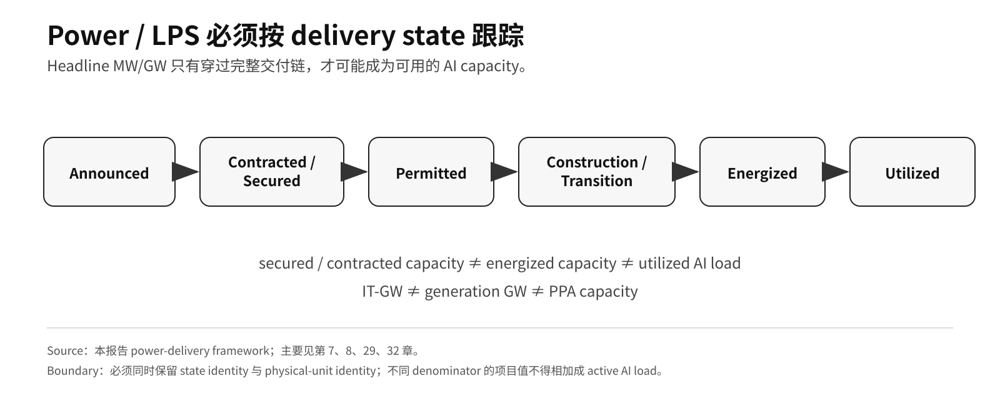
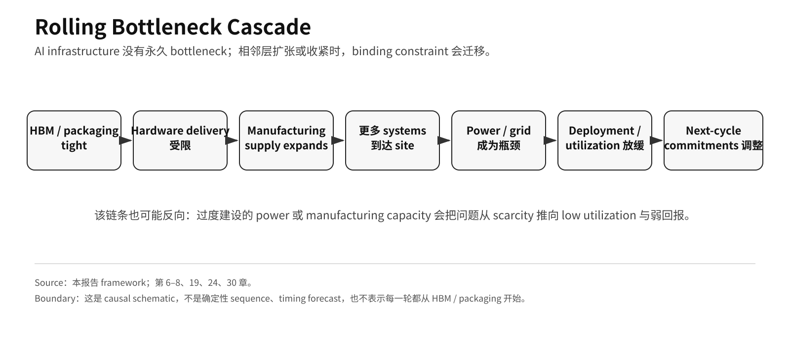

# Part I · 第7章：Time-to-Power——从 Rack Density 到 Deployable AI Capacity

## 1. Power 的核心问题是 Deployable Capacity，不是 Electricity Price

当 rack-scale AI system 进入约 **120 kW/rack** 时，power 已经不只是 OpEx input，而成为 deployment gate。[^1]

一个 D-grade stress conversion 可以显示量级：

> 500 racks × 120 kW/rack = **60 MW rack-level full-load power**

这不是任何具体 campus 的部署事实，也不包含 facility overhead。它说明数百个高密度 rack 会迅速把 **powered land、grid interconnection、substation、transformer、cooling、firm generation 与 permitting** 拉进同一交付链。

因此真正需要观察的是：

> **Time-to-Power：一个项目从决策、资源锁定到真正 energized、并可被 workload 使用，需要多长时间。**

---

## 2. Power 必须使用 Delivery-State Model

AI power project 至少要区分：

> **Announced → Contracted / Secured → Permitted → Construction / Transition → Energized → Utilized**

这些状态不能互换。

例如：

- 1 GW PPA 不等于 1 GW AI compute 已经 online；
- 500 MW development target 不等于当前已有 500 MW 可调度电力；
- secured capacity 不等于 energized capacity；
- energized capacity 也不等于已经被高利用率 workload 占用。

因此，AI power 研究最重要的不是把所有已公布 MW/GW 容量加总，而是判断：

**图 5 Note：** 本报告 power-delivery framework。必须同时保留 state identity 与 physical-unit identity；secured / contracted capacity ≠ energized capacity ≠ utilized AI load，且 IT-GW ≠ generation GW ≠ PPA capacity。

> **多少容量、在什么地点、什么时间、以什么状态，能够真正服务当前或下一代 AI system。**

---

## 3. 代表性项目位于不同 Delivery Clock

### 3.1 Microsoft / Constellation：重启约 835 MW 的存量核电资产

Microsoft 与 Constellation 的 **20 年 PPA** 支持原 Three Mile Island Unit 1 以 Crane Clean Energy Center 名义重启，公开机组规模约 **835 MW**。[^2]

这一案例说明，大型 AI / cloud demand 已经能够通过长期购电承诺影响大型 generation asset 的资本决策。

但 835 MW 是项目容量锚，不代表 835 MW 已经实时送达 AI data center。

Constellation **2024-09-20 的首份 PPA / restart announcement** 只写项目需要 significant investment，并未量化该投资；但公司 **2024-11-04 Q3 2024 results** 随后明确估计，Crane restart 需要约 **US$1.6B cash from operations 用于 restart capital expenditures**，estimated in-service date 为 **2028**。[^2]

因此，**US$1.6B 可以进入一手 fact layer，但身份必须锁定为 project restart-CapEx estimate**：它不是 Microsoft CapEx、不是 PPA contract value、不是已经实际支出的金额，也不代表 835 MW 已经实时送达 AI data center。

真正决定经济价值的是：

- regulatory approval；
- equipment restoration；
- grid interconnection；
- commercial operation timing；
- delivered MW；
- utilization。

---

### 3.2 Talen / AWS：最高 1,920 MW 的 revised PPA

Talen/AWS revised PPA 的 full contract quantity 为 **up to 1,920 MW**，合同延续至 2042。Talen 2026 Q2 10-Q 已明确写明 revised-PPA transition **occurred in April 2026**。[^3] 这一后续披露已经**取代 2025 Form 10-K 中 spring-2027 full-transition expectation，成为当前 transition-state marker**。较早 10-K 仍可用于保留原始 delivery-ramp 口径：power delivery 将随时间爬坡，full contract volume 当时预计最迟在 **2032** 达到。[^4]

因此，April 2026 是当前 revised-PPA transition 状态，但仍不能扩写成 full **1,920 MW** 已全部完成 physical delivery、energized for AWS load 或 utilized。transition state 与 delivery-ramp state 必须分开：

- 全部物理改造已完成；
- 全部 1,920 MW 已经 delivered；
- 全部 capacity 已被 AWS workload 高利用率使用。

这一案例说明，商业合同可以提前锁定长期资源，但物理交付仍有独立时钟。

---

### 3.3 Google / Kairos：2030 年 50 MWe、2035 年前最高 500 MWe

Google / Kairos 的公开时间线更长：**Hermes 2 最早在 2030 年达到 50 MWe，随后在 2035 年前形成最高 500 MWe 的 fleet。**[^5]

这更适合被理解为长期 supply option、industrial-learning path 与 capacity hedge，而不是 2026–2028 可以直接供 AI campus 使用的 near-term power。

因此，SMR 在近期的主要价值是 future optionality；不能用它来抹掉今天仍然存在的 interconnection、transformer 与 powered-site constraint。

### 3.4 PORTS-Pike / NVIDIA / SB Energy / OpenAI：secured LPS 与初始 4.25 IT-GW 设计容量

2026-08-17，NVIDIA 披露 PORTS-Pike Technology Campus 的新结构：通过与 SB Energy 合作，NVIDIA 为 land、power 与 shell buildout 提供 credit support，初始部署设计支持 **4.25 IT-GW**；OpenAI 将使用该 site，SB Energy 建设、持有并运营 data center。announcement-stage 口径是从 **calendar 2028** 开始分阶段上线；NVIDIA 后续 FY27 Q2 Form 10-Q 则把第一 guarantee/service phase 写为预计在 **fiscal 2029** 开始。两者属于可兼容的 time identity，不应当作两个独立交付节点。[^7]

这条证据把 Time-to-Power 再推进一层：

> **真正稀缺的不是孤立的电力合同，而是 land + power + shell 在可执行时间窗口内的组合。**

因此，LPS secured capacity 比单一 PPA 容量数字更接近 deployable-compute 的前置条件。

但 4.25 IT-GW 仍然是设计/规划容量，不是 2026 energized 或 utilized load。

---

## 4. Project Capacity 不能合并成 Active AI Load

**Table 7.1 — 代表性 AI 电力 / LPS 路径**

| 项目 | 名义规模 | 当前分析身份 |
|---|---:|---|
| Crane / Microsoft | ~835 MW | restart / regulatory / execution path |
| Talen / AWS | up to 1,920 MW | revised PPA / transition / ramp |
| Kairos / Google | up to 50 MWe in 2030; up to 500 MWe by 2035 | long-duration development option |
| PORTS-Pike / NVIDIA / SB Energy / OpenAI | initial 4.25 IT-GW design capacity | LPS secured / announcement-stage phased buildout from calendar 2028；first guarantee/service phase expected in fiscal 2029 |

**Source:** Constellation、Talen Energy、Kairos Power / Google、NVIDIA / SB Energy.[^2][^3][^4][^5][^7]  
**Note:** 不同项目处于不同合同、建设、许可、上电与利用状态，且表中的 generation MW/GW、PPA capacity 与 IT-GW 不是同一物理量，不能机械相加为 active AI load。

这些案例分别代表：

1. 重启既有大型电源；
2. 重构大型用户与现有 generation asset 的长期关系；
3. 建设新的未来 generation technology；
4. 通过信用支持提前锁定 land + power + shell 的组合交付能力。

它们说明 AI demand 正在影响 power capital formation，但不能用来证明某个统一 GW 数字已经投入 AI 运行。

---

## 5. Grid Queue 衡量 Friction，不衡量 AI Demand

Berkeley Lab 的 Queued Up 数据显示，美国 active generation/storage interconnection queue 在 **2023 年末**接近 **2,600 GW** 峰值，到 **2025 年末**约为 **2,061 GW**。[^6]

这个数字不能改写为“美国 AI 缺 2,061 GW 电力”。

它能够支持的更窄结论是：

> **大量 generation / storage project 需要经过漫长 interconnection 流程，grid buildout 与 transmission capacity 会形成多年级时钟。**

真正与 AI system delivery 相关的是：

- specific region；
- specific site；
- specific delivery window；
- executable interconnection path；
- firm delivered MW。

所以 nationwide queue 只是 grid friction 的宏观证据，不是 AI power shortage 的直接数量。

---

### 5A. Grid Delivery 还存在独立的 Equipment-Procurement Clock

Time-to-Power 不只受发电项目与 interconnection 约束，也受电网设备自身的供应链约束。IEA 指出，在 advanced economies，新 transmission line 往往需要 **4–8 年**；关键电网部件的等待时间近年也明显拉长。[^8] 另一份 IEA transmission supply-chain 研究给出的典型采购期为：**cable 约 2–3 年**、**large power transformer 最长约 4 年**，两者平均 lead time 自 2021 年以来接近翻倍。[^9]

### Table 7.2 — 与 Time-to-Power 直接相关的 Grid Delivery Frictions

| Constraint | 公开机构锚点 | 正确解释 |
|---|---|---|
| New transmission | advanced economies 约 4–8 年 | broad grid-build clock，不是单个 AI data-center 的固定交付期 |
| Cables | 采购约 2–3 年 | transmission / interconnection 交付链中的 component constraint |
| Large power transformers | 采购最长约 4 年 | 可能拖延 substation / grid delivery 的设备瓶颈 |
| Interconnection queue | 多年 study + 高 withdrawal rate | friction indicator，不是 AI unmet demand 的直接数量 |

**Source:** IEA 与 Lawrence Berkeley National Laboratory.[^6][^8][^9]  
**Note:** 上述数字属于 grid-system / equipment-supply anchor，不代表所有 AI campus 都面对相同 lead time。它们支持的更窄结论是：energized capacity 取决于 **permitting + interconnection + equipment procurement + construction**，不能由 generation nameplate 单独决定。

这也进一步收紧 delivery-state boundary：一个项目即使已经有 land、PPA 和 financing plan，仍可能因为 transformer、cable、substation 或 grid-connection path 未闭合而无法按期 energized。

## 6. Time-to-Power 已经成为 System-Competition Variable

先进芯片可以按季度甚至更快迭代，但：

- transmission；
- substation；
- transformer；
- permitting；
- generation；

往往以多年推进。

这意味着 hyperscaler / data-center competition 出现一个新的时间变量：

> **Time-to-Power：从项目决策到可稳定交付、可被 workload 利用的电力需要多久。**

拥有以下条件的项目会获得明显时间优势：

- existing grid connection；
- powered land；
- available transformer / substation capacity；
- firm generation；
- executable permitting path；
- cooling infrastructure。

Hyperscaler competition 因此不只是“谁拿到更多 accelerator”，还包括一个大规模 deployment-timing 问题：

> **谁能更快把下一批 50 MW / 100 MW / 500 MW system 推进到 energized。**

这里的 **50 / 100 / 500 MW 只是用于说明 Time-to-Power 的 scenario-scale markers，不是任何已披露项目容量。**

因此，拥有 accelerator 不代表拥有 deployable compute。

---

## 7. Semiconductor Supply 缓解后，Power 可以成为 Binding Constraint

AI infrastructure 没有一个永久固定的唯一瓶颈。

一种典型路径是：

> HBM / advanced packaging tight → hardware delivery受限 → 制造扩产后更多 racks 到场 → power / interconnection 成为下一瓶颈 → deployment / utilization 受限

**图 8 Note：** 本报告 causal framework。该链条是 schematic，不是确定性 sequence；cycle 可以从其他 layer 开始，overbuild 也可能把问题从 scarcity 反向推向 low utilization 与弱回报。

也可能反过来：

> power / data-center capacity 提前建设 → workload 或 hardware delivery 不足 → utilization 下降 → capital return 恶化

所以：

> **一个 bottleneck 被解决，不代表整个 system bottleneck 被解决。**

这就是 Rolling Bottleneck Cascade 在电力层的含义。

---

## 8. Power Contract 与 Compute Asset 运行在不同 Clock

AI server 的技术迭代周期通常远短于：

- data-center shell；
- transmission；
- generation asset；
- long-duration PPA。

Crane 对应 **20 年 PPA**，而 compute hardware 会更快换代。[^2]

因此，长期电力承诺具有双重属性：

**高需求情景**

它是：

- supply assurance；
- deployment advantage；
- financing support；
- barrier to entry。

**低利用率 / S4 情景**

它可能转化为：

- long-duration obligation；
- stranded infrastructure；
- take-or-pay exposure；
- lower capital return。

因此，power asset 不能只按“有没有签合同”评价，还要看：

- duration；
- ramp；
- cancellation / take-or-pay；
- project execution；
- utilization；
- residual economic value。

---

## 9. Power 何时成为 Binding Constraint？

需要看到多项同步证据，例如：

- major buyers 持续明确披露 power/interconnection 是增长上限；
- delivered hardware 大规模等待上电；
- energized capacity 长期落后于计划；
- next-generation orders 因 power delay 被推迟；
- powered sites 的 Time-to-Power 持续决定项目选址和资本回报；
- utilization 因电力不足系统性下降。

截至 2026 年 8 月，更稳健的判断是：

> **Power 已经进入与 HBM、advanced packaging 并列的核心物理约束层，但公开证据尚不足以证明它已经单独成为整个 AI infrastructure 的唯一主导瓶颈。**

## 10. 什么事实会改变当前判断

应下调 power / LPS 作为核心约束的判断，如果持续出现：

- Time-to-Power 显著缩短；
- secured / contracted projects 高比例、按期转化为 energized capacity；
- transformer、substation、grid interconnection 与 cooling 不再形成主要 deployment delay；
- energized capacity 增长持续快于 deployable compute demand；
- regional power price / availability 不再显著影响 site selection。

公布的 GW 规模增加本身不足以证明 power bottleneck 已解除，必须看到 state transition 与实际 utilization。

## References

[^1]: NVIDIA, DGX GB200 Hardware Guide, rack power approximately 120 kW, https://docs.nvidia.com/dgx/dgxgb200-user-guide/hardware.html
[^2]: Constellation, 2024-09-20 Crane Clean Energy Center / Microsoft 20-year PPA announcement, approximately 835 MW unit and 2028 restart target, https://www.constellationenergy.com/news/2024/Constellation-to-Launch-Crane-Clean-Energy-Center-Restoring-Jobs-and-Carbon-Free-Power-to-The-Grid.html ; Constellation, 2024-11-04 Q3 2024 results, approximately US$1.6B of cash from operations estimated for restart capital expenditures and 2028 in-service estimate, https://investors.constellationenergy.com/news-releases/news-release-details/constellation-reports-third-quarter-2024-results
[^3]: Talen Energy, 2026 Q2 Form 10-Q, revised AWS PPA transition and up to 1,920 MW, U.S. SEC, https://www.sec.gov/Archives/edgar/data/1622536/000162253626000066/tln-20260630.htm
[^4]: Talen Energy, 2025 Form 10-K, expected full transition timing, U.S. SEC, https://www.sec.gov/Archives/edgar/data/1622536/000162253626000017/tln-20251231.htm
[^5]: Kairos Power / Google partnership, Hermes 2 up to 50 MWe in 2030 and fleet up to 500 MWe by 2035, https://www.kairospower.com/google
[^6]: Lawrence Berkeley National Laboratory, “Queued Up: 2026 Edition,” active U.S. generation/storage interconnection queue, https://eta-publications.lbl.gov/sites/default/files/2026-06/queued_up_2026_edition.pdf
[^7]: NVIDIA / SB Energy, PORTS-Pike Exhibit 99.1 filed 2026-08-17, initial 4.25 IT-GW design capacity and announcement-stage phased buildout from calendar 2028, U.S. SEC, https://www.sec.gov/Archives/edgar/data/1045810/000104581026000069/sbeoainvidia-portsrelease.htm ; NVIDIA Corporation, FY27 Q2 Form 10-Q, guarantees phasing in across nine data centers with the first expected in fiscal 2029 and exposure declining as OpenAI fulfills lease payments, https://www.sec.gov/Archives/edgar/data/1045810/000104581026000075/nvda-20260726.htm

[^8]: International Energy Agency, “Energy and AI — Executive summary,” grid-connection queues, transmission lead times, and critical-component delays, https://www.iea.org/reports/energy-and-ai/executive-summary
[^9]: International Energy Agency, “Building the Future Transmission Grid — Executive summary,” cable and large-transformer procurement lead times, https://www.iea.org/reports/building-the-future-transmission-grid/executive-summary
