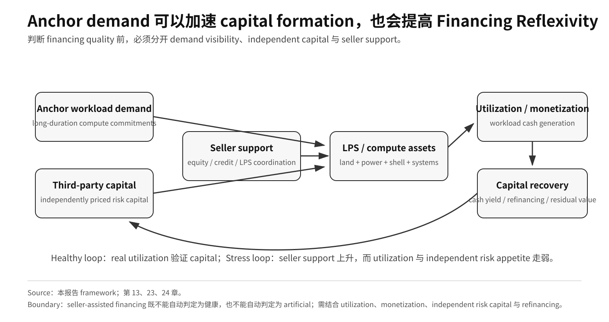

# Part III · 第23章：AI 基础设施资本市场与融资结构

## 1. AI Infrastructure 已经跨多种 Asset Class 融资

AI infrastructure finance 已经覆盖 equity、private infrastructure、project finance、power、long-duration compute contracts 与 private credit。

当前 capital stack 包括：

- semiconductor manufacturing；
- private infrastructure；
- data center；
- power / grid；
- project finance；
- long-duration compute contracts；
- private credit / institutional capital。

因此，核心问题不是“还有多少钱愿意投 AI”，而是：

> **哪一种资本承担哪一种久期、现金流和 residual-value risk。**

## 1A. Capital Allocation：观察 Risk-Adjusted Return 的五个维度

融资结构变复杂，本身不能被写成泡沫证据。资本在各自 mandate 下追求的是更高的**风险调整后回报（Risk-Adjusted Return）**，而不同类型资本会主动选择 AI value chain 中完全不同的位置。

对 AI infrastructure，至少需要把五个维度分开观察：

1. **市场规模 / Opportunity Set（TAM）。** 足够大的潜在现金流空间可以支持更大资本形成，但 TAM 只是机会边界，不是 realized revenue、utilization 或 cash flow。
2. **一级市场 / Pre-IPO / Strategic Capital。** VC、private capital、sovereign capital 与 strategic equity 反映资本愿意在成熟现金流出现前为 option value 出资；战略投资还可能同时服务于 customer、distribution、supply 或 ecosystem position，因此不能把它当纯被动估值信号。
3. **市场地位（Market Position）。** switching cost、distribution、scarce-resource access、customer concentration 与 bargaining power 决定资本预期某家公司或某一层能留下多少 economic rent。
4. **销售利润与真实经营经济性。** revenue growth、gross / operating margin、free cash flow、unit economics 与 cash conversion 用来检验“市场地位”是否真正变现。
5. **股票市值 / Public-Market Valuation / Cost of Capital。** market cap、equity multiple、debt spread 与融资可得性会改变企业发股、发债、并购、人才激励、供应链预付款与 infrastructure support 的能力。**Market cap 不是现金，高估值也不证明未来利润；它改变的是可执行融资选择集。**

这五个维度可以形成反馈，但不是必然向上的阶梯：

> **更大 opportunity set → 一级 / 战略资本 → capability 与 scale → 更强 market position → profit / FCF → 更低或更灵活的 capital cost → 更强再投资能力**

当底层 cash flow 能够验证这条链时，资本会强化领先地位；当 monetization、market position 或 financing condition 变化时，这条链也可以快速反向。

这也是为什么 private credit、SPV、infrastructure fund 或 seller-assisted financing 不能被自动写成“晚周期危险信号”。真正的问题是：

> **这些结构是在通过 duration matching 与 risk allocation 提高风险调整后回报，还是只是在用 refinancing / support 掩盖弱经济性？**

---

## 1B. 历史类比必须有 Contract-Level Evidence

vendor assistance、SPV、private credit 或 off-balance-sheet structure，确实可能让人联想到历史上的其他 infrastructure cycle；但“看起来像”不足以把当前 AI buildout 定性成历史电信泡沫或 2008 年 securitization cycle 的重演。

要做严谨历史类比，至少需要看到：

- leverage 与 loan-to-value；
- covenant quality 与 recourse；
- take-or-pay / minimum-revenue obligation；
- residual-value guarantee 或 repurchase commitment；
- senior / junior loss allocation；
- refinancing dependency；
- default / restructuring behavior；
- 底层资产的 transferability 与 secondary-market liquidity。

如果这些 contract-level 变量没有公开，历史类比只能作为**研究启发（research heuristic）**，不能升级成正式结论。

所以本报告使用 financing structure 时真正问的是：

> **下行风险最终由谁承担，现金收益能否覆盖 capital cost？**

而不是仅仅因为出现 SPV 或 private credit，就推断系统性脆弱性已经形成。

---

## 2. Asset-Light Platform 与 Heavy Infrastructure 具有不同 Return Structure

NVIDIA 的典型特征是 high system margin、strong cash generation 与 externalized manufacturing model；其 FY26 Form 10-K 明确记录了 fabless / contract manufacturing strategy。[^6]

FY26 NVIDIA-defined non-GAAP free cash flow 为 **US$96.575B**；[^1] FY27 Q2 Revenue **US$96.221B**、Data Center **US$89.0B**、GAAP gross margin **75.0%**、GAAP operating income **US$63.734B**。[^2]

相比之下，hyperscaler、foundry、memory vendor、data-center operator 和 power developer 需要承担大量 fixed assets。

所以同样 revenue growth，在 platform 与 infrastructure 层的 capital return 含义完全不同。

## 3. Hyperscaler Risk 叠加多个 Asset Clock

cloud CapEx 同时进入 servers、custom silicon、network、buildings、cooling、power 和 land。

这意味着 hyperscaler 必须同时管理多个 useful-life clock。

高 utilization 时，这种 CapEx 可以形成 barrier；低 utilization 时，D&A、FCF 与 residual-value pressure 会迅速显现。

因此需要同时看 growth、D&A、FCF、utilization、AI-related monetization 与 next-year CapEx。

## 4. Manufacturing Capital 具有不同的周期性

TSMC、SK hynix、Micron 等制造商承担 fab、equipment、cleanroom、process migration 与 yield learning。

它们的回报取决于 utilization、product mix、technology leadership、customer demand 与 pricing。

HBM boom 可以显著改善 memory-vendor economics，但制造利润仍比 system-platform economics 更受 cycle 与 utilization 影响。

## 5. Compute 正变成可独立融资的 Infrastructure Asset

NVIDIA 2026-08-10 官方宣布，与 Apollo、BlackRock、Blackstone、Brookfield、Goldman Sachs、KKR 建立独立 compute financing platforms，目标是**随时间动员超过 US$500B third-party capital**用于 AI infrastructure buildout。[^3]

这条证据的重要性不在于把 **US$500B mobilization target** 误写成“已到账现金”，而在于：[^3]

> **compute 正被尝试组织成可由长期机构资本独立承销和融资的基础设施资产。**

官方同时明确：相关 partnership **subject to execution of final agreements**。

因此 **>US$500B** 只能作为 mobilization target，不能写成 committed / funded / deployed capital。[^3]

## 6. Seller-Assisted Finance 形成 Financing Reflexivity

2026-08-17 的 PORTS-Pike structure 说明，compute financing 可以从 hardware 延伸到 **land + power + shell (LPS)**。NVIDIA 披露了对 LPS buildout 的 credit support、对 SB Energy 的 **US$1.5B** 投资、初始 **4.25 IT-GW** design capacity，以及 OpenAI 作为 end customer。[^4]

NVIDIA FY27 Q2 earnings call 又提供了一条 company-level signal：管理层表示公司已向 frontier AI labs 投资接近 **US$50B**，并讨论了 selective credit enhancement，为另一家 frontier lab 的 infrastructure buildout 提供接近 **2 GW of compute**。[^5]

这些披露支持一个独立分析机制：

> **platform cash generation → equity / credit support → infrastructure financing improves → Anchor Buyer capacity expands → platform-system demand expands**

这就是 **Financing Reflexivity**。

**图 9 Note：** 本报告 financing framework。seller-assisted financing 既不能自动判定为健康，也不能自动判定为 artificial；其证据意义取决于 utilization、monetization、independent risk-capital willingness 与 refinancing conditions。

它不证明 demand 是 artificial。

它意味着 demand quality 必须区分：

1. independently financed end demand；
2. long-duration customer commitments；
3. third-party infrastructure finance；
4. supplier equity / credit enhancement。

如果 utilization 与 monetization 保持健康，seller-assisted finance 可以加快真实基础设施形成。

如果 utilization 走弱，而 supplier support 与 refinancing dependency 持续上升，forward-demand signal 的独立性就会下降。

## 7. Compute 为什么可以按 Infrastructure 融资

长期资本通常偏好 predictable cash flow、long contract、collateral 与 clear offtaker。

AI compute 正通过 long-term compute commitments、hyperscaler leases、PPA 与 Anchor Compute Buyer demand 尝试创造这种结构。

如果 usage-linked revenue 与 customer transferability 足够稳定，compute asset 可以获得更接近 infrastructure financing 的资本来源。

## 8. Hardware Residual Value 是与传统 Infrastructure 的关键区别

compute 与传统 infrastructure 最大差异之一，是 generation obsolescence 更快。

如果下一代 accelerator / system 显著降低 cost per task，旧 hardware 即使仍可工作，也可能快速贬值。

所以融资结构必须回答：

- residual-value risk 谁承担；
- customer contract 是否覆盖 depreciation；
- utilization 是否足够稳定；
- asset 是否可在不同 customers/operators 之间转移；
- leverage 是否建立在过度乐观的 terminal value 上。

## 9. Anchor Buyer 降低 Financing Risk，同时提高 Concentration

OpenAI、Anthropic 等 long-duration demand 提供 revenue visibility，使 project finance 更容易成立。

但如果 project economics 高度依赖单一 model company，融资风险会从 technology risk 转成 customer-concentration / utilization risk。

因此，Anchor Buyer 既是融资条件，也是风险集中点。

## 10. Sovereign Capital 的意义在于 Strategic Capacity

主权基金参与 AI infrastructure 的逻辑通常不仅是财务回报，也包括 domestic compute、data center、power、semiconductor manufacturing 与 strategic autonomy。

所以真正具有战略意义的是对 fab、power、sovereign cloud、compute fund 和 infrastructure project 的直接参与，而不是二手市场股票持仓。

没有官方项目披露时，本报告不使用传闻持仓构造“主权资本已经全面入场”的结论。

## 11. Duration Matching 是 Financing-Quality Core Test

**Table 23.1 — AI infrastructure 资产类别与主要融资风险**

| 资产 | 主要风险 |
|---|---|
| GPU/server | technology refresh / residual value |
| Data center | utilization / lease duration |
| Grid/substation | long construction / regulated return |
| PPA | long obligation / demand risk |
| Foundry | utilization / node transition |
| HBM fab | memory cycle / generation timing |

**Source:** 本报告资产久期与融资风险框架。  
**Note:** 表中为机制分类，不代表所有项目具有相同融资结构、杠杆水平或合同条款。

最危险结构是：

> **short-duration demand assumption + long-duration debt / power / real-estate obligation**

## 12. Current Read

AI infrastructure 正从科技公司内部 CapEx 进一步扩展为：

> **technology capital + infrastructure capital + private capital + sovereign capital**

共同参与的长期资产体系。

这会扩大可获得资本规模，也会把 risk distribution 从单一 corporate balance sheet 扩散到更广的金融体系。

最终决定这类融资是否可持续的，不是公布的资本目标，而是 utilization、cash yield、contract quality 与 hardware residual value。

## 13. 什么事实会改变当前判断

应下调“compute 正在形成独立 infrastructure-finance asset class”的判断，如果：

- third-party financing platforms 无法完成 final agreements 或实际部署；
- long-duration customer contracts 大量重谈；
- hardware residual value / transferability 低于融资假设；
- refinancing 依赖持续提高；
- seller credit support 比重上升而 independent risk capital 下降；
- project cash yield 无法覆盖 capital cost。

反过来，更多公开资本目标并不足够；真正需要的是 funded capital、delivered assets、utilization 与可持续 cash flow。

## References

[^1]: NVIDIA, “NVIDIA Announces Financial Results for Fourth Quarter and Fiscal 2026,” NVIDIA-defined non-GAAP free cash flow, https://nvidianews.nvidia.com/news/nvidia-announces-financial-results-for-fourth-quarter-and-fiscal-2026
[^2]: NVIDIA, “NVIDIA Announces Financial Results for Second Quarter Fiscal 2027,” https://nvidianews.nvidia.com/news/nvidia-announces-financial-results-for-second-quarter-fiscal-2027
[^3]: NVIDIA, 2026-08-10, AI compute infrastructure financing platforms and >US$500B third-party-capital mobilization target, https://investor.nvidia.com/news/press-release-details/2026/NVIDIA-Partners-With-Apollo-BlackRock-Blackstone-Brookfield-Goldman-Sachs-and-KKR-to-Establish-AI-Compute-Infrastructure-Financing-Platforms-to-Mobilize-Over-500-Billion-of-Third-Party-Capital/default.aspx
[^4]: NVIDIA, “NVIDIA Guarantees SB Energy's PORTS-Pike Technology Campus in Ohio to Exclusively Host NVIDIA AI Compute,” 2026-08-17, credit support, US$1.5B SB Energy investment, initial 4.25 IT-GW design capacity, https://investor.nvidia.com/news/press-release-details/2026/NVIDIA-Guarantees-SB-Energys-PORTS-Pike-Technology-Campus-in-Ohio-to-Exclusively-Host-NVIDIA-AI-Compute/default.aspx
[^5]: NVIDIA, FY27 Q2 Earnings Call transcript, 2026-08-26, frontier-lab investments and selective credit enhancement commentary, https://investor.nvidia.com/files/content_files/TRANSCRIPT_-NVIDIA-Corp-NVDA-US-Q2-2027-Earnings-Call-26-August-2026-5_00-PM-ET.pdf

[^6]: NVIDIA Corporation, FY26 Form 10-K, external foundry / memory / packaging manufacturing model and supply commitments, https://www.sec.gov/Archives/edgar/data/1045810/000104581026000021/nvda-20260125.htm
