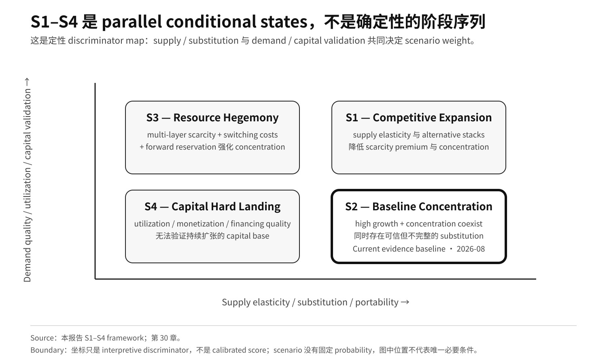

# Part IV · 第30章：Scenario Framework——S1–S4 判别

## 1. Scenario 是 Conditional State，不是 Narrative

该框架不为 2030 或 2036 给出唯一答案，也不为 S1–S4 配置固定概率。

Scenario framework 的作用是 operational classification：**当前哪一种 structural state 最符合证据、哪些变量能够区分替代情景、什么 observation 会迫使 scenario weight 发生迁移？**

下图以定性方式压缩这一 scenario framework。



**图 6 Note：** qualitative report framework。图中位置是 schematic discriminator，不是 calibrated score；S1–S4 是 parallel conditional states，不带固定 probability。

因此，scenario weighting 依赖可持续监测的 state variables：

- layer-specific scarce-capacity access；
- HBM / advanced-packaging supply；
- second-stack substitution；
- Anchor Buyer commitments；
- power delivery / Time-to-Power；
- software migration；
- China closure tests；
- utilization / monetization；
- financing quality；
- regulation / geopolitics。

## 2. S1 — Competitive Expansion：Supply 与 Substitution 跑赢 Concentration

### Structural Condition

AI demand 继续增长，但供给扩张与替代系统成熟速度足以降低 concentration。

典型条件：

- leading-edge capacity 扩张并有更多 qualified supply；
- HBM supply elasticity 提高；
- advanced-packaging tightness 显著缓解；
- cloud custom systems 承担大量真实 workload；
- open software / interfaces 降低 migration cost；
- power / energized capacity 跟上 buildout；
- 多套 system stacks 在 production 中长期并存。

### Economic Result

dominant platform 仍然很大，但 buyer optionality 和 bargaining power 提高，scarcity premium 下行，value capture 更分散。

这是：

> **market expands + concentration declines**

而不是“AI infrastructure 消失”。

### 2A. Supply-Response Overshoot 可以加速 S1

Rolling Bottleneck Cascade 不意味着同一稀缺层会连续十年保持短缺。Fab、memory 与 packaging 都具有较长建设 / qualification 周期，**当前高价格与高利润会刺激多家供应商同时扩产；当这些项目在相近窗口释放有效产出，而 demand growth 同时放缓时，某一层可以从 shortage 很快转向 headroom，甚至 oversupply。**

截至 evidence cutoff，公开前瞻已经显示这种**分层而非统一**的供给响应：TrendForce 2026-07-30 预计 2027 年 DRAM 仍偏紧，但 NAND Flash 在新增产能与 bit-output 增长作用下可能于 **2H27** 转向更宽松供需结构；其同时判断部分新增 DRAM 产能的显著 output contribution 要到 **2028** 才体现。[^10]

因此，不把 2024–2026 的 HBM / packaging tightness 静态外推为十年永久短缺。真正需要观察的是每一层的：

- effective capacity ramp；
- qualification / yield；
- demand-growth deceleration；
- lead time / clearing price；
- utilization；
- product-mix reversal。

如果多个 scarce layers 的 supply growth 持续超过 demand growth、lead time 与 scarcity premium 同时下降，S1 权重应明显上升；如果同时伴随 utilization 与 clearing price 恶化，则还可能提高 S4 权重。

## 3. S2 — Baseline Concentration：Growth 与 Concentration 共存

### 定义

当前主要趋势延续：

- AI demand 高；
- leading system-platform seller economics 强；
- HBM / advanced packaging 仍周期性 tight；
- cloud custom systems 继续扩大但未全面替代 frontier workload；
- power 进入独立部署约束；
- China frontier parallel stack 持续迭代并出现部分 production deployment，但完整 production-grade closure 尚未由公开证据确认；
- CapEx / forward commitments 仍高。

### 经济结果

市场继续高速扩大，同时 value capture 集中在少数 system platforms 与 scarce-layer suppliers。

对传统整机而言，S2 不是一个旁支背景：**高增长与高集中可以和 Non-AI Residual Capacity 偏紧、quantity assurance 分化、配置升级变慢或 upgrade tax 同期存在。** 这不等于所有整机都在衰退，而是说明增长的收益与资源压力可以同时分布在产业链不同位置。

截至 2026 年 8 月，这是最接近当前事实组合的**基准状态**，不是十年固定预测。

## 4. S3 — Resource Hegemony：Multi-Layer Concentration 进入自我强化

### 定义

demand growth 持续快于 substitution 与 supply expansion，多个 scarce layers 同时集中。

典型条件：

- advanced packaging 长期供不应求；
- HBM manufacturing intensity / generation constraint 持续；
- advanced logic、HBM、packaging、LPS/power 等多个关键层的 quantity assurance / delivery access 持续向少数买方集中；
- proprietary software / interconnect migration cost 仍高；
- cloud custom systems 只能局部分流；
- powered land / firm MW 被少数大型 buyers 长期锁定；
- Anchor Buyer 与 seller forward commitments 持续扩大；
- infrastructure finance 能持续吸收长期资本，且 workload monetization 足以支撑相关承诺。

### Reinforcement Mechanism

> high profit → stronger commitments / prepayment → greater future resource reservation → higher delivery certainty → stronger installed base / workload retention

它描述的是 system-level resource coordination 强化，不是法律意义上的 monopoly finding。

## 5. S4 — Capital Hard Landing：Capital Formation 跑赢 Productive Demand

### 定义

AI workload demand、utilization 与 monetization 无法覆盖快速增长的资本基数。

典型同步信号：

- token / workflow volume 增长不足；
- instance / lease price 快速下跌；
- utilization 下降；
- enterprise AI monetization 弱；
- hyperscaler CapEx guidance 下调；
- seller / Anchor Buyer commitments 缩减或取消；
- used hardware residual value 快速下跌；
- impairment / write-down 上升；
- customer financing capacity 走弱，同时 supplier equity / credit support 或 refinancing dependency 上升；
- consumer-linked、labor-income-dependent enterprise revenue 走弱，同时 AI budgets 继续增长。

这些是**典型信号族，不是 five-of-five mandatory gate**。S4 的确认依赖 cross-signal confirmation + cross-actor / cross-layer causal breadth。Accounting impairment 属于 confirmation / severity evidence，而不是 prerequisite；financing-led 或 real-economy clearing 可以在 qualifying write-down 出现之前被确认。

S4 也可能从**需求腿**而非融资腿到来。如果 AI 驱动的替代压缩劳动收入的速度快于新需求的创造，压力可以通过消费与家庭信用、而不是通过一次融资事故，传导到 enterprise AI monetization 与 capital clearing。这是 S4 内部的一条传导路径，不是第五种情景；其闸门与时钟见[第24章](part-III-ch24-capital-clearing.md) §7B 与[第29章](part-IV-ch29-monitoring-framework.md) §10。

### Clearing Order

首先承压通常是：

- next-generation hardware orders；
- inventory；
- short-lived system residual value；
- speculative / highly concentrated financing。

如果弱势持续，才进一步传导到 semiconductor CapEx、data-center expansion 与 power buildout。

S4 不等于 AI usage 消失；资本清算之后，低价 compute 仍可能刺激新的 application demand。

## 5.1 Comparative Scenario Matrix

**Table 30.1 — S1–S4 的核心驱动、主要结果与反向信号**

| 情景 | 核心驱动 | 主要产业结果 | 关键反向信号 |
|---|---|---|---|
| S1 — Competitive Expansion | supply elasticity、multi-sourcing、portability 上升 | value capture 更分散，buyer optionality 提高 | scarce-layer tightness 重新强化、migration cost 回升 |
| S2 — Baseline Concentration | demand 强、dominant platforms 强、替代持续但不完全 | 高增长与集中并存 | supply/substitution 明显改善或 ROI/commitments 同步恶化 |
| S3 — Resource Hegemony | 多层 scarcity + quantity assurance / delivery access 集中 + switching cost + financing coordination 同时强化，且 monetization 足以支撑 long-duration commitments | scarce-capacity access 更集中，后来者复制成本提高 | capacity access 分散、financing dependence 下降、open interfaces 显著降低迁移成本 |
| S4 — Capital Hard Landing | utilization / monetization 弱于资本基数，且 demand financing quality 恶化 | clearing、orders、CapEx 与资产价值下行，refinancing pressure 上升 | utilization、clearing price、financing independence 和 forward commitments 恢复 |

**Source:** 本报告 S1–S4 scenario framework。  
**Note:** 四类情景是并列条件状态，不赋固定概率，也不是必然连续阶段。

如何用 Table 30.1 避免 false precision：把每个“核心驱动”映射到 [第29章 Table 29.5–29.6](part-IV-ch29-monitoring-framework.md) 的可观测代理与持续性依据。改判需要可比的同分母观察 + 该变量自身时钟上的 cross-actor / cross-layer breadth；窄口径或脱离时钟的 headline 不得改 headline scenario。无同单位度量时，Gap 标注为 not measurable from public data，而不是用其他单位替代。

## 5A. Capacity Gap 是 Diagnostic Axis，不是第五种 Scenario

S1–S4 仍然是并列条件状态；不另设第二套 scenario taxonomy。为了把“这一层今天是否短缺”与“压力是在扩大还是收敛”分开，使用两个互补指标。

### Absolute Gap

```text
AI_Capacity_Gap_i(t)
= AI_Effective_Demand_i(t)
- AI_Effective_Capacity_i(t)
```

Demand 与 capacity 必须位于同一 physical layer、delivery window 与 qualification / quality boundary。单位可以是 wafers/month、qualified package starts/month、bits/year 或 MW。

- **Absolute Gap > 0：** 当前可交付供给不足；
- **Absolute Gap ≈ 0：** 当前供需接近平衡；
- **Absolute Gap < 0：** 当前存在 effective headroom。

### Growth Gap

```text
AI_Capacity_Growth_Gap_i(t)
= Growth(AI_Effective_Demand_i(t))
- Growth(AI_Effective_Capacity_i(t))
```

Growth Gap 是同一时期的增长率差，用来判断 absolute gap 更可能扩大还是收敛：

- **Growth Gap > 0：** scarcity 可能扩大，或既有 headroom 被侵蚀；
- **Growth Gap < 0：** scarcity 可能收敛，或 effective headroom 扩大；
- **Growth Gap = 0：** 供需以相同速度变化；不代表不存在 shortage。

因此：

- **多个关键层同时出现 Absolute Gap > 0 且 Growth Gap > 0：** scarcity 正在强化，权重向 S2 / S3 移动；
- **Absolute Gap > 0 但 Growth Gap < 0：** 当前仍短缺，但 supply 正在追赶，S1 权重可以上升；
- **Absolute Gap < 0 且 utilization 健康：** 供给存在 headroom，但这本身不是 S4；
- **Absolute Gap < 0 + utilization 下降 + clearing price 走弱 + commitments 收缩：** S4 权重显著上升。

AI Capacity Gap / Growth Gap 必须与 Non-AI Residual Capacity 一起读取。前两者回答 AI 当前缺多少、缺口如何变化；NARC 回答 priority allocation 之后还剩多少 effective supply 给 non-AI demand。

## 6. 六类变量用于 Scenario Discrimination

### Supply

leading-edge wafers、HBM、advanced packaging、power。

### Substitution

cloud custom systems、open compiler/runtime、alternative interconnect、China parallel stack。

### Demand

token/workflow volume、enterprise adoption、Anchor Buyer commitments、sovereign demand。

### Capital / Monetization

seller cash generation、hyperscaler CapEx、depreciation、utilization、workload revenue、residual value。

### Financing Quality

Anchor Buyer credit quality、third-party risk capital、supplier equity / credit support、refinancing dependency、asset transferability。

### Regulation / Geopolitics

export control、antitrust remedy、interface openness、industrial policy、regional fragmentation。

## 7. Anchor Buyer 与 Financing Quality 可以放大 Expansion 或 Clearing

大型 model companies 的多年 compute commitments 已经可以影响 infrastructure financing、custom silicon、power 与 data-center buildout。

2026 年的 financing layer 已经有 first-party disclosure：NVIDIA 公布的 compute-financing platforms 目标是随时间动员 **超过 US$500B third-party capital**，而 PORTS-Pike 则把 seller credit support 与 initial **4.25 IT-GW design capacity** 结合起来。[^7][^8] NVIDIA FY27 Q2 Form 10-Q 进一步披露，相关 SB Energy lease guarantees 的 aggregate obligations 上限为 **US$105B**；这些 guarantees 通常随着对应 lease 分阶段开始而生效，在特定 tenant default 情形下触发，并随着 lease payments 履行而下降。[^11] **US$105B 是 maximum conditional guarantee exposure，不是 funded CapEx，不是当前 cash outflow，也不能再与底层 lease demand 加总一次。**

Financing Reflexivity 也已不再是 NVIDIA 独有。AMD Q2 2026 Form 10-Q 披露，公司针对部分 commercial-partner data-center lease obligations 提供 guarantees，期限最长 15 年，**maximum gross exposure 为 US$4.1B**；AMD 同时说明，这些 guarantees 通常在 commercial partner default 时触发，且 exposure 会随着 contractual lease payments 履行而下降。[^12] **US$4.1B 同样是 maximum guarantee exposure，不是 funded CapEx，也不是 realized loss。**

这组 cross-vendor evidence 使该机制从单一公司案例扩展为行业融资结构，同时仍必须把不同 instrument 的 denominator 与 risk transfer 分开处理。

因此需要同时观察两个方向：

- **健康扩张**：Anchor Buyer demand、third-party capital、seller support 与真实 utilization / monetization 同步增长；
- **融资反身性恶化**：customer cash generation 走弱，但 seller equity / credit support 与 refinancing dependency 持续上升。

前者可以强化 S2/S3 的 infrastructure coordination；后者则提高 S4 风险。

所以 model-company contracts 与 seller-supported financing 都不能被当作普通 cloud customer spending。

## 8. 推动 S2 → S1 的 Signals

- alternative system stacks 在 frontier / high-value production workload 中规模化；
- HBM / packaging lead time 持续下降；
- advanced capacity access 更分散；
- open software / interfaces 明显降低 migration cost；
- power expansion 缩短 Time-to-Power；
- buyer multi-sourcing 变成生产常态。

## 9. 推动 S2 → S3 的 Signals

- seller forward commitments 持续快速扩大；
- HBM / packaging tightness 跨代持续；
- proprietary system switching cost 上升；
- 多个关键 scarce layers 的 quantity assurance / delivery access 持续向少数买方集中；
- scarce power / powered land 被少数 anchor buyers 长期锁定；
- alternative stacks 无法在 production scale 形成足够选择权。

## 10. 推动 S2 → S4 的 Signals

- CapEx guidance 连续下降；
- utilization 下降；
- seller / Anchor Buyer commitments 取消或明显收缩；
- second-hand system clearing price 快速下跌；
- cloud discounts / lease rates 明显恶化；
- impairment 增加；
- enterprise AI monetization 长期弱于 depreciation / operating cost；
- supplier equity / credit support 占比上升，而独立 customer financing / third-party risk-taking 走弱；
- labor-income compression 传导到 consumption、household credit 或 consumer-linked enterprise revenue，同时独立 financing 也走弱。

## 11. 这些是 State，不是 Stage

它们是并列条件状态。

例如，某些区域可能出现 S3-style power scarcity，同时某些 workload 已进入 S1-style multi-stack competition；memory 可能暂时进入宽松，而 packaging 仍 tight；capital market 可能局部清算，但 productive workload 继续增长。

因此，scenario weighting 用来描述**相对结构**，而不是把产业演化简化为单一路径。

## 12. Current Baseline：S2

截至 2026 年 8 月，baseline 是：

> **S2 — Baseline Concentration**

主要原因是：

- NVIDIA / leading platform seller economics 仍强；[^1]
- HBM 与 advanced packaging 仍是关键 bottlenecks；[^2][^3]
- cloud custom systems 已形成真实竞争，但尚未证明全面替代 frontier workload；[^4]
- infrastructure CapEx 与 forward commitments 仍高；[^5]
- power constraint 上升；[^6]
- China 已形成真实 frontier parallel alternatives 与部分 production deployment，但按[第17章](part-II-ch17-china-parallel-stack.md)七个 Production-Grade Gate，完整 production-grade frontier closure 尚未由公开证据确认；
- 全行业 Capital Hard Landing 的同步证据尚不足。

这条 baseline 只在上述事实组合继续成立时有效；判别方法见 §12A。

## 12A. Discrimination Rules

情景之间按以下判别轴区分，而不是用单一总量指标：

- **S1 ↔ S2**：替代系统在 frontier / high-value production workload 中的规模化程度，以及 HBM / packaging lead time 是否持续下降；
- **S2 ↔ S3**：scarce-layer allocation 的集中度变化方向、seller forward commitments 增速、proprietary switching cost 与 powered-land 锁定程度；
- **S3 ↔ S4**：utilization / monetization 与 capital base 之间的关系。由于公开数据没有提供可比的 industry-wide ratio，使用 public proxies：clearing price（二手系统价、lease rate、cloud discount）、commitment growth、seller equity / credit support、third-party capital risk premia 与 refinancing dependency。

同一批资本证据现在已经跨越 third-party mobilization 与多家 supplier-assisted support：包括 **>US$500B** third-party-capital mobilization target、**US$105B** PORTS-Pike maximum conditional guarantee exposure、AMD **US$4.1B** commercial-partner data-center lease-guarantee maximum gross exposure、接近 **US$50B** 的 frontier AI lab 投资，以及接近 **2 GW of compute** 的 selective credit enhancement。[^7][^11][^12][^9]这些数字的 denominator 不同，不能加总成一个资本总额。在代理信号健康时，它们支持 S2/S3 的 infrastructure coordination；在代理信号广泛、持续恶化时，则提高 S4 权重。判别不依赖任何单点数据。

边界情形：若需求增速显著放缓，但尚未在多类 S4 信号族之间形成足够的 cross-signal confirmation 与 causal breadth，则按 substitution 强度归属——替代规模化扩大则 S1 权重上升；scarce-layer 仍紧则归入 S2（此时"需求高"应读作"需求增速仍高于有效供给增速"）。

## 12B. Calibration Status

截至 evidence cutoff，S1–S4 的判别轴已经明确，但**尚不存在经统计验证的统一数值阈值、固定观察窗口或自动切换规则**。

因此：

- 单一 CapEx 下调不能独立触发 S4；
- 单一 packaging / HBM tightness 不能独立触发 S3；
- 单一 alternative-chip launch 不能独立触发 S1；
- S2 也不能因为“多数变量仍可解释”为默认永久状态。

情景权重的变化必须来自**多个相互独立的公开代理在连续观察中形成同方向证据**，同时显式记录反证与 segment breadth。不同数据具有季度、半年或年度披露频率，不人为把它们压成一个伪精确统一窗口。

**Mechanism-break override：** breadth 要求约束的是**系统级 scenario classification**，不是给底层机制提供“必须等多信号才承认反例”的保护。如果一条高质量证据在同一 denominator、同一 time identity 下直接击穿某个机制的必要前提，该机制必须立即降级、重写或废弃，即使此时尚未形成 cross-signal breadth。breadth 决定是否改判整个 S1–S4 状态，但不能被用来忽略已经失效的前提。

换言之：

> **当前框架已经规定“看什么”，但还没有把“变化多少、持续多久”伪装成已验证阈值。**

历史回测、lead/lag 与阈值校准属于后续 empirical-validation 工作；在其完成前，S1–S4 应被理解为可更新的结构判别框架，而不是机械分类模型。

---

## 13. 如何使用这个 Framework

未来每次更新时，不问：

> “哪一个十年预测被证明了？”

而问：

> **“哪些可观察变量改变了，S1–S4 的相对权重应如何调整？”**

这使远期判断能够随产业事实更新，而不是被一次性的 endpoint forecast 绑定。

## References

[^1]: NVIDIA, FY27 Q2 official results, https://nvidianews.nvidia.com/news/nvidia-announces-financial-results-for-second-quarter-fiscal-2027
[^2]: Micron Technology, FY24 Q2 Prepared Remarks, HBM3E wafer-supply trade ratio, https://s25.q4cdn.com/621799436/files/doc_financials/2024/q2/FY24-Q2-Prepared-Remarks.pdf
[^3]: TSMC, 2Q26 Earnings Conference Transcript, advanced-packaging tightness limiting customer growth, https://investor.tsmc.com/english/encrypt/files/encrypt_file/reports/2026-08/3e494f0c14dd0890f897aa044415e21d93486cc4/TSMC%202Q26%20Transcript.pdf
[^4]: Google Ironwood TPU, https://blog.google/innovation-and-ai/infrastructure-and-cloud/google-cloud/ironwood-tpu-age-of-inference/ ; AWS Trainium3 UltraServers, https://aws.amazon.com/about-aws/whats-new/2025/12/amazon-ec2-trn3-ultraservers/ ; Microsoft Maia 200, https://blogs.microsoft.com/blog/2026/01/26/maia-200-the-ai-accelerator-built-for-inference/ ; Meta MTIA 300, https://engineering.fb.com/2026/08/24/networking-traffic/mtia-300-meta-training-chip-built-in-nics/
[^5]: NVIDIA Corporation, FY27 Q2 Form 10-Q, US$279B aggregate supply and capacity commitments, https://www.sec.gov/Archives/edgar/data/1045810/000104581026000075/nvda-20260726.htm
[^6]: NVIDIA, DGX GB200 Hardware Guide, rack power density, https://docs.nvidia.com/dgx/dgxgb200-user-guide/hardware.html ; Talen Energy, 2026 Q2 Form 10-Q, large-load / PPA transition context, https://www.sec.gov/Archives/edgar/data/1622536/000162253626000066/tln-20260630.htm ; International Energy Agency, Energy and AI — Executive summary, grid-connection and transmission constraints, https://www.iea.org/reports/energy-and-ai/executive-summary
[^7]: NVIDIA, 2026-08-10, AI compute infrastructure financing platforms and >US$500B third-party-capital mobilization target, https://investor.nvidia.com/news/press-release-details/2026/NVIDIA-Partners-With-Apollo-BlackRock-Blackstone-Brookfield-Goldman-Sachs-and-KKR-to-Establish-AI-Compute-Infrastructure-Financing-Platforms-to-Mobilize-Over-500-Billion-of-Third-Party-Capital/default.aspx
[^8]: NVIDIA, 2026-08-17, PORTS-Pike / SB Energy / OpenAI, LPS credit support and initial 4.25 IT-GW design capacity, https://investor.nvidia.com/news/press-release-details/2026/NVIDIA-Guarantees-SB-Energys-PORTS-Pike-Technology-Campus-in-Ohio-to-Exclusively-Host-NVIDIA-AI-Compute/default.aspx
[^9]: NVIDIA, FY27 Q2 Earnings Call transcript, 2026-08-26, frontier-lab investment close to US$50B and selective credit enhancement for close to 2 GW of compute, https://investor.nvidia.com/files/content_files/TRANSCRIPT_-NVIDIA-Corp-NVDA-US-Q2-2027-Earnings-Call-26-August-2026-5_00-PM-ET.pdf

[^10]: TrendForce, 2026-07-30, “Diverging Memory Market Outlook in 2027 as DRAM Supply Remains Tight While NAND Flash Supply Conditions Ease,” https://www.trendforce.com/presscenter/news/20260730-13158.html

[^11]: NVIDIA Corporation, FY27 Q2 Form 10-Q, SB Energy / PORTS-Pike guarantees covering approximately 4.25 GW of IT load, aggregate obligations capped at US$105B, phased effectiveness as nine data centers enter service, and exposure declining as lease payments are made, https://www.sec.gov/Archives/edgar/data/1045810/000104581026000075/nvda-20260726.htm

[^12]: Advanced Micro Devices, Inc., Q2 2026 Form 10-Q, US$4.1B maximum gross exposure from guarantees tied to certain commercial-partner data-center lease obligations with terms up to 15 years; guarantees typically become payable upon partner default and exposure declines as lease payments are made, https://www.sec.gov/Archives/edgar/data/2488/000000248826000123/amd-20260627.htm

## 交叉引用

- [第29章：核心指标与证据监测框架](part-IV-ch29-monitoring-framework.md)
- [第32章：总判](part-IV-ch32-master-judgment.md)
- [核心假设矩阵](../核心假设矩阵.md)